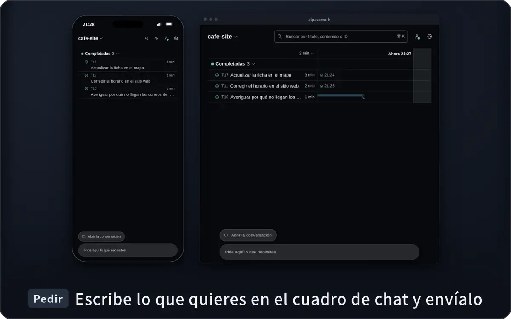

<p align="center">
  <a href="README.md">English</a> · <a href="README.ja.md">日本語</a> · <a href="README.zh-CN.md">简体中文</a> · <b>Español</b> · <a href="README.pt-BR.md">Português (Brasil)</a>
</p>

<h1 align="center">
  <picture>
    <source media="(prefers-color-scheme: dark)" srcset="docs/images/wordmark-dark.png">
    
  </picture>
</h1>

<h3 align="center">Controla todos tus agentes de IA desde un solo chat.</h3>

<p align="center">
  Escribe lo que quieres. Los agentes de IA de tu PC, como Claude Code y Codex, lo dividen en tareas y las ejecutan a la vez.<br/>
  Tú respondes las preguntas de la IA y revisas los resultados. También desde tu teléfono.
</p>

<p align="center">
  <a href="#instalar"><b>Instalar</b></a> ·
  <a href="docs/es/getting-started.md">Primeros pasos</a> ·
  <a href="docs/es/concept.md">Cómo funciona</a>
</p>

<p align="center">
  <a href="https://www.npmjs.com/package/alpacawork"></a>
  <a href="LICENSE"></a>
</p>

<p align="center">
  <picture>
    <source media="(prefers-color-scheme: dark)" srcset="docs/images/hero-dark-es.gif">
    
  </picture>
</p>

## Qué es alpacawork

alpacawork es una herramienta de orquestación de IA: te permite dirigir desde un solo chat los agentes de programación con IA que ya tienes en tu PC, como Claude Code y Codex.

- **Un solo chat como punto de contacto** — Las solicitudes nuevas, y lo que quieras añadir o cambiar en el trabajo en curso, se escriben en el mismo cuadro de chat. El coordinador, la IA que es tu punto de contacto, convierte cada solicitud en una tarea y se la encarga a otra IA.
- **Tu Claude Code y tu Codex, tal como están** — Empiezas enseguida con las cuentas con las que ya iniciaste sesión, en la carpeta de un repositorio que ya tienes. No necesitas una cuenta ni una clave de API para alpacawork, y `AGENTS.md`, `CLAUDE.md`, las skills, MCP y los hooks se usan tal cual. También puedes usar GitHub Copilot, Grok Build y pi, y los modelos locales funcionan a través de pi ([Las IA que usas](docs/es/projects.md#las-ia-que-usas)).
- **Tareas, no conversaciones** — La pantalla muestra las tareas que pediste. Los resultados y las preguntas para ti se agrupan por tarea ([Cómo funciona](docs/es/concept.md#el-trabajo-avanza-por-tareas-no-por-conversaciones)).
- **El proceso, con tus palabras** — Pide algo como “Haz tres propuestas, cada una con un modelo distinto. Combínalas en una y haz que otra IA la revise”, y las IA lo llevan a cabo pasándose el trabajo entre sí. También puedes hacer que otra IA trabaje en paralelo en una tarea en curso.
- **Cambia de IA y sigue donde se quedó el trabajo** — Cuando una IA se detiene por un error o un límite de uso, o incluso a mitad del trabajo, puedes cambiar a otra IA, por ejemplo de Claude Code a Codex, y esta continúa desde donde se quedó. Si eliges IA alternativas en Configuración, una toma el relevo cuando el trabajo se detiene por un límite de uso.
- **El contexto pasa por los registros de la tarea** — Cuando una conversación se alarga, la IA la compacta o empieza una nueva. En lugar de lo hablado, la IA de la conversación nueva, o la IA que tomó el relevo, recibe los registros de la tarea, que resumen cómo va el trabajo (la solicitud, lo decidido, lo que falta), y continúa desde ahí.
- **Preguntas que respondes eligiendo una opción** — Lo que la IA no puede decidir te llega como una pregunta con opciones y una recomendación. Las preguntas y los informes llegan con imágenes y videos.
- **Se puede usar solo con el teléfono** — Puedes pedir, responder preguntas y revisar resultados desde el teléfono. Para responder o marcar un resultado como completado, deslizas hacia la derecha.

<p align="center">
  
</p>

## Instalar

Pega el siguiente texto en Claude Code o Codex, en tu PC. La IA instala alpacawork y te indica la URL de la pantalla de configuración inicial, que normalmente también se abre en tu navegador.

```text
Descarga la siguiente guía, léela completa y síguela para instalar alpacawork en este PC.
https://raw.githubusercontent.com/alpacakit/alpacawork/main/skills/alpacawork/references/setup.md
```

Para instalarlo con comandos, ejecuta estas dos líneas en una terminal (en Windows, dentro de Ubuntu), en orden. La configuración inicial muestra lo que va a preparar y empieza cuando presionas Enter.

```sh
npm install -g alpacawork
alpacawork setup
```

Funciona en macOS (Apple silicon), Linux (x64) y Windows (WSL2). Después de instalarlo, sigue [Primeros pasos](docs/es/getting-started.md) para hacer tu primera solicitud.

### Abrir la pantalla

Para abrir la pantalla en el navegador, pídelo así en Claude Code o Codex (`$alpacawork` en Codex).

```text
/alpacawork abre la pantalla
```

En una terminal, también se abre con `alpacawork open`.

## Ten en cuenta

- **Es gratis (licencia MIT).** El uso de IA se factura según el plan que ya tienes con Claude Code, Codex u otro agente.
- **Se ejecuta en tu PC.** La IA se ejecuta en tu PC, así que mantén el PC encendido y configúralo para que no entre en suspensión mientras usas alpacawork.
- **alpacawork inicia los agentes de IA en el mismo modo sin confirmaciones que `bypassPermissions` de Claude Code y `danger-full-access` de Codex, así que no se detienen a preguntar.** Lo que la IA no debe hacer, o lo que debe consultarte antes, puedes escribirlo en la [política del proyecto](docs/es/projects.md#política-del-proyecto).
- **Las tareas, las conversaciones y los archivos de resultados se guardan en tu PC.** alpacawork no los envía a ningún servidor externo gestionado por sus desarrolladores. Tus instrucciones a la IA y lo que la IA lee se envían al proveedor de la IA, igual que cuando usas cada agente de IA directamente ([más sobre el tratamiento de los datos](docs/es/manage.md#dónde-se-guardan-los-datos-y-qué-se-envía-fuera)).

## Documentación

- [Primeros pasos](docs/es/getting-started.md): instalar, pedir una tarea y revisarla
- [Índice de la documentación](docs/es/README.md): la lista de todas las páginas: cómo usarlo, la configuración, la solución de problemas y más
- Por favor, informa de los errores en [Issues](https://github.com/alpacakit/alpacawork/issues)
- Los anuncios de nuevas versiones se publican en X: [@codemafia0000](https://x.com/codemafia0000)

## Licencia

[Licencia MIT](LICENSE)
