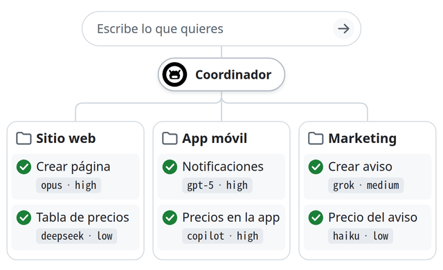
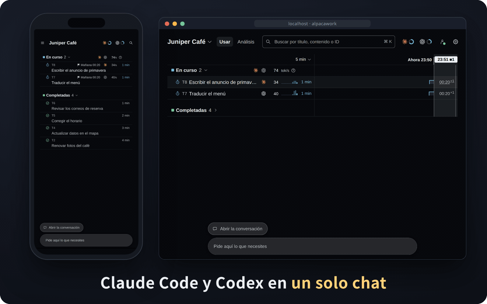

<p align="center">
  <a href="README.md">English</a> · <a href="README.ja.md">日本語</a> · <a href="README.zh-CN.md">简体中文</a> · <b>Español</b> · <a href="README.pt-BR.md">Português (Brasil)</a>
</p>

<h1 align="center">
  <picture>
    <source media="(prefers-color-scheme: dark)" srcset="docs/images/wordmark-dark.png">
    
  </picture>
</h1>

<h3 align="center">Controla todos tus agentes de IA desde un solo chat.</h3>

<p align="center">
  Escribe lo que quieres. Los agentes de IA de tu PC, como Claude Code y Codex, lo dividen en tareas y las ejecutan a la vez.<br/>
  Tú respondes las preguntas de la IA y revisas los resultados. También desde tu teléfono.
</p>

<p align="center">
  <a href="#instalar"><b>Instalar</b></a> ·
  <a href="docs/es/getting-started.md">Primeros pasos</a> ·
  <a href="docs/es/concept.md">Cómo funciona</a>
</p>

<p align="center">
  <a href="https://www.npmjs.com/package/alpacawork"></a>
  <a href="LICENSE"></a>
</p>

<p align="center">
  <picture>
    <source media="(prefers-color-scheme: dark)" srcset="docs/images/hero-dark-es.gif">
    
  </picture>
</p>

## ¿Qué es alpacawork?

alpacawork reúne a varias IA para sacar adelante el trabajo. Es una herramienta de orquestación de IA basada en tareas. Te permite coordinar Claude Code y Codex, con las cuentas que ya usas, desde un único cuadro de chat.

Solo tienes que pedirle el trabajo a la IA que atiende el chat, la coordinadora. Esta comprueba cómo va y transmite las instrucciones a las IA que se encargan de hacerlo. Así puedes delegar tanto la división de tareas como las instrucciones detalladas.

<p align="center">
  
</p>

### Pide

- Usa un solo cuadro de chat para pedir trabajo y cambios en [varios proyectos](docs/es/projects.md#añadir-proyectos).
- [Indica cómo hacerlo con tus palabras](docs/es/concept.md#indica-cómo-trabajar-con-tus-palabras). Por ejemplo, «Haz tres propuestas con modelos distintos».
- Usa tu cuenta de siempre, `CLAUDE.md`, las skills y MCP. [También admite Copilot y pi](docs/es/projects.md#las-ia-que-usas).

### El trabajo avanza

- Cada [tarea](docs/es/concept.md#el-trabajo-avanza-por-tareas-no-por-conversaciones) conserva su historial y sus resultados si cambias de IA o de chat.
- Si un error o un límite de uso detiene el trabajo, [cambia de IA y continúa desde ahí](docs/es/guide.md#tareas-detenidas).
- Con más turnos, [baja la precisión](https://arxiv.org/abs/2505.06120). La IA puede compactar el chat o abrir otro.

### Revisa

- Cuando necesita una decisión, la IA te [pregunta con opciones y una recomendación](docs/es/guide.md#responder-una-pregunta).
- Las preguntas y los [informes](docs/es/guide.md#revisar-un-informe) pueden incluir capturas o videos para ayudarte a decidir.
- Pide, responde y revisa resultados desde el [móvil](docs/es/remote.md#usarlo-desde-tu-teléfono). [Desliza](docs/es/guide.md#en-el-teléfono) para responder o terminar la revisión.

## Instalar

Pega el siguiente texto en Claude Code o Codex, en tu PC. La IA instala alpacawork y te indica la URL de la pantalla de configuración inicial, que normalmente también se abre en tu navegador.

```text
Descarga la siguiente guía, léela completa y síguela para instalar alpacawork en este PC.
https://raw.githubusercontent.com/alpacakit/alpacawork/main/skills/alpacawork/references/setup.md
```

Para instalarlo con comandos, ejecuta estas dos líneas en una terminal (en Windows, dentro de Ubuntu), en orden. La configuración inicial muestra lo que va a preparar y empieza cuando presionas Enter.

```sh
npm install -g alpacawork
alpacawork setup
```

Funciona en macOS (Apple silicon), Linux (x64) y Windows (WSL2). Después de instalarlo, sigue [Primeros pasos](docs/es/getting-started.md) para hacer tu primera solicitud.

### Abrir la pantalla

Para abrir la pantalla en el navegador, pídelo así en Claude Code o Codex (`$alpacawork` en Codex).

```text
/alpacawork abre la pantalla
```

En una terminal, también se abre con `alpacawork open`.

## Ten en cuenta

- **Es gratis (licencia MIT).** El uso de IA se factura según el plan que ya tienes con Claude Code, Codex u otro agente.
- **Se ejecuta en tu PC.** Mantén el PC encendido y configúralo para que no entre en suspensión mientras usas alpacawork.
- **alpacawork inicia los agentes de IA en el mismo modo sin confirmaciones que `bypassPermissions` de Claude Code y `danger-full-access` de Codex, así que no se detienen a preguntar.** Lo que la IA no debe hacer, o lo que debe consultarte antes, puedes escribirlo en la [política del proyecto](docs/es/projects.md#política-del-proyecto).
- **Las tareas, las conversaciones y los archivos de resultados se guardan en tu PC.** alpacawork no los envía a ningún servidor externo gestionado por sus desarrolladores. Tus instrucciones a la IA y lo que la IA lee se envían al proveedor de la IA, igual que cuando usas cada agente de IA directamente ([más sobre el tratamiento de los datos](docs/es/manage.md#dónde-se-guardan-los-datos-y-qué-se-envía-fuera)).

## Documentación

- [Primeros pasos](docs/es/getting-started.md): instalar, pedir una tarea y revisarla
- [Índice de la documentación](docs/es/README.md): la lista de todas las páginas: cómo usarlo, la configuración, la solución de problemas y más
- Por favor, informa de los errores en [Issues](https://github.com/alpacakit/alpacawork/issues)
- Los anuncios de nuevas versiones se publican en X: [@codemafia0000](https://x.com/codemafia0000)

## Licencia

[Licencia MIT](LICENSE)
