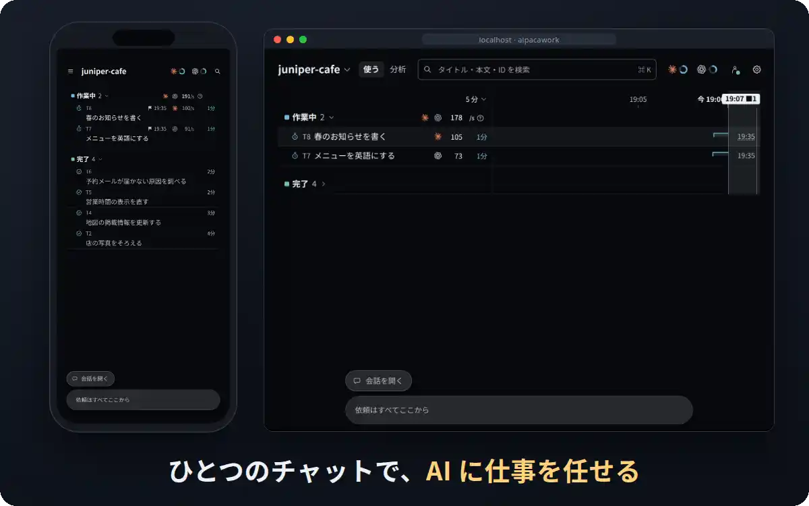

<p align="center">
  <a href="README.md">English</a> · <b>日本語</b> · <a href="README.zh-CN.md">简体中文</a> · <a href="README.es.md">Español</a> · <a href="README.pt-BR.md">Português (Brasil)</a>
</p>

<h1 align="center">
  <picture>
    <source media="(prefers-color-scheme: dark)" srcset="docs/images/wordmark-dark.png">
    
  </picture>
</h1>

<h3 align="center">ひとつのチャットで、すべての AI エージェントを操作しよう。</h3>

<p align="center">
  頼みごとを書くと、PC の Claude Code や Codex などの AI エージェントが仕事を分けて同時に進めます。<br/>
  あなたは AI からの質問に答えて、できあがりを確かめます。スマートフォンからも使えます。
</p>

<p align="center">
  <a href="#インストール"><b>インストール</b></a> ·
  <a href="docs/ja/getting-started.md">はじめかた</a> ·
  <a href="docs/ja/concept.md">考え方</a>
</p>

<p align="center">
  <a href="https://www.npmjs.com/package/alpacawork"></a>
  <a href="LICENSE"></a>
</p>

<p align="center">
  <picture>
    <source media="(prefers-color-scheme: dark)" srcset="docs/images/hero-dark-ja.gif">
    
  </picture>
</p>

## alpacawork とは

alpacawork は、あなたの PC に入っている Claude Code や Codex などの AI エージェントを、1つのチャットからまとめて動かす AI オーケストレーションツールです。

- **窓口は1つのチャット** — 頼みごとも、作業中の AI への追加や変更も、1つの入力欄に書くだけです。窓口の AI（コーディネーター）が依頼をタスクにして、担当の AI に任せます。
- **いまの Claude Code や Codex のまま** — いまのログインで、すでにあるリポジトリのフォルダからすぐ始められます。alpacawork 用のアカウントや API キーは要りません。`AGENTS.md`、`CLAUDE.md`、スキル、MCP、Hooks も、そのまま使われます。
- **会話ではなくタスク** — 画面に並ぶのは、頼んだ仕事のタスクです。結果もあなたへの質問もタスクごとにまとまり、会話を新しくしても AI を替えても、経緯はタスクに残ります（[考え方](docs/ja/concept.md#仕事は会話ではなくタスクを単位に進む)）。
- **進め方は言葉で** — 「案を3つ、別々のモデルで作って。1つにまとめたら、別の AI にレビューさせて」のように頼むと、AI 同士でやり取りしながら進めます。
- **利用上限での引き継ぎ** — 設定で予備の AI を選んでおくと、AI が利用上限や混雑で止まったとき、予備の AI が続きを引き継ぎます。Claude Code から Codex へも引き継げます。
- **文脈はタスクの記録で引き継ぐ** — 会話が長くなると、AI が会話を圧縮するか、新しい会話で仕切り直します。新しい会話の AI も予備の AI も、前のやり取りの代わりに、いまの状況をまとめたタスクの記録（依頼、決まったこと、残りの作業）を受け取って、続きから進めます。
- **質問は選んで答える** — AI が決められないことは、選択肢とおすすめを付けた質問で届きます。質問にも報告にも、画像や動画が付きます。
- **スマートフォンだけでも使える** — 依頼から、質問への回答、できあがりの確認まで、スマートフォンでできます。回答と完了は、右へスワイプします。PC のブラウザでも同じように使えます。

<p align="center">
  
</p>

## インストール

PC の Claude Code や Codex に、次の文を貼り付けます。AI が alpacawork をインストールし、セットアップの画面の URL を伝えます。ふつうはブラウザでも開きます。

```text
次のドキュメントをダウンロードして全文を読み、その手順に従ってこの PC に alpacawork をインストールしてください。
https://raw.githubusercontent.com/alpacakit/alpacawork/main/skills/alpacawork/references/setup.md
```

コマンドで入れるときは、ターミナル（Windows では Ubuntu の中）で次の2行を順に実行します。セットアップは、設定する内容を表示し、Enter を押すと始まります。

```sh
npm install -g alpacawork
alpacawork setup
```

動作環境は macOS（Apple シリコン）、Linux（x64）、Windows（WSL2）です。入れたあとは [はじめかた](docs/ja/getting-started.md) に沿って、最初の1件を頼みます。

### 画面を開く

ブラウザで画面を開く場合、Claude Code か Codex で次のように頼みます（Codex では `$alpacawork`）。

```text
/alpacawork 画面を開いて
```

ターミナルなら `alpacawork open` でも開けます。

## 知っておくこと

- **無料です（MIT License）。** AI の利用料は、お使いの Claude Code や Codex などの契約のとおりです。
- **あなたの PC で動きます。** AI は PC で動くので、使っている間は PC を起動したまま、スリープしない設定にします。
- **AI エージェントは、Claude Code の `bypassPermissions` や Codex の `danger-full-access` と同じ、確認を求めない設定で起動します。** やってほしくないことや、確認してほしいことは、[プロジェクト方針](docs/ja/projects.md#プロジェクト方針) に書けます。
- **タスクや会話、成果のファイルは PC に保存されます。** alpacawork の開発元が、これらを外部サーバーに送信することはありません。AI への指示や AI が読んだ内容は、各 AI エージェントを直接使う場合と同じように、AI の提供元へ送られます（[詳しいデータの扱い](docs/ja/manage.md#データの置き場と外へ送られるもの)）。

## ドキュメント

- [はじめかた](docs/ja/getting-started.md) — 入れて、1件頼んで、確かめるまで
- [ドキュメントの入口](docs/ja/README.md) — 使いかた、設定、困ったときなど、全ページの一覧
- 不具合の報告は [Issues](https://github.com/alpacakit/alpacawork/issues) へお願いします
- リリースのお知らせは、X の [@codemafia0000](https://x.com/codemafia0000) で発信しています

## ライセンス

[MIT License](LICENSE)
