<p align="center">
  <a href="README.md">English</a> · <b>日本語</b>
</p>

<p align="center">
  
</p>

<h1 align="center">alpacawork</h1>

<p align="center">
  <b>もう PC の前に座って仕事をする必要はありません。</b><br/><b>alpacawork なら、スマートフォンでも PC と同等以上の効率で仕事を行うことができます。</b>
</p>

<p align="center">
  <a href="https://www.npmjs.com/package/alpacawork"></a>
  <a href="LICENSE"></a>
  
</p>

<p align="center">
  <a href="#なぜスマートフォンで仕事を進められるのか">スマートフォンで進められる理由</a> ·
  <a href="#インストール">インストール</a> ·
  <a href="#よくある質問">よくある質問</a>
</p>

<p align="center">
  <picture>
    <source media="(min-width: 768px)" srcset="docs/images/hero-wide.gif" width="820">
    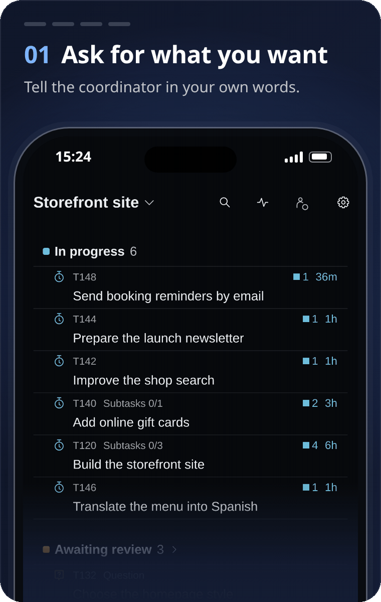
  </picture>
</p>

alpacawork は、**スマートフォンで PC と同等以上の効率で仕事ができるようにする**ための Claude Code や Codex の AI ハーネスです。あなたの PC にインストールして、スマートフォンからは VPN 経由でアクセスします（VPN 自体は別アプリでの設定が必要です）。

仕事の割り振りと進み具合の管理は、AI がすべて受け持ちます。あなたがするのは、やりたいことを頼む、質問に答える、できあがりを確かめる、の3つだけです。画面はスマートフォン操作に最適化されており、依頼から成果物のレビューまで、快適に作業を行うことができます。

> 私は Web 開発を14年ほど続けていますが、alpacawork を作ってからは PC をほとんど開かなくなりました。最近は、散歩したり、ベッドでゴロゴロしながらスマートフォンから Web の開発を行っています。実際に、このアプリ自体、スマートフォンから alpacawork で開発しています。

## なぜ、スマートフォンで仕事を進められるのか

<sub>※ 説明を飛ばして、すぐ試したい方は <a href="#インストール">インストール</a> へ進んでください。</sub>

スマートフォンから PC の AI に指示を出せるサービスは、Claude や ChatGPT をはじめ、すでにたくさんあります。ただ、どれも PC で作業することが前提で、スマートフォンでできるのは、進み具合を見たり、簡単な修正を頼んだりといった補助的な操作がほとんどです。小さな画面で作業の状況を追い、成果物をレビューするのは、想像以上にストレスでした。それが、alpacawork を作り始めたきっかけです。

### alpacawork の特徴
alpacawork は、最初からスマートフォンで仕事を進める前提で作りました。小さな画面で細かく進み具合を追わなくて済むように、タスクと AI の管理は、すべて1つの AI に任せています。この AI を、アプリでは「コーディネーター」と呼びます。

あなたの指示はすべて、窓口となるコーディネーターが受け取ります。そのため、作業ごとにチャットや AI を切り替える必要はありません。コーディネーターは、進行中のタスクと AI の作業状況を確かめたうえで、いちばん良い進め方を考え、別の AI に仕事を割り振ります。

<p align="center">
  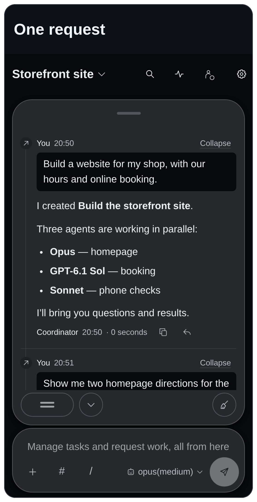
  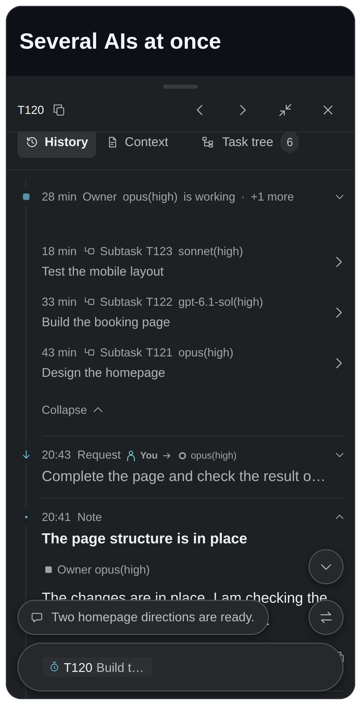
  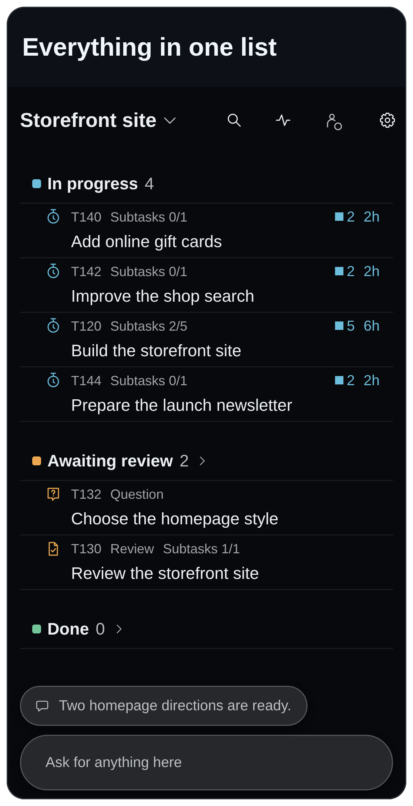
</p>

### alpacawork の使い方
タスクや AI の管理はコーディネーターが受け持つので、あなたがすることは、次の3つだけです。

- コーディネーターに、やりたいことを頼む
- AI からの質問に答える
- できあがりを確かめる

どのチャットで何を頼んだかを思い出す。終わったかどうかを、何度も見に行く。作業に合わせてモデルを切り替える。「これが終わったら、次はあれ」と順番を覚えておく。そうした手間は、もう要りません。

<p align="center">
  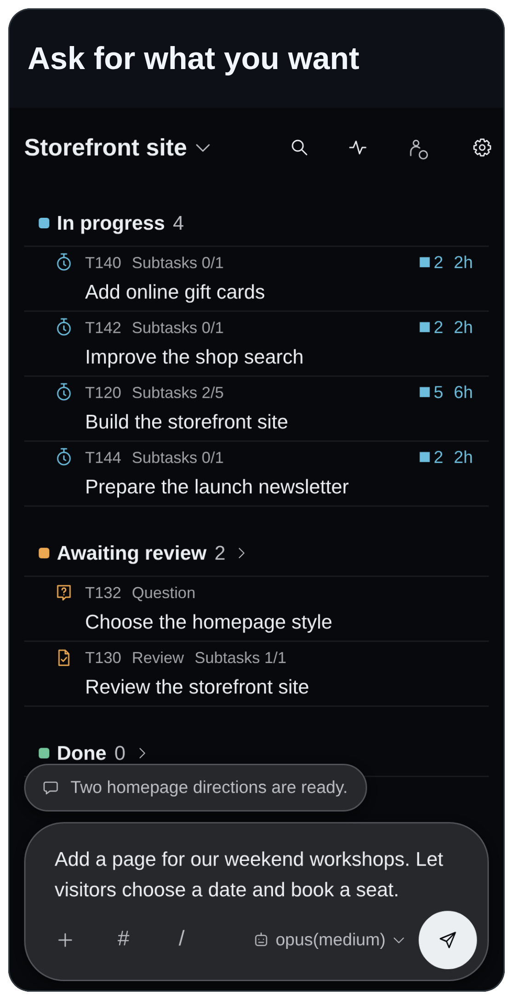
  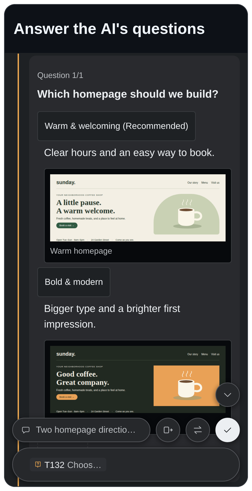
  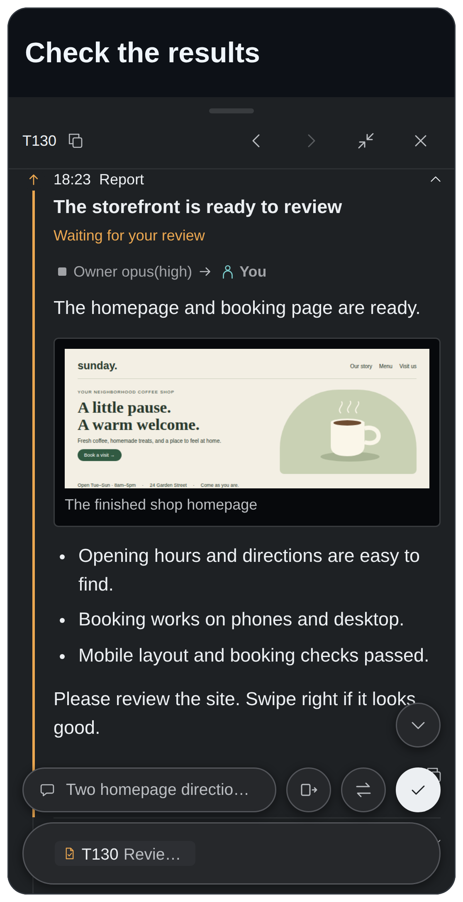
</p>

**進め方も、コーディネーターに伝えるだけ**

AI にどう仕事を進めてもらうかは、あなたの指示で決められます。たとえば、次のように頼めます。

- **「この作業は、このモデルで」** その作業が出てきたときに、AI が指示どおりのモデル（やエフォート）で進めます。
- **「早く仕上げて」** コーディネーターが作業を小さく分け、何体もの AI で並行して進めます。
- **「案を3つ、別々のモデルで作って。できたら比べて、いちばん良い案にまとめて」** モデルごとに案を作り、互いに評価したうえで、1つに仕上げます。

この他にも、たいていの進め方は、思ったとおりに頼めます。いろいろ試してみてください。

<p align="center">
  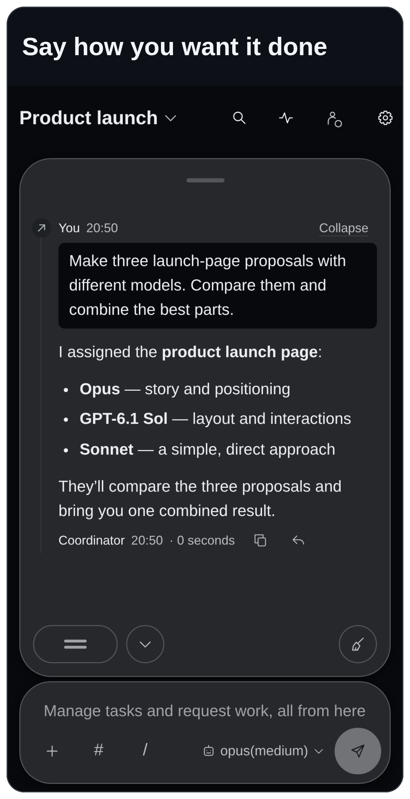
  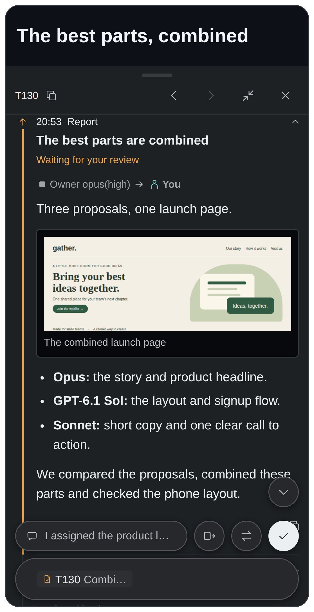
</p>

#### 質問に答えて、できあがりを確かめる

スマートフォンの小さな画面でも判断しやすいように、alpacawork の AI は、画像や動画を添えて質問や報告を送ってきます。

AI からの質問には、案とおすすめが付いています。案を選んで右へスワイプすれば答えられます。できあがりは報告を読み、よければ右へスワイプして完了に、直してほしければ一言書いて返します。

<p align="center">
  <picture>
    <source media="(min-width: 768px)" srcset="docs/images/question-swipe-wide-dark.gif" width="820">
    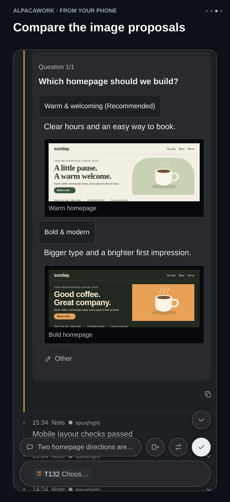
  </picture>
</p>

しくみを詳しく知りたいときは、[alpacawork の考え方](docs/ja/concept.md) を読んでください。

### 使い慣れた AI エージェントを、そのまま使える

alpacawork 自体は AI エージェントではありません。あなたの PC に入っている Claude Code や Codex などの AI エージェントを、そのまま動かします。

`AGENTS.md` や `CLAUDE.md`、スキル、MCP、Hooks といった、いつもの設定がそのまま使われます。alpacawork のために環境を作り直したりメンテナンスする必要はありません。あなたの AI の作業環境がそのまま alpacawork で動く AI の環境になります。alpacawork 用のアカウントや API キーも要りません。

[Claude Code や Codex のチャットからスキル経由で使う](docs/ja/getting-started.md#6-いつもの-claude-codecodex-から使う) こともできます。Claude Code や Codex の他に、Antigravity や Grok なども使えます。詳細は [はじめかた](docs/ja/getting-started.md#使える-ai-エージェント) を読んでください。

### PC でも使える

PC のブラウザでも同じ画面を開けます。広い画面では、タスクの一覧と開いたタスクが横に並びます。

<p align="center">
  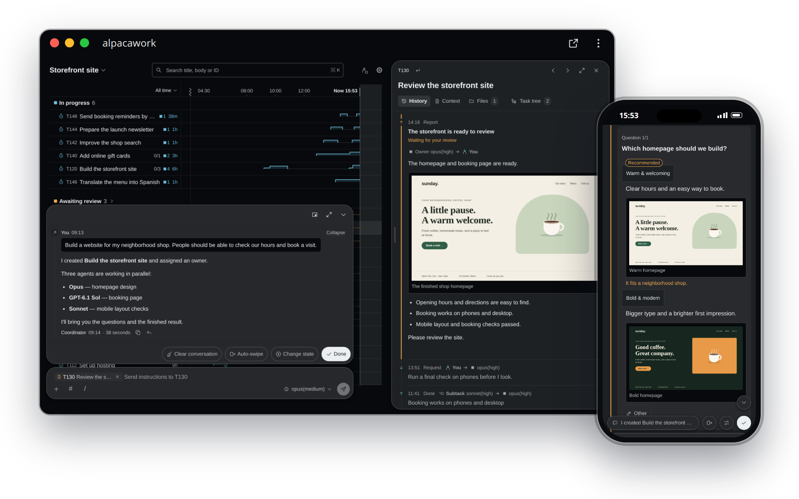
</p>

## インストール

### 動作環境
- macOS（Apple シリコン）、Linux（x64）、Windows（WSL2 の中）
- Node.js（24.16.0 以降）
- Chrome・Edge 111、Safari 16.4、Firefox 128 以降（iPhone・iPad は iOS／iPadOS 16.4 以降）
- ターミナルでログイン済みの AI エージェント（[Claude Code](https://code.claude.com/docs/en/overview) や [Codex CLI](https://developers.openai.com/codex/cli/) など）
- Tailscale などの VPN アプリ（スマートフォンなどで外から使う場合）

### 動作のしくみとデータの保存先
- **あなたの PC で動きます。** alpacawork は、PC にインストールされた Claude Code や Codex CLI などの AI エージェントを呼び出して、仕事を進めます。
- **スマートフォンからは VPN でつなぎます。** スマートフォンから、あなたの PC で動いている alpacawork に接続して操作します。
- **タスクや会話、成果のファイルは PC に保存されます。** alpacawork の開発元が、これらを外部サーバーに送信することはありません。

※ AI への指示や AI が読んだ内容は、各 AI エージェントを直接使う場合と同じように、AI の提供元へ送られます（[詳しいデータの扱い](docs/ja/getting-started.md#保存されるもの外へ送られるもの)）。

### AI を使ってインストールする
PC の Claude Code や Codex などの AI エージェントに、次の文を貼り付けます。AI が alpacawork をインストールし、セットアップの画面がブラウザで開きます。
```text
次のドキュメントをダウンロードして全文を読み、その手順に従ってこの PC に alpacawork をインストールしてください。
https://unpkg.com/alpacawork/skills/alpacawork/references/setup.md
```
詳しくは [はじめかた](docs/ja/getting-started.md) を読んでください。

### コマンドでインストールする

ターミナルで、次の2行を順に実行します。
```sh
npm install -g alpacawork
alpacawork setup
```

スマートフォンから使うときは、インストールのあとで [スマートフォンで使う](docs/ja/getting-started.md#5-スマートフォンで使う) に進んでください。

## よくある質問

<details>
<summary><b>お金はかかりますか？</b></summary>

alpacawork は無料です（MIT License）。AI の利用料は、お使いの Claude Code や Codex などの契約のとおりです。AI を同時に動かした分だけ利用枠を使います。同時に動かす数は設定で決められます。

</details>

<details>
<summary><b>PC はつけたままにしておく必要がありますか？</b></summary>

はい。AI はあなたの PC で動くので、使っている間は起動したまま、スリープしない設定にします。いつも電源を入れてある別の PC に入れて、手元の PC やスマートフォンから使うこともできます。手元の Claude Code や Codex の会話からつなぐ手順は、[セットアップの手順書](skills/alpacawork/references/setup.md#connect) にあります（英語です）。

</details>

<details>
<summary><b>データはどこに置かれますか？</b></summary>

タスクも、やり取りも、成果のファイルも、あなたの PC に置かれます。開発元が預かるクラウドはありません。外へ出る通信は、[はじめかた](docs/ja/getting-started.md#保存されるもの外へ送られるもの) にまとめてあります。

</details>

うまく動かないときは、はじめかたの [困ったとき](docs/ja/getting-started.md#困ったとき) を読んでください。不具合の報告は [Issues](https://github.com/alpacakit/alpacawork/issues) へお願いします。

## ライセンス

[MIT License](LICENSE)
