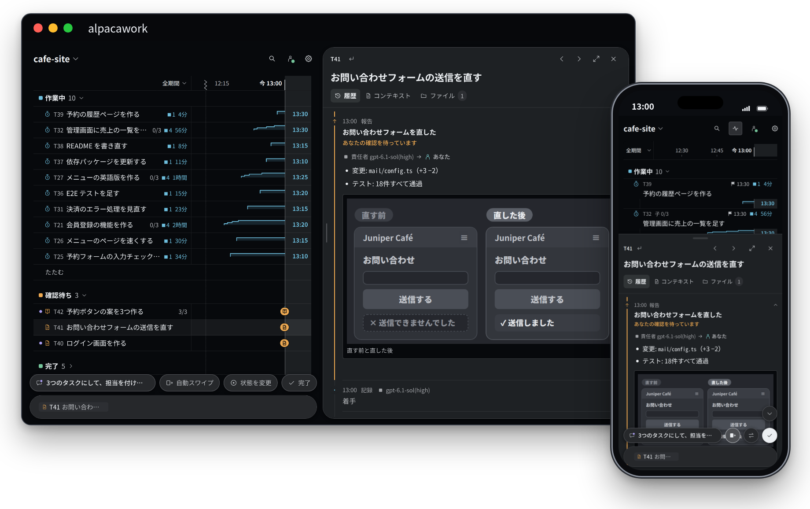

<p align="center">
  <a href="README.md">English</a> · <b>日本語</b> · <a href="README.zh-CN.md">简体中文</a> · <a href="README.es.md">Español</a> · <a href="README.pt-BR.md">Português (Brasil)</a>
</p>

<h1 align="center">
  <picture>
    <source media="(prefers-color-scheme: dark)" srcset="docs/images/wordmark-dark.png">
    
  </picture>
</h1>

<h3 align="center">ひとつのチャットで、すべての AI エージェントを操作しよう。</h3>

<p align="center">
  頼みごとを書くと、PC の Claude Code や Codex が仕事を分けて同時に進めます。<br/>
  あなたは AI からの質問に答えて、できあがりを確かめます。スマートフォンからも使えます。
</p>

<p align="center">
  <a href="#インストール"><b>インストール</b></a> ·
  <a href="docs/ja/getting-started.md">はじめかた</a> ·
  <a href="docs/ja/concept.md">考え方</a>
</p>

<p align="center">
  <a href="https://www.npmjs.com/package/alpacawork"></a>
  <a href="LICENSE"></a>
</p>

<p align="center">
  <picture>
    <source media="(prefers-color-scheme: dark)" srcset="docs/images/hero-dark-ja.gif">
    
  </picture>
</p>

alpacawork は、あなたの PC に入っている Claude Code や Codex に仕事を割り振って動かす道具（AI ハーネス）です。やりたいことを1つの入力欄に書くと、窓口の AI（コーディネーター）がタスクにして担当の AI に割り振り、進み具合を管理します。あなたがするのは、頼む、質問に答える、できあがりを確かめる、の3つです。スマートフォンからも同じように使えます。

<p align="center">
  
</p>

## インストール

PC の Claude Code や Codex に、次の文を貼り付けます。AI が alpacawork をインストールし、セットアップの画面の URL を伝えます。ふつうはブラウザでも開きます。

```text
次のドキュメントをダウンロードして全文を読み、その手順に従ってこの PC に alpacawork をインストールしてください。
https://raw.githubusercontent.com/alpacakit/alpacawork/main/skills/alpacawork/references/setup.md
```

コマンドで入れるときは、ターミナル（Windows では Ubuntu の中）で次の2行を順に実行します。セットアップは、設定する内容を表示し、Enter を押すと始まります。終わると、画面の URL を `開く:` の行（ターミナルが英語のときは `Open:`）に出し、ふつうはブラウザでも開きます。

```sh
npm install -g alpacawork
alpacawork setup
```

動作環境は macOS（Apple シリコン）、Linux（x64）、Windows（WSL2）です。入れたあとは [はじめかた](docs/ja/getting-started.md) に沿って、最初の1件を頼みます。

### よく使う操作

タスクは画面の入力欄で頼みます。画面を開く、設定を変えるといった操作は、ターミナルやアプリで開いた Claude Code か Codex に頼むと AI が行います（Codex では `/alpacawork` を `$alpacawork` に変えます）。ターミナルでは表のコマンドでも同じことができます。

| すること | AI に頼む文 | コマンド |
| --- | --- | --- |
| 画面を開く | `/alpacawork 画面開いて` | `alpacawork open` |
| 動いているか見る | `/alpacawork 動いているか見て` | `alpacawork status` |
| 設定を変える | `/alpacawork 同時に動かす AI を4つまでにして` | — |
| ふだん使うモデルを変える | `/alpacawork タスクをふだん opus で進めるようにして` | — |
| 新しいモデルを使えるようにする | `/alpacawork Codex の新しいモデルが出たので、選べるようにモデルの設定に足して` | — |
| プロジェクト方針を変える | `/alpacawork プロジェクト方針に「デザインの作成は opus で」と書き足して` | — |
| 最新の版に更新する | `/alpacawork 最新の版に更新して` | `alpacawork deploy npm:alpacawork` |
| 止める・起動する・再起動する | `/alpacawork 再起動して` | `alpacawork stop`・`start`・`restart` |
| アンインストールする | `/alpacawork アンインストールして` | `alpacawork uninstall` のあと `npm uninstall -g alpacawork` |

設定とモデルは画面の入力欄や設定でも変えられ、更新も画面の設定からできます。ほかのコマンドと使い方は `alpacawork -h` で確かめられます（詳しくは [開き直す・止める・更新する](docs/ja/manage.md)）。

タスクを頼む・探す・質問に答えるといった操作も、Claude Code・Codex の会話からできます。頼み方は [Claude Code・Codex から使う](docs/ja/chat.md) にあります。

Chrome か Edge なら、画面でのセットアップの終わりか、あとから設定の「アプリ・スマホ」でアプリとして入れられ、Dock やタスクバーのアイコンから開き直せます。Mac の Safari では、メニューの「ファイル → Dock に追加」（macOS Sonoma 以降）で入れます。

## できること

- **頼みごとは、1つの入力欄に書くだけ。** コーディネーターが依頼をタスクにして、担当の AI に任せます。作業ごとに会話や AI を切り替える必要はありません。
- **複数の AI を、AI が横断して管理する。** 作業中の AI への追加や変更も、コーディネーターに伝えるだけです。「作業中の3つとも、スマホ表示も確認して」と書けば、コーディネーターが、3つを進めている AI それぞれに指示します。
- **進め方を言葉で伝えると、AI 同士が連携して進める。** 「案を3つ、別々のモデルで作って。1つにまとめたら、別の AI にレビューさせて、直してから報告して」のような込み入った進め方も、そのとおりに AI が管理し、AI 同士でやり取りしながらこなします。
- **AI からの質問には、案とおすすめが付く。** 質問も報告も、画像や動画を添えて届きます。案を選べば答えられます。
- **スマートフォンに最適化した画面。** 質問への回答も、できあがりの完了も、右へのスワイプで済みます。依頼から完了まで、スマートフォンだけで終えられます。PC のブラウザでも同じように使えます。
- **いつもの環境のまま動く。** `AGENTS.md` や `CLAUDE.md`、スキル、MCP、Hooks が、そのまま使われます。alpacawork 用のアカウントや API キーは要りません。すでにあるリポジトリのフォルダを作業フォルダにすれば、そのまま始められます。

## 知っておくこと

- **無料です（MIT License）。** AI の利用料は、お使いの Claude Code や Codex などの契約のとおりです。
- **あなたの PC で動きます。** AI は PC で動くので、使っている間は PC を起動したまま、スリープしない設定にします。
- **AI エージェントは、Claude Code の `bypassPermissions` や Codex の `danger-full-access` と同じ、確認を求めない設定で起動します。** やってほしくないことや、確認してほしいことは、[プロジェクト方針](docs/ja/projects.md#プロジェクト方針) に書けます。
- **タスクや会話、成果のファイルは PC に保存されます。** alpacawork の開発元が、これらを外部サーバーに送信することはありません。AI への指示や AI が読んだ内容は、各 AI エージェントを直接使う場合と同じように、AI の提供元へ送られます（[詳しいデータの扱い](docs/ja/manage.md#データの置き場と外へ送られるもの)）。

## ドキュメント

- [はじめかた](docs/ja/getting-started.md) — 入れて、1件頼んで、確かめるまで
- [ドキュメントの入口](docs/ja/README.md) — 使いかた、設定、困ったときなど、全ページの一覧
- 不具合の報告は [Issues](https://github.com/alpacakit/alpacawork/issues) へお願いします

## ライセンス

[MIT License](LICENSE)
