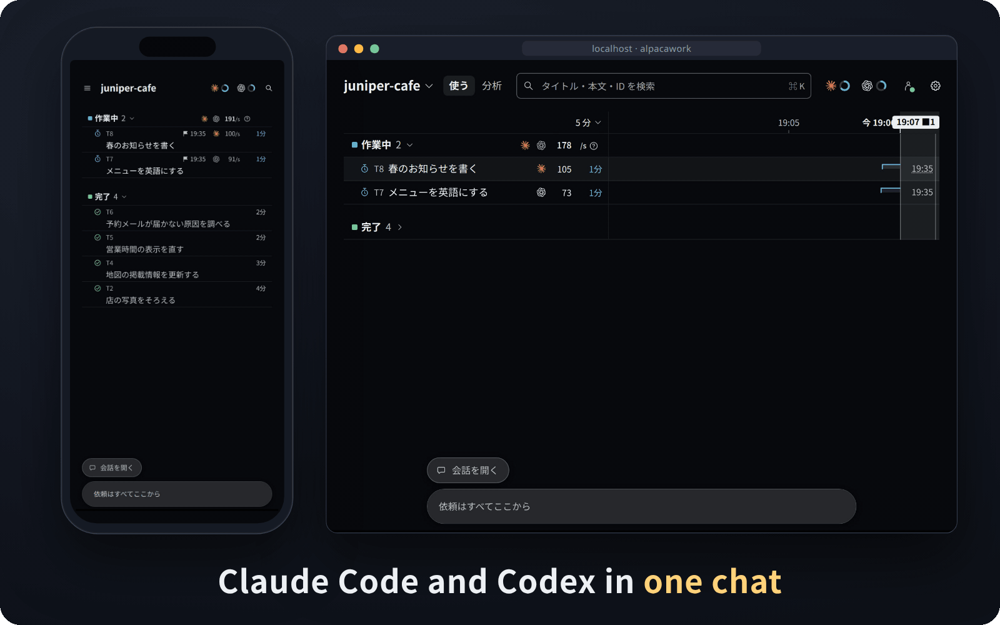

<!--
Use repository-root paths for local files (docs/images/logo.png, LICENSE) so they open on every
branch. Link to the guides in this README with absolute GitHub URLs so the npm copy opens the
rendered guides and their section links. Put pictures in docs/images/. The package omits GIFs
and WebPs from that directory. Write links and pictures as inline Markdown links or as double-quoted src,
srcset or href attributes. Image descriptors in srcset are preserved.
Other forms of relative path are not rewritten for npm.
npm resolves no relative path, so the release rewrites each one in the packaged copy
(apps/backend/src/release/npm-readme.ts): a file the package carries opens from
https://unpkg.com/alpacawork@<version>/<path>. Pictures outside the package are served from
https://raw.githubusercontent.com/alpacakit/alpacawork/<release-commit>/<path>.
Other links outside the package open https://github.com/alpacakit/alpacawork/blob/main/<path>.
The setup guide an AI downloads uses a GitHub raw URL so the AI can read the Markdown directly.
GitHub plays a video only from the URL it gives when the file is uploaded on github.com, written on
a line of its own; it drops a <video> tag that points anywhere else. The packaged copy turns that
line into an explicit link to the video. To add a video, attach the file to a pull request comment
(gh pr comment --attach) and write the URL GitHub gives it.
The name at the top is a picture (wordmark.png, wordmark-dark.png for dark pages) so that it shows
larger than a heading can; its alt text carries the name.
The demo in the introduction uses synthetic data in the real app. It is an animated GIF with
transparent rounded corners (demo-dark.gif). The translated READMEs use demo-dark-<lang>.gif
with localized captions, diagrams, and closing cards.
The diagram at the top is drawn in each README's language (hero.gif, hero-dark.gif for this file;
hero-<lang>.gif, hero-dark-<lang>.gif for the others) and switches with the page theme in a <picture>;
its first and last frames are the finished picture.
README.ja.md, README.zh-CN.md, README.es.md and README.pt-BR.md are translations: keep all five with
the same sections and content, and change them in the same commit. Each links to the guides in its
own language (this file to docs/, the others to docs/ja/, docs/zh-CN/, docs/es/, docs/pt-BR/).
Each guide links back to the install heading of the README in its language (docs/getting-started.md
to README.md#install): keep those headings, or change the links with them.
-->

<p align="center">
  <b>English</b> · <a href="README.ja.md">日本語</a> · <a href="README.zh-CN.md">简体中文</a> · <a href="README.es.md">Español</a> · <a href="README.pt-BR.md">Português (Brasil)</a>
</p>

<h1 align="center">
  <picture>
    <source media="(prefers-color-scheme: dark)" srcset="docs/images/wordmark-dark.png">
    
  </picture>
</h1>

<h3 align="center">Run all your AI agents from one chat.</h3>

<p align="center">
  Write a request. AI agents on your machine, such as Claude Code and Codex, split it into tasks and run them in parallel.<br/>
  You answer their questions and check the results. It works from your phone too.
</p>

<p align="center">
  <a href="#install"><b>Install</b></a> ·
  <a href="https://github.com/alpacakit/alpacawork/blob/main/docs/getting-started.md">Getting started</a> ·
  <a href="https://github.com/alpacakit/alpacawork/blob/main/docs/concept.md">How it works</a>
</p>

<p align="center">
  <a href="https://www.npmjs.com/package/alpacawork"></a>
  <a href="LICENSE"></a>
</p>

<p align="center">
  <picture>
    <source media="(prefers-color-scheme: dark)" srcset="docs/images/hero-dark.gif">
    
  </picture>
</p>

## What is alpacawork?

alpacawork brings AIs together to get work done. It's a task-based AI orchestration tool that lets you direct the Claude Code and Codex you already use from one chat box.

Ask the AI in that chat, called the coordinator. It checks how the work is going and passes instructions to the AIs doing it. You can leave the work of splitting up tasks and writing detailed instructions to the coordinator.

<p align="center">
  
</p>

### Ask

- Use one chat box for requests and changes, even across [multiple projects](https://github.com/alpacakit/alpacawork/blob/main/docs/projects.md#add-projects).
- [Say how the work should run](https://github.com/alpacakit/alpacawork/blob/main/docs/concept.md#say-how-to-work-in-words), for example, “Make three proposals with different models.”
- Use your existing login, `CLAUDE.md`, skills, and MCP. [Copilot and pi work too](https://github.com/alpacakit/alpacawork/blob/main/docs/projects.md#ais-to-use).

### Progress

- Work moves by [task](https://github.com/alpacakit/alpacawork/blob/main/docs/concept.md#work-moves-by-task-not-by-conversation). Its history and results stay when you switch AIs or chats.
- If an error or usage limit stops work, [switch AIs and pick up where it left off](https://github.com/alpacakit/alpacawork/blob/main/docs/guide.md#tasks-that-stopped).
- As a chat goes on, [accuracy drops](https://arxiv.org/abs/2505.06120). The AI decides whether to compact it or start a fresh chat.

### Review

- When the AI needs your decision, it [asks with options and a recommendation](https://github.com/alpacakit/alpacawork/blob/main/docs/guide.md#answer-a-question).
- Questions and [reports](https://github.com/alpacakit/alpacawork/blob/main/docs/guide.md#check-a-report) can include screenshots or recordings to help you decide.
- Ask, answer questions, and check results from your [phone](https://github.com/alpacakit/alpacawork/blob/main/docs/remote.md#use-it-from-your-phone). [Swipe](https://github.com/alpacakit/alpacawork/blob/main/docs/guide.md#on-a-phone) to answer or finish reviewing.

## Install

Paste the following text into Claude Code or Codex on your PC. The AI installs alpacawork and tells you the URL of the setup screen, which usually opens in your browser too.

```text
Download the guide below, read all of it, and follow it to install alpacawork on this PC.
https://raw.githubusercontent.com/alpacakit/alpacawork/main/skills/alpacawork/references/setup.md
```

To install with commands, run these two lines in a terminal (on Windows, inside Ubuntu), in order. Setup lists what it will set up and starts when you press Enter.

```sh
npm install -g alpacawork
alpacawork setup
```

It runs on macOS (Apple silicon), Linux (x64) and Windows (WSL2). After installing, follow [Getting started](https://github.com/alpacakit/alpacawork/blob/main/docs/getting-started.md) to make your first request.

### Open the screen

To open the screen in your browser, ask Claude Code or Codex like this (`$alpacawork` in Codex).

```text
/alpacawork open the screen
```

In a terminal, `alpacawork open` also opens it.

## Good to know

- **It is free (MIT License).** AI usage is billed under your existing Claude Code, Codex or other plan.
- **It runs on your PC.** Keep the PC on and set it not to sleep while you use alpacawork.
- **It starts AI agents in the same no-approval mode as Claude Code's `bypassPermissions` and Codex's `danger-full-access`, so they don't stop to ask.** You can write what the AI should not do, or should ask you about first, in the [project policy](https://github.com/alpacakit/alpacawork/blob/main/docs/projects.md#project-policy).
- **Tasks, conversations and result files are kept on your PC.** alpacawork does not send them to any outside server run by its developers. Your instructions to the AI, and what the AI reads, are sent to the AI's provider, just as when you use each AI agent directly ([more on how data is handled](https://github.com/alpacakit/alpacawork/blob/main/docs/manage.md#where-your-data-is-and-what-is-sent-out)).

## Documentation

- [Getting started](https://github.com/alpacakit/alpacawork/blob/main/docs/getting-started.md): install, make one request, and check it
- [Documentation home](https://github.com/alpacakit/alpacawork/blob/main/docs/README.md): every page, including how to use it, settings and troubleshooting
- Please report bugs in [Issues](https://github.com/alpacakit/alpacawork/issues)
- Release announcements are posted on X at [@codemafia0000](https://x.com/codemafia0000)

## License

[MIT License](LICENSE)
