<!--
Link to files of this project by their path from the repository root (docs/images/hero.gif,
docs/getting-started.md, LICENSE), and only to files committed to git: GitHub opens them on every
branch. Put pictures in docs/images/, which the npm package carries. Write links and pictures as
inline Markdown links or as src and href attributes in double quotes.
Double-quoted srcset attributes are also rewritten, preserving each image candidate's descriptor.
Other forms are not rewritten for npm.
npm resolves no relative path, so the release rewrites each one in the packaged copy
(apps/backend/src/release/npm-readme.ts): a file the package carries opens from
https://unpkg.com/alpacawork@<version>/<path>, any other file from
https://github.com/alpacakit/alpacawork/blob/main/<path>. On npm a guide opens as unformatted Markdown
text, with no pictures, no working links and no jump to a #section.
The setup guide an AI downloads stays an absolute unpkg URL inside the install text.
Neither GitHub nor npm shows a <video> tag in a README, so motion goes in as a GIF.
The pictures show the English screen with made-up data. This file uses the dark-theme pictures
(*-dark.png, *-dark.gif, hero.gif); the guides under docs/ use the light ones.
README.ja.md is the Japanese version: keep both with the same sections and content, and change them
in the same commit.
-->

<p align="center">
  <b>English</b> · <a href="README.ja.md">日本語</a>
</p>

<p align="center">
  
</p>

<h1 align="center">alpacawork</h1>

<p align="center">
  <b>You no longer need to sit at your PC to get work done.</b><br/><b>With alpacawork, you can work from your phone just as efficiently as at your PC, if not more.</b>
</p>

<p align="center">
  <a href="https://www.npmjs.com/package/alpacawork"></a>
  <a href="LICENSE"></a>
  
</p>

<p align="center">
  <a href="#why-you-can-get-work-done-on-your-phone">Why it works on your phone</a> ·
  <a href="#install">Install</a> ·
  <a href="#faq">FAQ</a>
</p>

<p align="center">
  <picture>
    <source media="(min-width: 768px)" srcset="docs/images/hero-wide.gif" width="820">
    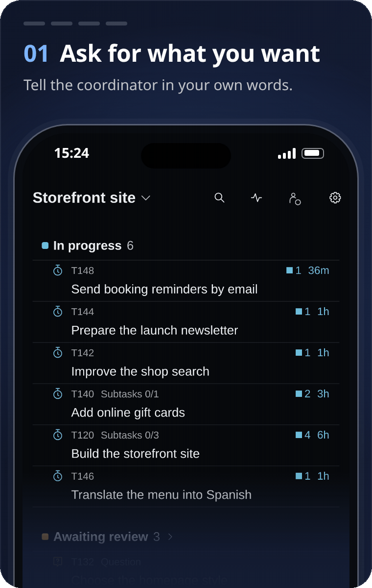
  </picture>
</p>

alpacawork is an AI harness for Claude Code, Codex and other AI agents, built so that **you can work from your phone just as efficiently as at your PC, if not more**. You install it on your PC and reach it from your phone over a VPN (you need to set up the VPN itself in a separate app).

The AI handles all of the work assignment and progress tracking. You do just three things: ask for what you want, answer questions, and check the results. The interface is optimized for phones, so everything from making a request to reviewing the results is comfortable.

> I have been working in web development for 14 years. Since building alpacawork, I rarely open my PC. These days I do web development from my phone, out on a walk or lounging in bed. In fact, I build this very app with alpacawork, from my phone.

## Why you can get work done on your phone

<sub>If you'd rather skip the explanation and try it right away, go to <a href="#install">Install</a>.</sub>

There are already many services that let you give instructions to the AI on your PC from your phone, Claude and ChatGPT among them. But they all assume you do the work at your PC. On a phone, you can mostly only do supporting tasks, such as checking progress or asking for small fixes. Following the work and reviewing results on a small screen was more stressful than I had imagined. That is why I started building alpacawork.

### What makes alpacawork different

I built alpacawork from the start for getting work done on a phone. So that you don't have to follow every step on a small screen, a single AI takes care of managing all tasks and AIs. In the app, this AI is called the coordinator.

Every instruction you give goes to the coordinator, your point of contact, so you never have to switch chats or AIs from one job to the next. The coordinator checks the tasks in progress and what each AI is working on, works out the best way forward, and assigns the work to other AIs.

<p align="center">
  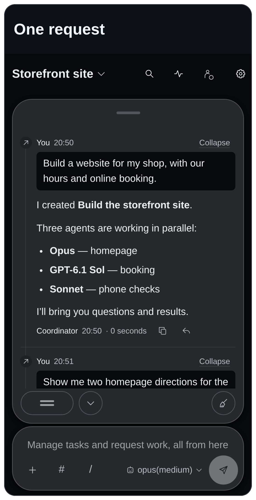
  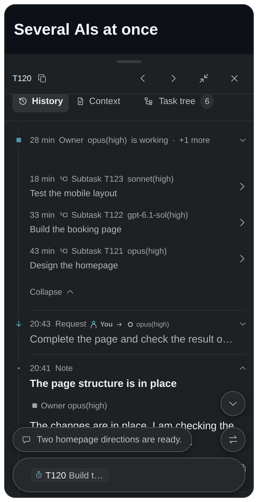
  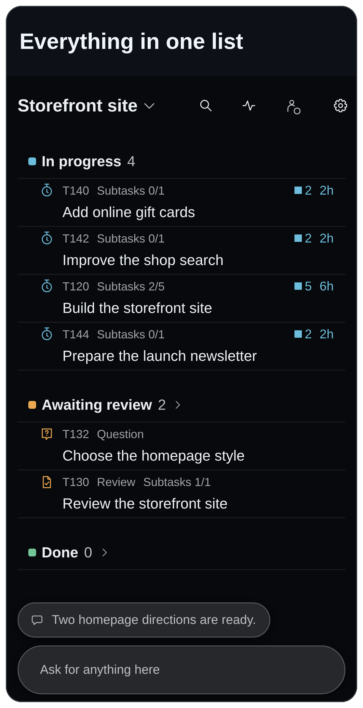
</p>

### How to use alpacawork

The coordinator takes care of managing tasks and AIs, so you only do these three things:

- Ask the coordinator for what you want
- Answer the AI's questions
- Check the results

Remembering what you asked for in which chat. Going back again and again to see whether something is done. Switching models to suit the work. Keeping in mind that "when this is done, that comes next." You don't need to do any of that anymore.

<p align="center">
  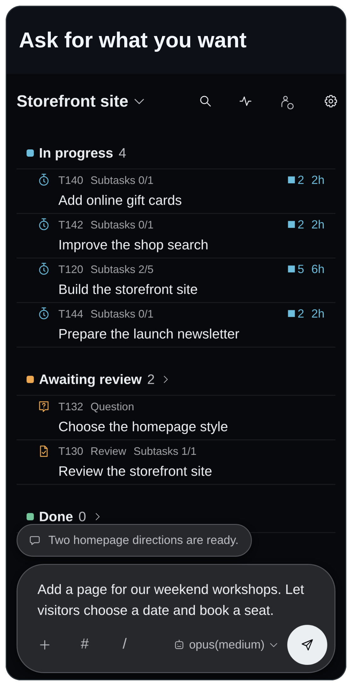
  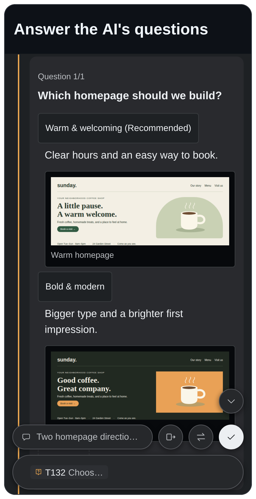
  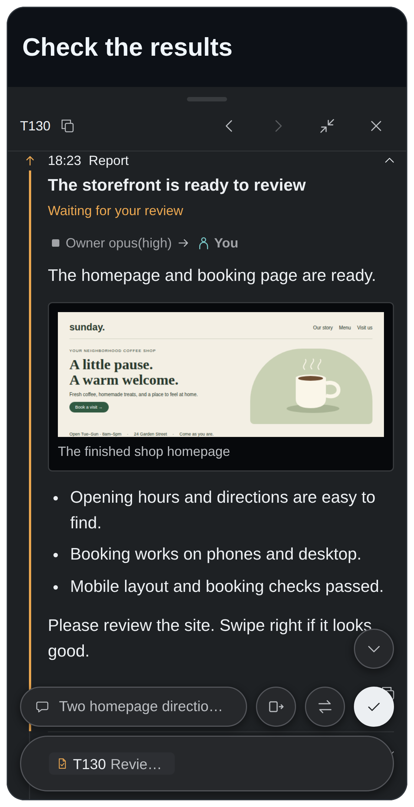
</p>

**To change how the work is done, just tell the coordinator**

You decide how the AI goes about the work by telling it. For example, you can ask:

- **"Use this model for this work."** Whenever that work comes up, the AI does it with the model (and effort) you named.
- **"Finish this quickly."** The coordinator breaks the work into small pieces and has several AIs work on them in parallel.
- **"Make three proposals, each with a different model. When they're done, compare them and combine them into the best one."** Each model makes a proposal, the models review one another's proposals, and the best parts are combined into one.

You can ask for most other ways of working just as you have in mind. Try different things and see what works.

<p align="center">
  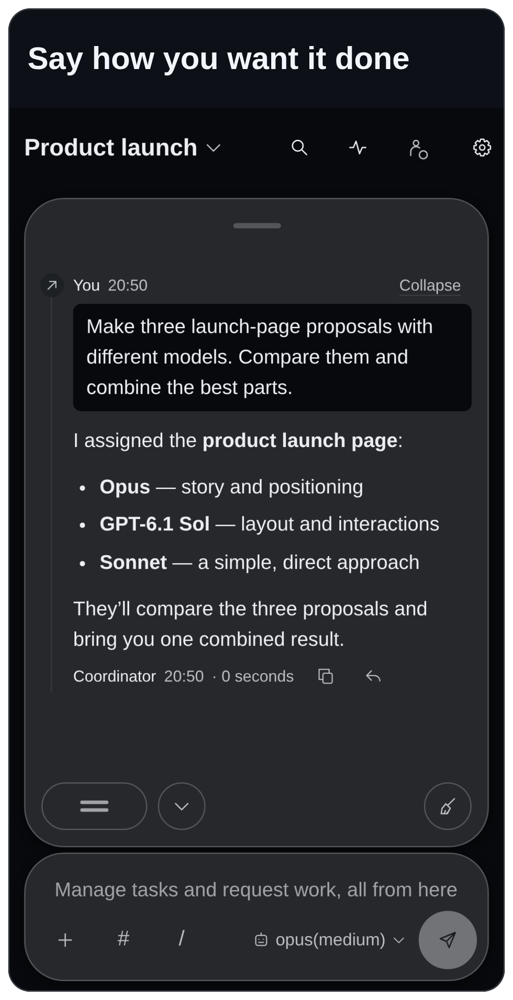
  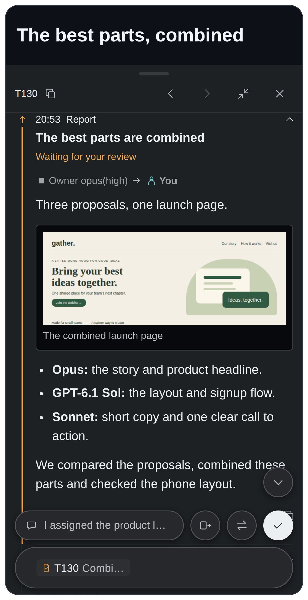
</p>

#### Answer questions and check the results

So that you can make decisions easily even on a small phone screen, the AI in alpacawork sends its questions and reports with images and videos.

Each question from the AI comes with options and a recommendation. Pick an option and swipe right to answer. When a result comes in, read the report, then swipe right to mark it done if it looks good, or write a short note and send it back if it needs changes.

<p align="center">
  <picture>
    <source media="(min-width: 768px)" srcset="docs/images/question-swipe-wide-dark.gif" width="820">
    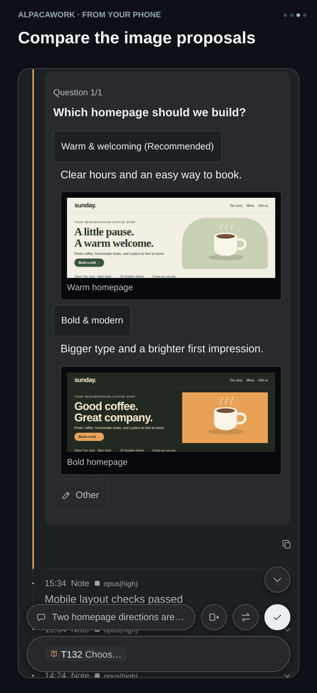
  </picture>
</p>

To learn how it works in more detail, read [The ideas behind alpacawork](docs/concept.md).

### Keep using the AI agents you already know

alpacawork itself is not an AI agent. It runs the AI agents already on your PC, such as Claude Code and Codex, as they are.

Your usual setup works unchanged: `AGENTS.md`, `CLAUDE.md`, skills, MCP and hooks. You don't need to rebuild your environment or maintain a separate one for alpacawork. The AIs in alpacawork work in your own setup. You don't need an account or an API key for alpacawork either.

You can also [use it from a Claude Code or Codex chat through a skill](docs/getting-started.md#6-use-it-from-claude-code-or-codex). Besides Claude Code and Codex, you can use Antigravity, Grok and others. For details, read [Getting started](docs/getting-started.md#supported-ai-agents).

### Use it on your PC too

The same screen also opens in a browser on your PC. On a wide screen, the task list and the open task sit side by side.

<p align="center">
  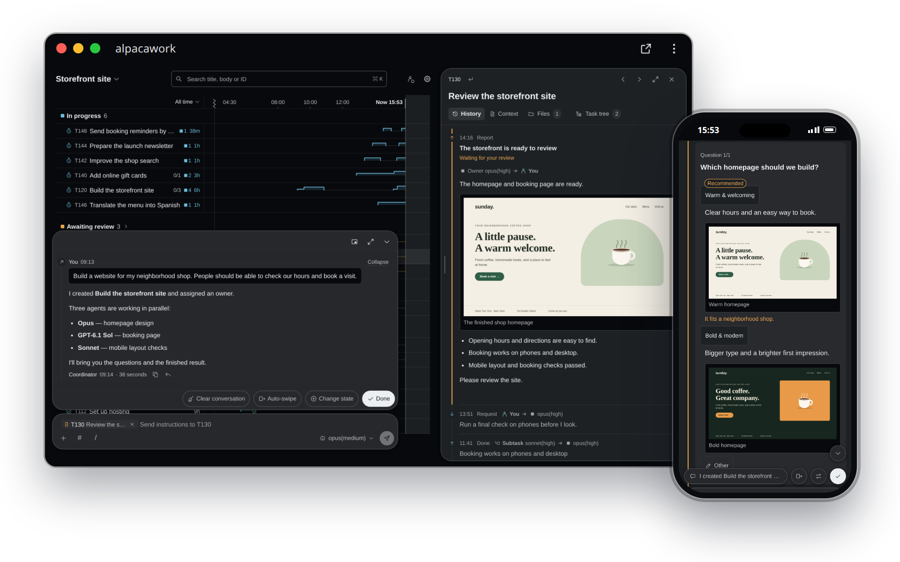
</p>

## Install

### Requirements

- macOS (Apple silicon), Linux (x64), Windows (inside WSL2)
- Node.js (24.16.0 or later)
- Chrome or Edge 111, Safari 16.4, or Firefox 128, or later (iOS/iPadOS 16.4 or later on iPhone and iPad)
- An AI agent you are signed in to in the terminal (such as [Claude Code](https://code.claude.com/docs/en/overview) or [Codex CLI](https://developers.openai.com/codex/cli/))
- A VPN app such as Tailscale (to use it from outside, such as from your phone)

### How it runs and where your data is kept

- **It runs on your PC.** alpacawork gets work done by calling the AI agents installed on your PC, such as Claude Code and Codex CLI.
- **Your phone connects over a VPN.** From your phone, you connect to the alpacawork running on your PC and operate it.
- **Tasks, conversations and result files are kept on your PC.** alpacawork does not send them to any outside server run by its developers.

Note: your instructions to the AI, and what the AI reads, are sent to the AI's provider, just as when you use each AI agent directly ([more on how data is handled](docs/getting-started.md#what-is-stored-and-what-is-sent-out)).

### Install with an AI

Paste the following text into an AI agent on your PC, such as Claude Code or Codex. The AI installs alpacawork, and the setup screen opens in your browser.

```text
Download the guide below, read all of it, and follow it to install alpacawork on this PC.
https://unpkg.com/alpacawork/skills/alpacawork/references/setup.md
```

For details, read [Getting started](docs/getting-started.md).

### Install with commands

Run these two lines in a terminal, in order.

```sh
npm install -g alpacawork
alpacawork setup
```

To use it from your phone, go on to [Use it from your phone](docs/getting-started.md#5-use-it-from-your-phone) after installing.

## FAQ

<details>
<summary><b>Does it cost anything?</b></summary>

alpacawork is free (MIT License). AI usage is billed under your existing Claude Code, Codex or other plan. The more AIs you run at once, the more of your usage limits you use. You can set how many run at once.

</details>

<details>
<summary><b>Does my PC need to stay on?</b></summary>

Yes. The AI runs on your PC, so keep it on and set it not to sleep while you use alpacawork. You can also install it on another PC that is always on, and use it from your everyday PC or from your phone. The steps for connecting from a Claude Code or Codex conversation on your everyday PC are in the [setup guide](skills/alpacawork/references/setup.md#connect).

</details>

<details>
<summary><b>Where is my data kept?</b></summary>

Your tasks, conversations and result files are all kept on your PC. No cloud service run by the developers stores them. What goes out over the network is listed in [Getting started](docs/getting-started.md#what-is-stored-and-what-is-sent-out).

</details>

If something doesn't work, read [Troubleshooting](docs/getting-started.md#troubleshooting) in Getting started. Please report bugs in [Issues](https://github.com/alpacakit/alpacawork/issues).

## License

[MIT License](LICENSE)
