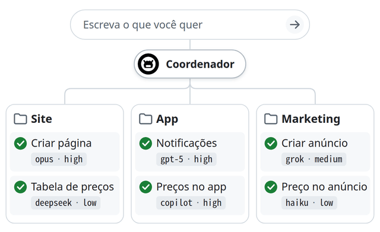

<p align="center">
  <a href="README.md">English</a> · <a href="README.ja.md">日本語</a> · <a href="README.zh-CN.md">简体中文</a> · <a href="README.es.md">Español</a> · <b>Português (Brasil)</b>
</p>

<h1 align="center">
  <picture>
    <source media="(prefers-color-scheme: dark)" srcset="docs/images/wordmark-dark.png">
    
  </picture>
</h1>

<h3 align="center">Controle todos os seus agentes de IA em um só chat.</h3>

<p align="center">
  Faça um pedido. Os agentes de IA do seu PC, como o Claude Code e o Codex, o dividem em tarefas e as rodam em paralelo.<br/>
  Você responde às perguntas da IA e revisa os resultados. Também pelo celular.
</p>

<p align="center">
  <a href="#instalar"><b>Instalar</b></a> ·
  <a href="docs/pt-BR/getting-started.md">Primeiros passos</a> ·
  <a href="docs/pt-BR/concept.md">Como funciona</a>
</p>

<p align="center">
  <a href="https://www.npmjs.com/package/alpacawork"></a>
  <a href="LICENSE"></a>
</p>

<p align="center">
  <picture>
    <source media="(prefers-color-scheme: dark)" srcset="docs/images/hero-dark-pt-BR.gif">
    
  </picture>
</p>

## O que é o alpacawork

O alpacawork é uma ferramenta de orquestração de IA: com ele, você controla a partir de um só chat os agentes de programação com IA que já tem no PC, como Claude Code e Codex.

- **Um só chat como ponto de contato** — Os pedidos novos, e o que você quiser acrescentar ou mudar em um trabalho em andamento, vão no mesmo campo de mensagem. O coordenador, a IA que é seu ponto de contato, transforma cada solicitação em uma tarefa e a delega a outra IA.
- **Seu Claude Code e seu Codex, como já estão** — Você começa na hora com os logins que já tem, na pasta de um repositório que já existe. Você não precisa de conta nem de chave de API do alpacawork. O `AGENTS.md`, o `CLAUDE.md`, as skills, o MCP e os hooks continuam funcionando como estão.
- **Tarefas, não conversas** — A tela mostra as tarefas que você pediu. Os resultados e as perguntas para você ficam reunidos por tarefa, e o histórico fica na tarefa mesmo que você comece uma conversa nova ou troque de IA ([Como funciona](docs/pt-BR/concept.md#o-trabalho-avança-por-tarefas-não-por-conversas)).
- **O processo, com suas palavras** — Peça algo como “Faça três propostas, cada uma com um modelo diferente. Junte as três em uma só e peça para outra IA revisar”, e as IAs executam isso, passando o trabalho umas para as outras.
- **Troca de IA no limite de uso** — Se você escolher IAs alternativas nas Configurações, quando uma IA para por limite de uso ou de capacidade, uma IA alternativa assume e continua o trabalho. Também dá para passar do Claude Code para o Codex.
- **O contexto passa pelos registros da tarefa** — Quando uma conversa fica longa, a IA a compacta ou começa uma nova. No lugar da conversa anterior, a IA da conversa nova, assim como uma IA alternativa, recebe os registros da tarefa, que resumem em que pé o trabalho está (o pedido, o que foi decidido, o que falta), e continua dali.
- **Perguntas que você responde escolhendo uma opção** — O que a IA não consegue decidir chega como uma pergunta com opções e uma recomendação. Perguntas e relatórios chegam com imagens e vídeos.
- **Dá para usar só pelo celular** — Você pede, responde às perguntas e revisa os resultados pelo celular. Para responder ou marcar um resultado como concluído, basta deslizar para a direita. No navegador do PC, funciona do mesmo jeito.

<p align="center">
  
</p>

## Instalar

Cole o texto abaixo no Claude Code ou no Codex do seu PC. A IA instala o alpacawork e informa a URL da tela de configuração inicial, que normalmente também abre no navegador.

```text
Baixe o guia abaixo, leia-o inteiro e siga as instruções para instalar o alpacawork neste PC.
https://raw.githubusercontent.com/alpacakit/alpacawork/main/skills/alpacawork/references/setup.md
```

Para instalar pela linha de comando, execute estas duas linhas no terminal (no Windows, dentro do Ubuntu), nesta ordem. A configuração inicial mostra o que vai preparar e começa quando você pressiona Enter.

```sh
npm install -g alpacawork
alpacawork setup
```

Os requisitos são macOS (Apple silicon), Linux (x64) ou Windows (WSL2). Depois de instalar, siga os [Primeiros passos](docs/pt-BR/getting-started.md) para fazer a sua primeira solicitação.

### Abrir a tela

Para abrir a tela no navegador, peça assim no Claude Code ou no Codex (`$alpacawork` no Codex).

```text
/alpacawork abra a tela
```

No terminal, `alpacawork open` também abre a tela.

## Vale saber

- **É gratuito (licença MIT).** O uso de IA é cobrado de acordo com o plano que você já tem do Claude Code, do Codex ou de outro agente.
- **Roda no seu PC.** A IA roda no PC, então mantenha o PC ligado e configure-o para não entrar em suspensão enquanto você usa o alpacawork.
- **O alpacawork inicia os agentes de IA no mesmo modo sem confirmações que o `bypassPermissions` do Claude Code e o `danger-full-access` do Codex, então eles não param para perguntar.** Você pode escrever na [política do projeto](docs/pt-BR/projects.md#política-do-projeto) o que a IA não deve fazer, ou o que deve perguntar a você antes.
- **Tarefas, conversas e arquivos de resultado ficam no seu PC.** O alpacawork não os envia a nenhum servidor externo mantido pelos desenvolvedores. Suas instruções para a IA e o conteúdo que ela lê são enviados ao provedor da IA, como acontece quando você usa cada agente de IA diretamente ([mais sobre o tratamento dos dados](docs/pt-BR/manage.md#onde-ficam-os-dados-e-o-que-é-enviado-para-fora)).

## Documentação

- [Primeiros passos](docs/pt-BR/getting-started.md) — instalar, fazer uma solicitação e revisar o resultado
- [Início da documentação](docs/pt-BR/README.md) — como usar, configurações, solução de problemas e a lista de todas as páginas
- Reporte bugs nas [Issues](https://github.com/alpacakit/alpacawork/issues)
- Os anúncios de novas versões são publicados no X: [@codemafia0000](https://x.com/codemafia0000)

## Licença

[Licença MIT](LICENSE)
