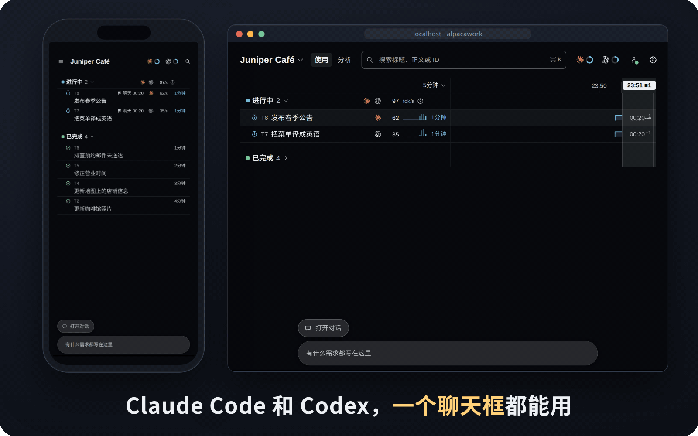

<p align="center">
  <a href="README.md">English</a> · <a href="README.ja.md">日本語</a> · <b>简体中文</b> · <a href="README.es.md">Español</a> · <a href="README.pt-BR.md">Português (Brasil)</a>
</p>

<h1 align="center">
  <picture>
    <source media="(prefers-color-scheme: dark)" srcset="docs/images/wordmark-dark.png">
    
  </picture>
</h1>

<h3 align="center">在一个聊天里，操控所有 AI 智能体。</h3>

<p align="center">
  写下想做的事，你电脑上的 Claude Code、Codex 等 AI 智能体就会拆成多个任务，同时推进。<br/>
  你来回答 AI 的提问、验收结果。在手机上也能使用。
</p>

<p align="center">
  <a href="#安装"><b>安装</b></a> ·
  <a href="docs/zh-CN/getting-started.md">入门指南</a> ·
  <a href="docs/zh-CN/concept.md">设计理念</a>
</p>

<p align="center">
  <a href="https://www.npmjs.com/package/alpacawork"></a>
  <a href="LICENSE"></a>
</p>

<p align="center">
  <picture>
    <source media="(prefers-color-scheme: dark)" srcset="docs/images/hero-dark-zh-CN.gif">
    
  </picture>
</p>

## 什么是 alpacawork？

alpacawork 是一个以任务为单位的 AI 编排工具，让多个 AI 协作完成工作。你可以用一个聊天框操作常用的 Claude Code 和 Codex。

把请求交给聊天框里的 AI 协调员即可。它会查看工作进展，把指令转达给执行任务的 AI。拆分任务和交代细节都可以由它代劳。

<p align="center">
  
</p>

### 无需切换聊天

新请求、对进行中工作的补充和变更，都可以写在同一个聊天框。协调员会把请求变成任务，并交给负责处理的 AI。它还可以跨多个[项目](docs/zh-CN/projects.md#增加项目)下达指令。

### 继续使用现有的 Claude Code 和 Codex

用现有的登录状态，在常用的代码仓库里就能开始。alpacawork 无需专用账户或 API 密钥，`AGENTS.md`、`CLAUDE.md`、技能、MCP 和 hooks 都照常生效。也支持 GitHub Copilot、Grok Build，以及通过 pi 使用本地模型（[要使用的 AI](docs/zh-CN/projects.md#要使用的-ai)）。

### 在你的电脑上运行

与 Claude Code 和 Codex 一样，alpacawork 在你的电脑上运行。任务、对话和结果文件都保存在本机，alpacawork 不会将它们发送到开发者运营的外部服务器（[数据处理](docs/zh-CN/manage.md#数据存放位置与向外发送的内容)）。

### 换个 AI 也能从断点继续

AI 因出错或达到用量上限而停止时，可以换另一个 AI 接着做，例如从 Claude Code 换到 Codex（[停住的任务](docs/zh-CN/guide.md#停住的任务)）。提前选好[备选 AI](docs/zh-CN/projects.md#选择模型)，达到用量上限时，备选 AI 就会自动接手。

### 对话变长时，AI 可以自行开启新对话

研究表明，对话越长，AI 就越容易遗漏指令或做出错误假设（[Li 等，2024](https://arxiv.org/abs/2402.10962)、[Laban 等，2025](https://arxiv.org/abs/2505.06120)）。在 alpacawork 中，AI 会自行判断何时压缩对话，或根据任务记录中的要点开启新对话。

### 用文字说明工作方式

直接在聊天框里交代，无需复杂设置。比如：“用三个不同的模型各做一个方案。合并后请另一个 AI 审阅。”你可以指定模型，也可以安排多个 AI 协作（[用文字告诉 AI 怎么做](docs/zh-CN/concept.md#用文字告诉-ai-怎么做)）。

### 用手机也能推进工作

用手机就能提出请求、回答问题、验收结果。用滑动手势即可处理收到的事项（[在手机上使用](docs/zh-CN/remote.md#在手机上使用)）。

### 选择选项来回答问题

遇到需要你决定的事情，AI 会发来带选项和建议的提问。它可以附上修改后的界面截图或操作视频，方便你判断。

### 以任务为单位，而非对话

界面上列出的是你交办的任务。信息会自动按任务归集，让你和 AI 都能更方便地推进工作（[设计理念](docs/zh-CN/concept.md#工作以任务为单位推进而不是以对话为单位)）。

## 安装

把下面这段文字粘贴给你电脑上的 Claude Code 或 Codex。AI 会安装 alpacawork，并告诉你初始设置界面的 URL，通常它也会在浏览器中打开。

```text
请下载下面的指南，完整阅读后，按其中的步骤在这台电脑上安装 alpacawork。
https://raw.githubusercontent.com/alpacakit/alpacawork/main/skills/alpacawork/references/setup.md
```

想用命令安装的话，在终端（在 Windows 上是 Ubuntu 中）依次执行以下两行。初始设置会列出要设置的内容，按 Enter 后开始。

```sh
npm install -g alpacawork
alpacawork setup
```

运行环境为 macOS（Apple 芯片）、Linux（x64）或 Windows（WSL2）。安装之后，按照[入门指南](docs/zh-CN/getting-started.md)发出第一个委托。

### 打开界面

要在浏览器中打开界面时，在 Claude Code 或 Codex 中这样请求（在 Codex 中用 `$alpacawork`）。

```text
/alpacawork 打开界面
```

在终端中，也可以用 `alpacawork open` 打开。

## 须知

- **免费（MIT License）。** AI 的使用按你现有的 Claude Code、Codex 等套餐计费。
- **在你的电脑上运行。** 使用 alpacawork 期间请保持电脑开机，并设置为不休眠。
- **AI 智能体以与 Claude Code 的 `bypassPermissions`、Codex 的 `danger-full-access` 相同的免确认模式启动，运行中不会停下来询问。** 不希望 AI 做的事，或希望它先问你的事，可以写进[项目准则](docs/zh-CN/projects.md#项目准则)。
- **任务、对话和结果文件保存在你的电脑上。** alpacawork 不会把它们发送到开发者运营的任何外部服务器。给 AI 的指示，以及 AI 读取的内容，会发送给 AI 的提供商，与你直接使用各个 AI 智能体时相同（[数据处理的详细说明](docs/zh-CN/manage.md#数据存放位置与向外发送的内容)）。

## 文档

- [入门指南](docs/zh-CN/getting-started.md) — 从安装、发出一个委托到确认结果
- [文档首页](docs/zh-CN/README.md) — 使用方法、设置、遇到问题时等全部页面的一览
- 发现 bug 时，请在 [Issues](https://github.com/alpacakit/alpacawork/issues) 中报告
- 新版本公告发布在 X 的 [@codemafia0000](https://x.com/codemafia0000)

## 许可证

[MIT License](LICENSE)
