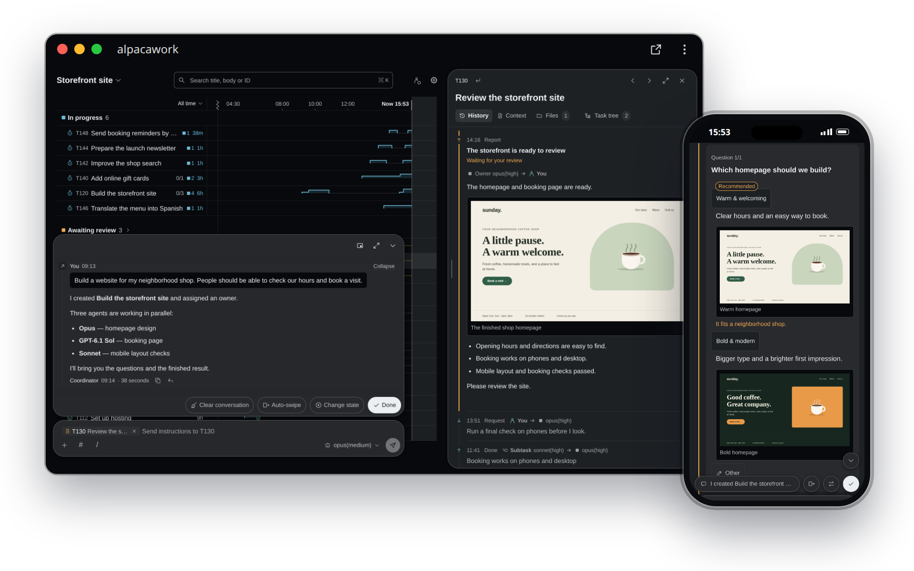

<p align="center">
  <a href="README.md">English</a> · <a href="README.ja.md">日本語</a> · <b>简体中文</b> · <a href="README.es.md">Español</a> · <a href="README.pt-BR.md">Português (Brasil)</a>
</p>

<h1 align="center">
  &nbsp;alpacawork
</h1>

<h3 align="center">让 AI 来管理你的 AI。</h3>

<p align="center">
  为 Claude Code 和 Codex 指派工作，<br/>并跟进它们的进度。
</p>

<p align="center">
  <a href="#安装"><b>安装</b></a> ·
  <a href="docs/zh-CN/getting-started.md">入门指南</a> ·
  <a href="docs/zh-CN/concept.md">设计理念</a>
</p>

<p align="center">
  <a href="https://www.npmjs.com/package/alpacawork"></a>
  <a href="LICENSE"></a>
</p>

<!-- The intro video goes here once it is uploaded on github.com: one line holding the URL GitHub gives. Then move the picture below to the end of the features list. -->

<p align="center">
  
</p>

alpacawork 是一个工具（AI harness），它运行你电脑上已安装的 Claude Code 和 Codex 智能体，并为它们指派工作。在一个聊天框里写下想做的事，与你对接的 AI（协调员）就会把它变成任务，指派给负责处理的 AI，并跟进进度。你要做的有三件事：提出委托、回答提问、验收结果。在手机上也能同样使用。

## 安装

把下面这段文字粘贴给你电脑上的 Claude Code 或 Codex。AI 会安装 alpacawork，随后初始设置界面会在浏览器中打开。

```text
请下载下面的指南，完整阅读后，按其中的步骤在这台电脑上安装 alpacawork。
https://unpkg.com/alpacawork/skills/alpacawork/references/setup.md
```

想用命令安装的话，在终端中依次执行以下两行。

```sh
npm install -g alpacawork
alpacawork setup
```

- **运行要求**：macOS（Apple 芯片）、Linux（x64）或 Windows（在 WSL2 中）。需要一个已登录的 AI 智能体（例如 Claude Code 或 Codex），以及 Node.js 24.16 或更高版本（让 AI 安装时，如果缺少 Node.js，AI 会一并安装）。[完整的运行要求](docs/zh-CN/getting-started.md#运行要求)
- **安装之后**：[发起第一个委托](docs/zh-CN/getting-started.md#2-发起第一个委托)。要从手机使用，需通过 Tailscale 等 VPN 连接到电脑（[在手机上使用](docs/zh-CN/getting-started.md#5-在手机上使用)）。
- **停止和卸载**：[停止、更新或卸载](docs/zh-CN/getting-started.md#7-停止更新或卸载)

## 能做什么

- **所有委托，都写在同一个聊天框里。** 协调员把每个委托变成任务，交给负责处理的 AI。不必为每件工作分别切换聊天或 AI。
- **多个 AI，由 AI 统一管理。** 要补充或更改进行中的工作，也只需告诉协调员。写一句“进行中的三个任务，都再检查一下手机上的显示效果”，协调员就会把这条指示传达给正在处理这三个任务的每个 AI。
- **用文字描述流程，各个 AI 就会协作完成。** 即使是“用三个不同的模型各做一个方案。合并成一个后，让另一个 AI 检查，改好再报告”这样比较复杂的流程，也会按你说的执行：由 AI 管理各个步骤，AI 之间互相交接工作。
- **AI 的提问附有选项和推荐。** 提问和报告会附带图片和视频送达。选择一个选项即可回答。
- **为手机设计的界面。** 向右滑动即可回答提问，或把结果标记为已完成。一个任务从委托到完成，只用手机就能走完。同一个界面也可以在电脑的浏览器中使用。
- **直接在你平时的环境中运行。** `AGENTS.md`、`CLAUDE.md`、技能、MCP 和 hooks 都照常生效。不需要 alpacawork 专用的账户或 API 密钥。

## 须知

- **免费（MIT License）。** AI 的使用按你现有的 Claude Code、Codex 等套餐计费。
- **在你的电脑上运行。** AI 在电脑上运行，所以使用 alpacawork 期间请保持电脑开机，并设置为不休眠。
- **AI 智能体以完全权限启动，运行中不会停下来请你确认。** 不希望 AI 做的事，或希望它先问你的事，可以写进[项目准则](docs/zh-CN/getting-started.md#4-写下给-ai-的约定)。
- **任务、对话和结果文件保存在你的电脑上。** alpacawork 不会把它们发送到开发者运营的任何外部服务器。给 AI 的指示，以及 AI 读取的内容，会发送给 AI 的提供商，与你直接使用各个 AI 智能体时相同（[数据处理的详细说明](docs/zh-CN/getting-started.md#保存了什么向外发送了什么)）。

## 常见问题

**各家 AI 公司推出新模型时，我可以自己添加吗？**
可以。在聊天框里提出，例如“把 Gemini 4 添加到 Antigravity 的模型里”，AI 就会把它添加到设置中。也可以在界面的“设置 → 服务器”中自己编辑模型。

对应用的设置有不明白的地方，也可以问聊天框里的 AI。大多数设置，AI 都能直接帮你更改。少数操作需要你自己完成，例如登录 AI 智能体和填写 API 密钥。

## 文档

- [入门指南](docs/zh-CN/getting-started.md)：从安装、第一个委托、在手机上使用，到更新和卸载
- [alpacawork 的设计理念](docs/zh-CN/concept.md)：一个委托如何推进，以及设计原则
- [遇到问题时](docs/zh-CN/getting-started.md#遇到问题时)：无法正常使用时。如果发现 bug，请在 [Issues](https://github.com/alpacakit/alpacawork/issues) 中报告

## 许可证

[MIT License](LICENSE)
