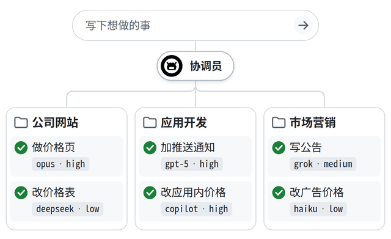
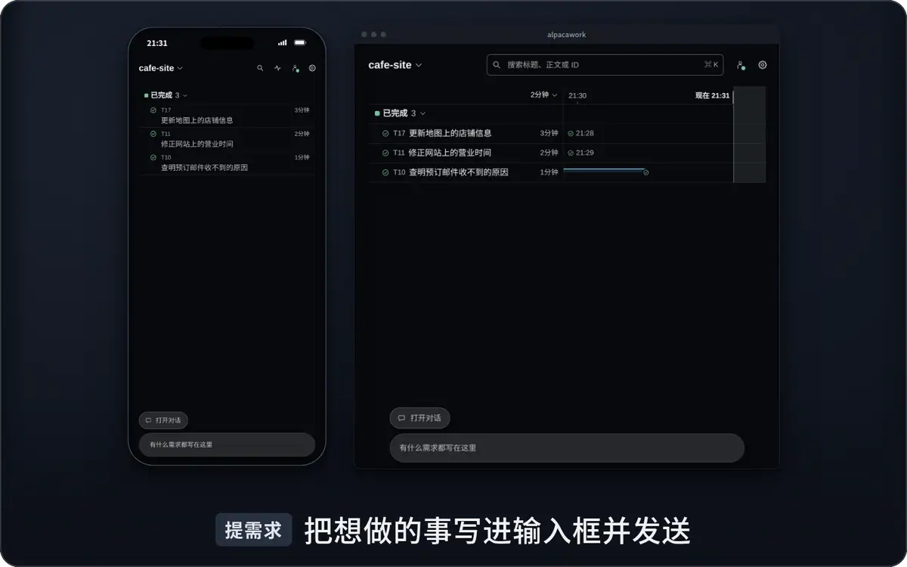

<p align="center">
  <a href="README.md">English</a> · <a href="README.ja.md">日本語</a> · <b>简体中文</b> · <a href="README.es.md">Español</a> · <a href="README.pt-BR.md">Português (Brasil)</a>
</p>

<h1 align="center">
  <picture>
    <source media="(prefers-color-scheme: dark)" srcset="docs/images/wordmark-dark.png">
    
  </picture>
</h1>

<h3 align="center">在一个聊天里，操控所有 AI 智能体。</h3>

<p align="center">
  写下想做的事，你电脑上的 Claude Code、Codex 等 AI 智能体就会拆成多个任务，同时推进。<br/>
  你来回答 AI 的提问、验收结果。在手机上也能使用。
</p>

<p align="center">
  <a href="#安装"><b>安装</b></a> ·
  <a href="docs/zh-CN/getting-started.md">入门指南</a> ·
  <a href="docs/zh-CN/concept.md">设计理念</a>
</p>

<p align="center">
  <a href="https://www.npmjs.com/package/alpacawork"></a>
  <a href="LICENSE"></a>
</p>

<p align="center">
  <picture>
    <source media="(prefers-color-scheme: dark)" srcset="docs/images/hero-dark-zh-CN.gif">
    
  </picture>
</p>

## alpacawork 是什么

alpacawork 是一个 AI 编排工具，让你在一个聊天里统一调动电脑上已有的 Claude Code、Codex 等 AI 编程智能体。

- **入口只有一个聊天** — 新的委托，以及对进行中工作的补充或更改，都写在同一个输入框里。与你对接的 AI（协调员）把委托变成任务，交给负责处理的 AI。
- **沿用现有的 Claude Code 和 Codex** — 用现有的登录状态，在已有的代码仓库文件夹里就能马上开始。不需要 alpacawork 专用的账户或 API 密钥。`AGENTS.md`、`CLAUDE.md`、技能、MCP 和 hooks 都照常生效。
- **以任务为单位，而不是对话** — 界面上列出的是你委托的任务。结果和需要你回答的提问都按任务汇总；即使开启新的对话或更换 AI，过程也会留在任务里（[设计理念](docs/zh-CN/concept.md#工作以任务为单位推进而不是以对话为单位)）。
- **用文字描述流程** — 写一句“用三个不同的模型各做一个方案。合并成一个后，让另一个 AI 检查”，各个 AI 就会互相交接着完成。
- **达到用量上限时由备选 AI 接手** — 在设置中选好备选 AI 后，AI 因用量上限或容量不足而停止时，备选 AI 会接手继续。也可以从 Claude Code 交接给 Codex。
- **上下文通过任务记录交接** — 对话变长时，AI 会压缩对话，或开启新的对话重新开始。新对话中的 AI 和备选 AI 拿到的不是之前的往来内容，而是汇总了当前状况的任务记录（委托内容、已决定的事项、剩余的工作），并从那里继续。
- **选择选项即可回答提问** — AI 无法自行决定的事，会以附有选项和推荐的提问送达。提问和报告都附带图片和视频。
- **只用手机也能用** — 从提出委托、回答提问到验收结果，都可以在手机上完成。向右滑动即可回答或标记为已完成。在电脑的浏览器中也能同样使用。

<p align="center">
  
</p>

## 安装

把下面这段文字粘贴给你电脑上的 Claude Code 或 Codex。AI 会安装 alpacawork，并告诉你初始设置界面的 URL，通常它也会在浏览器中打开。

```text
请下载下面的指南，完整阅读后，按其中的步骤在这台电脑上安装 alpacawork。
https://raw.githubusercontent.com/alpacakit/alpacawork/main/skills/alpacawork/references/setup.md
```

想用命令安装的话，在终端（在 Windows 上是 Ubuntu 中）依次执行以下两行。初始设置会列出要设置的内容，按 Enter 后开始。

```sh
npm install -g alpacawork
alpacawork setup
```

运行环境为 macOS（Apple 芯片）、Linux（x64）或 Windows（WSL2）。安装之后，按照[入门指南](docs/zh-CN/getting-started.md)发出第一个委托。

### 打开界面

要在浏览器中打开界面时，在 Claude Code 或 Codex 中这样请求（在 Codex 中用 `$alpacawork`）。

```text
/alpacawork 打开界面
```

在终端中，也可以用 `alpacawork open` 打开。

## 须知

- **免费（MIT License）。** AI 的使用按你现有的 Claude Code、Codex 等套餐计费。
- **在你的电脑上运行。** AI 在电脑上运行，所以使用 alpacawork 期间请保持电脑开机，并设置为不休眠。
- **AI 智能体以与 Claude Code 的 `bypassPermissions`、Codex 的 `danger-full-access` 相同的免确认模式启动，运行中不会停下来询问。** 不希望 AI 做的事，或希望它先问你的事，可以写进[项目准则](docs/zh-CN/projects.md#项目准则)。
- **任务、对话和结果文件保存在你的电脑上。** alpacawork 不会把它们发送到开发者运营的任何外部服务器。给 AI 的指示，以及 AI 读取的内容，会发送给 AI 的提供商，与你直接使用各个 AI 智能体时相同（[数据处理的详细说明](docs/zh-CN/manage.md#数据存放位置与向外发送的内容)）。

## 文档

- [入门指南](docs/zh-CN/getting-started.md) — 从安装、发出一个委托到确认结果
- [文档首页](docs/zh-CN/README.md) — 使用方法、设置、遇到问题时等全部页面的一览
- 发现 bug 时，请在 [Issues](https://github.com/alpacakit/alpacawork/issues) 中报告
- 新版本公告发布在 X 的 [@codemafia0000](https://x.com/codemafia0000)

## 许可证

[MIT License](LICENSE)
