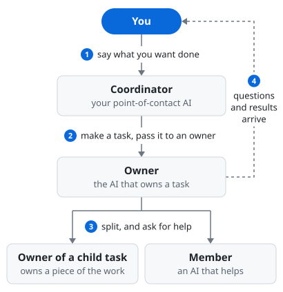
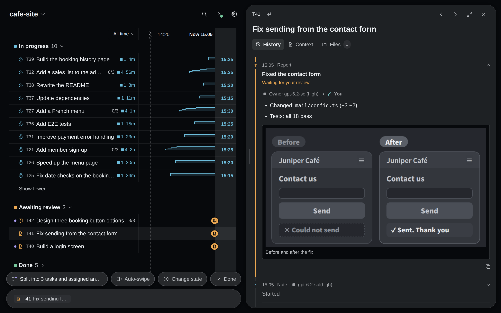

# The ideas behind alpacawork

What happens behind the scenes after you send a request, and what you need to do.

## What it is for

When you hand several jobs to AI, work is left for you: remembering what you asked where, going around checking progress, and deciding who does what next. alpacawork hands this management work to the AI as well.

What you do comes down to three things: ask, answer questions, and check the results. It is built so you can do all of them on a phone.

## Work moves by task, not by conversation

Most tools for AI agents organize work around your conversation with the AI. alpacawork organizes it around tasks. Each task gets AIs suited to the work, and they can be changed along the way.

So the screen lists the tasks you asked for, not conversations with the AI. You ask from the input box at the bottom of the screen. The coordinator's reply appears above the input box; press it to open the conversation.

Work is organized by task for these reasons:

- **You want the results, not the conversation.** What was made, what is left, and the questions for you are grouped by task. You don't have to scroll back through a long conversation to find them.
- **Tasks and conversations don't line up one to one.** What a job involves changes along the way. One conversation mixes several jobs, and one job spans several conversations. In alpacawork the record stays with the task, so starting a new conversation does not lose the history or the results.
- **Swap the AI, and the work goes on.** Whether you switch the assigned AI to another model or from Claude Code to Codex, the new AI picks up from the task's record.
- **One task can have several AIs.** You can put an AI on each role, such as one that builds and one that checks.
- **The AI manages large work as a hierarchy of tasks.** The AI splits work into subtasks, and tasks are grouped by project. The list shows how far along each one is.

## How one request moves along

Suppose you ask, "Build a booking form for the shop's site." The numbers in the diagram match the numbers in the text below.

  

1. A request you write in the input box goes to the coordinator, the AI you talk to.
2. The coordinator decides whether to make it a new task or add it to a task under way, and passes the task to the AI that takes it on (the owner).
3. The owner splits the work into subtasks such as "Decide the booking fields", "Build the entry screen" and "Check how it looks on phones", and hands each to an owner of its own. When it needs help, it calls in members (AIs that help). Work that doesn't need to wait runs side by side. Each subtask's result goes back to the owner above it.
4. What the AI can't decide, such as "What fields should the booking form have?", comes to you as a question with options and a recommendation. When the work is finished, a report arrives. Check the report and press "Done", and you're finished.

These role names, such as "Owner", appear in the History on the screen. Each of these AIs is simply the Claude Code, Codex or other agent installed on your PC.

## What comes to you

Only the things that only you can decide come to you. Tasks with a question or report appear in the list under "Awaiting review", and tasks whose AI run stopped appear under "Needs attention".

- Questions where you choose a preference or a direction
- Checking finished work
- Approving actions with outside effects, such as publishing or deleting
- Deciding what to do when an AI's run stopped

The AI decides how to proceed, who does what, the order and how to check. You can keep making requests without waiting for earlier ones to finish.

## Say how to work in words

Instead of looking for a setting, ask in plain sentences.

- "Do this work with opus, effort high"
- "Have Claude Code and Codex make proposals separately, then compare them for me"
- "When it's done, have a model other than the one that made it check it"
- "The AI on this task seems confused; switch to a new AI and carry on"

What you always want goes in the [project policy](projects.md#project-policy). The policy is an agreement with the AI, not something a mechanism enforces.

The `AGENTS.md`, `CLAUDE.md`, skills and MCP you use now keep working as they are.

## What it isn't suited for

- Sharing with a team: It is a tool for one person. The screen has no login.
- Exposing it to the internet: It assumes other devices connect through a VPN that only your own devices are on.
