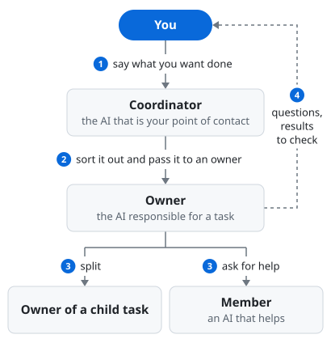
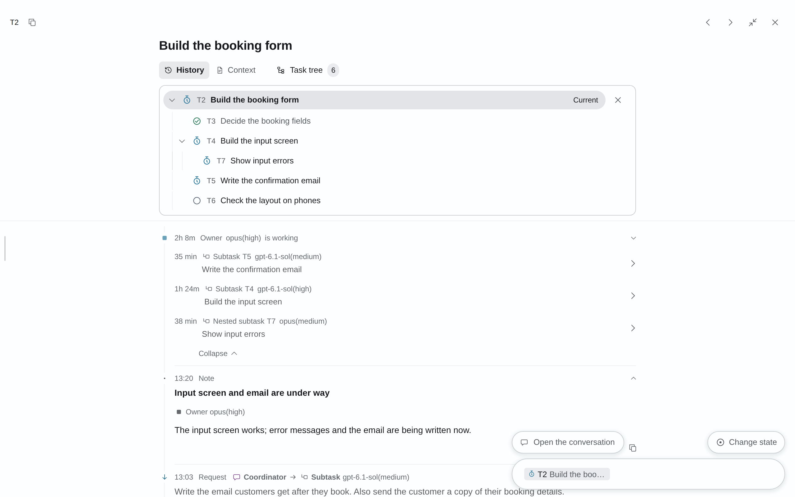

# Las ideas detrás de alpacawork

Esta página explica para qué sirve alpacawork, cómo avanza una solicitud y las ideas que guían su diseño. Está pensada para quienes quieren entender esas ideas y sacarle más partido a alpacawork. Para las instrucciones paso a paso, consulta [Primeros pasos](getting-started.md).

## Qué resuelve

Cuando encargas varios trabajos a la vez a agentes de IA, la tarea de gestionarlos recae en ti: recordar qué pediste y dónde, comprobar cómo avanza cada uno y decidir quién hace qué. alpacawork le pasa ese trabajo a la IA. Tú dices lo que quieres que se haga, respondes las preguntas de la IA y revisas lo que hizo.

## Cómo funciona

  

Supón que pides: “Crea un formulario de reservas para el sitio web de la tienda”.

1. **Todas las solicitudes van al coordinador, la IA que es tu punto de contacto.** El trabajo nuevo y los añadidos o cambios al trabajo en curso van todos en el mismo cuadro de chat. Pregúntale “¿Qué hay en curso ahora mismo?” y te lo dice.
2. **El coordinador mira el trabajo que ya está en curso y decide cómo proceder.** Decide si añade la solicitud a una tarea que ya está en curso, si la convierte en una tarea nueva o si la inicia cuando terminen otras tareas, y luego se la encarga a la IA responsable de la tarea (el responsable). Si tiene dudas, te consulta. El chat queda listo enseguida para tu siguiente solicitud.
3. **El responsable lleva la tarea hasta el final.** Divide el trabajo en tareas más pequeñas, como “Decidir los campos de la reserva”, “Crear la pantalla de entrada de datos”, “Redactar el correo que se envía tras la reserva” y “Comprobar cómo se ve en teléfonos”, y encarga cada una a una IA adecuada. Las partes que no dependen unas de otras avanzan en paralelo.
4. **Llega tu turno cuando hace falta tu criterio.** Lo que la IA no puede decidir por sí sola (por ejemplo, qué campos debe tener el formulario de reservas) te llega como una pregunta con opciones, motivos y una recomendación. Cuando el trabajo termina, la tarea aparece en “Por revisar” con un informe; revísala y márcala como completada, o describe qué hay que cambiar y devuélvela. Si la ejecución de una IA falla y se detiene, también es tu turno. alpacawork puede enviar una notificación a tu teléfono cada vez que llegue tu turno.

El historial de cada tarea registra quién pidió qué y qué hizo cada IA, así que más adelante puedes reconstruir lo ocurrido.

El modelo y el esfuerzo que eliges en el cuadro de texto se aplican al coordinador. Los modelos de los responsables los indicas en la política del proyecto o en tu solicitud ([Pedir](getting-started.md#pedir)).

Los responsables son los propios agentes de IA de tu PC, como Claude Code y Codex. alpacawork no añade ninguna IA propia; lleva el registro de las tareas y se encarga de entregar el trabajo a la IA y de recibirlo de vuelta.

## Los elementos

| Nombre | Descripción |
| --- | --- |
| Proyecto | Un conjunto de trabajos, con la carpeta en la que trabaja la IA y las reglas básicas para la IA (la política del proyecto) |
| Tarea | Un trabajo. La IA divide un trabajo grande en subtareas |
| Coordinador | La IA que es tu punto de contacto. Mira el trabajo en curso, decide si una solicitud se convierte en una tarea nueva o se suma a una que ya está en curso, y se la pasa a un responsable |
| Responsable | La IA que responde del resultado de una tarea |
| Miembro | Una IA a la que un responsable llama para que ayude |
| Tu turno | Un estado que no puede avanzar hasta que actúes: una pregunta, un resultado por revisar, la ejecución de una IA que falló y se detuvo, etc. |

## Principios de diseño

### No hace más de lo necesario

alpacawork se ocupa de la gestión de tareas y de la mecánica de pasar el trabajo a la IA y recibir los resultados. No dicta los detalles de cómo trabaja la IA ni de cómo informa. Para que la IA trabaje a tu manera, escribe lo que quieres en la política del proyecto o en `AGENTS.md`, o pon los pasos en una skill, como ya haces con tu agente de IA ([Dilo con palabras, no con configuración](#dilo-con-palabras-no-con-configuración)).

Las skills, el MCP y el `AGENTS.md` que usas ahora siguen funcionando sin cambios, y el entorno que has ido construyendo también beneficia a la IA que trabaja en alpacawork. No hay nada en medio que vigile o detenga lo que hace la IA, así que no se gastan tiempo ni tokens adicionales en eso.

### Las personas solo deciden y revisan

La IA decide cómo proceder, quién hace qué y cómo comprobar el trabajo. También se ocupa de la gestión: el orden entre las tareas, si se continúa la conversación de un responsable o se inicia una nueva, y si el trabajo se traspasa a otra IA. Puedes seguir haciendo solicitudes en el mismo cuadro de texto sin tener que mirar el progreso ni el orden para determinar quién debe hacer qué.

A ti solo te llega lo que nadie más que tú puede decidir.

- Preguntas sobre preferencias y rumbo (con opciones, motivos y una recomendación)
- La revisión de lo que se hizo
- La aprobación de operaciones con efectos externos (como publicar o eliminar)

Las reglas básicas dicen cuándo debe preguntarte la IA; ningún mecanismo las impone ([Escribir las reglas básicas para la IA](getting-started.md#4-escribir-las-reglas-básicas-para-la-ia)).

### En la pantalla solo está lo que usas

Lo que no se usa no se construye ni se muestra. La mayoría de las operaciones, como cambiar la configuración, crear un proyecto o actualizar, puedes pedírselas al coordinador con palabras sencillas, así que hacen falta pocos botones y formularios para trabajos concretos.

La pantalla se centra en lo que se hizo y en lo que necesita tu criterio. Tus solicitudes aparecen agrupadas por estado, para que veas qué avanza y qué te está esperando. Puedes abrir el intercambio detallado con la IA cuando lo necesites.

Como la pantalla solo contiene lo que usas, cabe cómodamente en un teléfono.

### Dilo con palabras, no con configuración

Escribe lo que quieres que haga la IA en frases sencillas, no mediante opciones de configuración.

- **Política del proyecto**: reglas básicas que llegan a todos los responsables del proyecto. Escribe cosas como “Para los cambios de aspecto, muestra un ejemplo antes de hacerlos” o “Ejecuta solo las pruebas de la parte que cambió”. Cuanto más digas sobre qué puede decidir la IA y qué debe preguntarte, menos preguntas recibirás.
- **`AGENTS.md`, `CLAUDE.md`**: como siempre, la IA lee los que están en la carpeta de trabajo del proyecto.

Las solicitudes para el trabajo del momento también son frases sencillas. Por ejemplo:

- “Haz esto con opus de Claude Code, con esfuerzo high”
- “Que Claude Code y Codex preparen cada uno una versión, y luego compáramelas”
- “Cuando esté listo, que lo compruebe un modelo distinto del que lo hizo”
- “Ejecuta solo las pruebas relacionadas con el cambio”
- “Parece que la IA que trabaja en esto se ha confundido; cambia a una IA nueva y continúa”

Cuando se reemplaza al responsable, las decisiones y los resultados permanecen en los registros de la tarea, así que la nueva IA continúa desde ahí. Lo que quieras que se haga siempre, ponlo en la política del proyecto (por ejemplo, “La implementación con Codex y la comprobación de los resultados con Claude Code”).

## Para qué no sirve

- **Uso en equipo**: es una herramienta para una sola persona. Por ahora, la pantalla no tiene inicio de sesión y no hay forma de separar usuarios.
- **Exponerlo a internet**: da por hecho que los demás dispositivos se conectan a través de una VPN en la que solo están tus propios dispositivos ([Usarlo desde tu teléfono](getting-started.md#5-usarlo-desde-tu-teléfono)).
