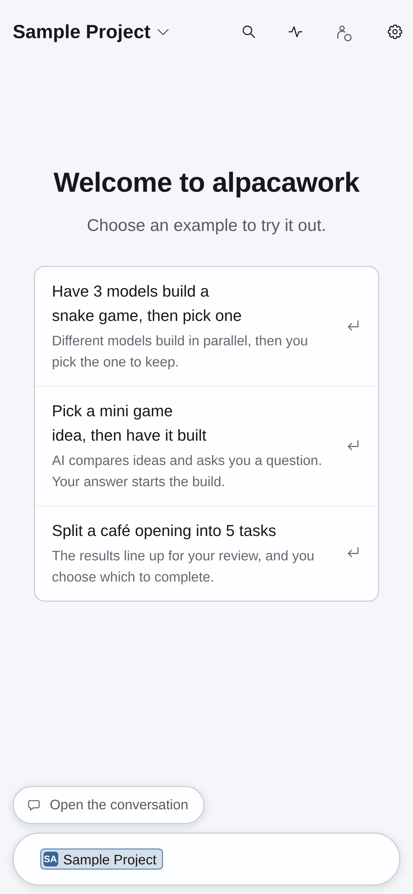
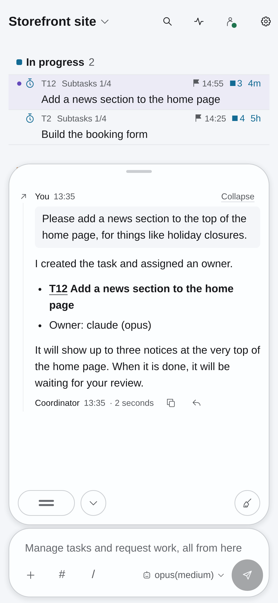
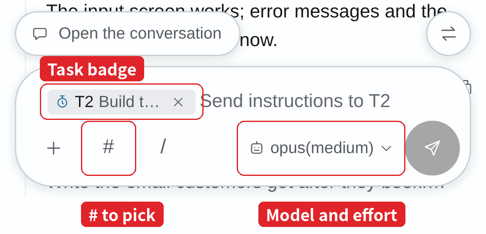
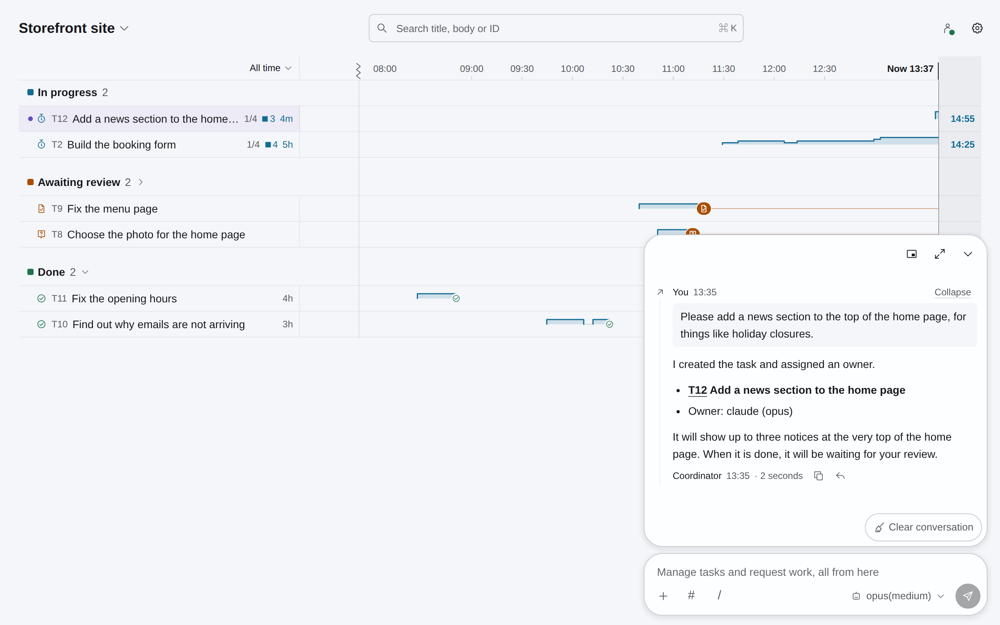
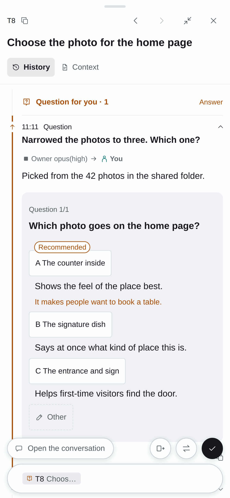
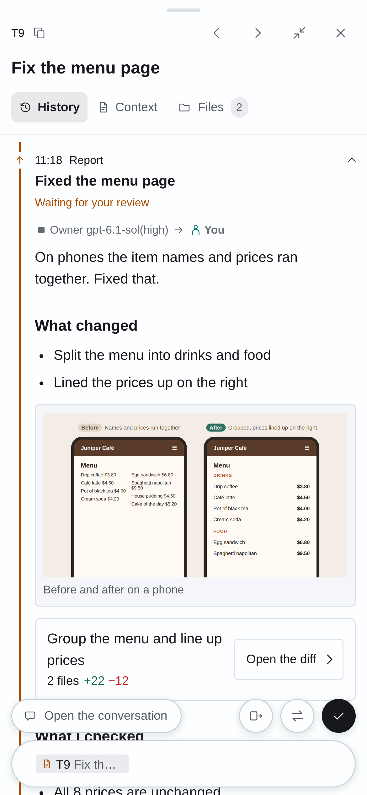
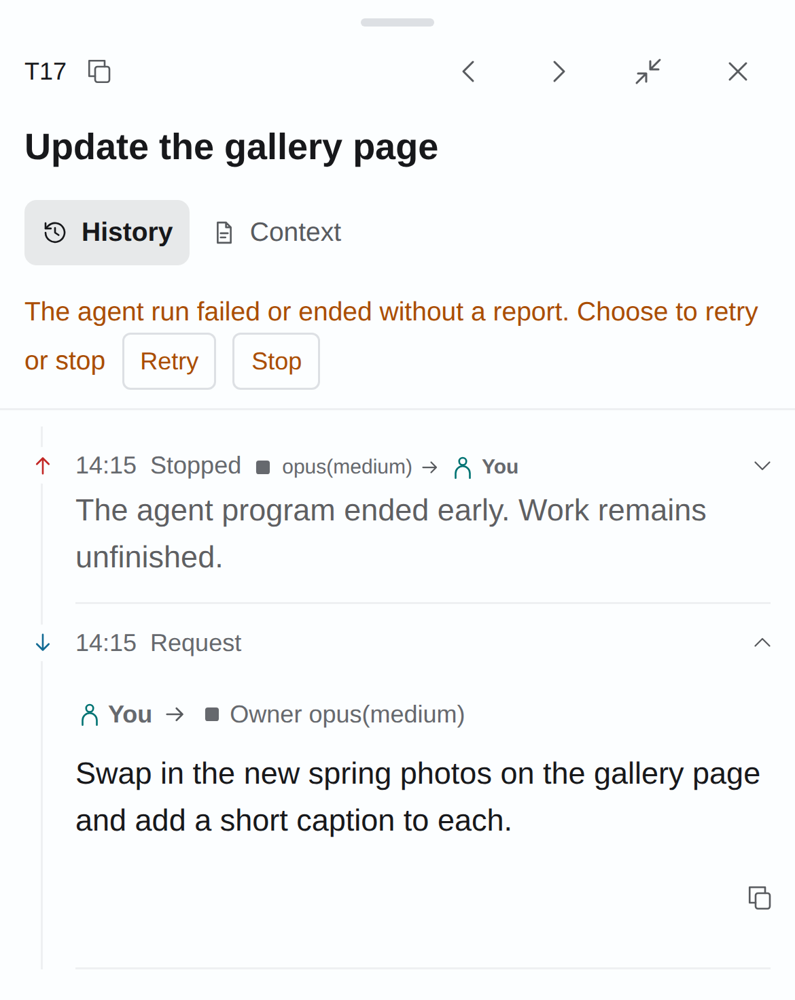
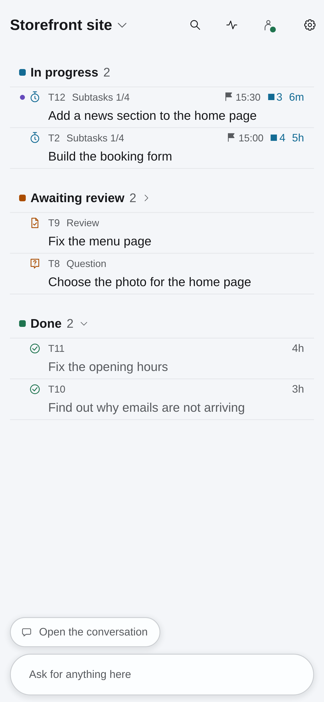
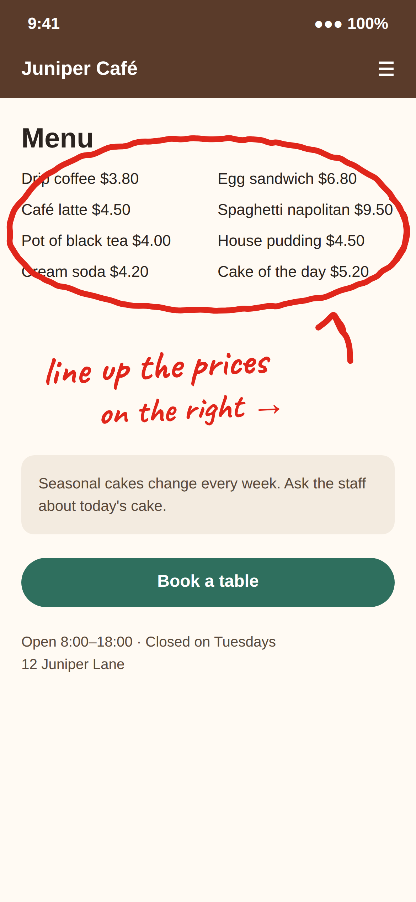

# Primeros pasos

Esta guía te lleva desde la instalación de alpacawork hasta su uso diario. Sigue los pasos 1 a 3 en orden para hacer una primera solicitud, responder una pregunta de la IA y revisar un resultado. Lee del paso 4 en adelante cuando lo necesites.

**Primero, pruébalo**

1. [Instalar](#1-instalar)
2. [Hacer tu primera solicitud](#2-hacer-tu-primera-solicitud)
3. [Seguir el progreso y responder](#3-seguir-el-progreso-y-responder)

**Úsalo en tu propio trabajo**

4. [Escribir las reglas básicas para la IA](#4-escribir-las-reglas-básicas-para-la-ia)
5. [Usarlo desde tu teléfono](#5-usarlo-desde-tu-teléfono)
6. [Usarlo desde Claude Code o Codex](#6-usarlo-desde-claude-code-o-codex)

**Mantenimiento**

7. [Detener, actualizar o desinstalar](#7-detener-actualizar-o-desinstalar)

Consulta también: [Qué se guarda y qué se envía fuera](#qué-se-guarda-y-qué-se-envía-fuera), [Solución de problemas](#solución-de-problemas). Para saber cómo funciona alpacawork y por qué, consulta [Las ideas detrás de alpacawork](concept.md).

Las imágenes de esta guía muestran la pantalla en inglés. La pantalla se abre en el idioma que usaste con la IA que instaló alpacawork. Puedes cambiarlo en la parte superior derecha de la pantalla de configuración inicial y, más adelante, en Configuración (el engranaje) → Personal → Idioma de la interfaz.

## 1. Instalar

alpacawork es una herramienta para una sola persona, en su propio PC. Para usarlo desde otros dispositivos, como un teléfono, conéctate a través de una VPN ([Usarlo desde tu teléfono](#5-usarlo-desde-tu-teléfono)).

alpacawork inicia agentes de IA como Claude Code y Codex con permisos completos, sin pedir confirmación. La IA puede hacer todo lo que podría hacer si la ejecutaras tú con permisos completos. Lo que no debe hacer, o lo que debe consultarte antes, puedes escribirlo en la política del proyecto ([cómo escribirla](#4-escribir-las-reglas-básicas-para-la-ia)).

La instalación se la pides a una IA.

1. **Pega el texto de instalación.** Copia el texto que aparece en la sección [Instalar](https://github.com/alpacakit/alpacawork/blob/main/README.es.md#instalar) del README y pégalo tal cual en un agente de IA de tu PC (como Claude Code o Codex).
2. **La IA lo instala.** Comprueba que alpacawork puede ejecutarse en este PC, instala lo que falta e inicia alpacawork. No tienes que ejecutar comandos ni responder confirmaciones durante el proceso. Si tu propio agente de IA pide permiso para ejecutar un comando, concédeselo.
3. **La pantalla de configuración inicial se abre en tu navegador.** La IA también te indica su URL. Después de reiniciar el PC e iniciar sesión, la misma URL vuelve a funcionar. Si olvidas la URL, pregúntasela a la IA o ejecuta `alpacawork workspace url` en una terminal.

La pantalla de configuración inicial tiene tres pasos: los agentes de IA que vas a usar (y si envías [datos de uso](telemetry.md)), las [skills](#skills) que se instalan y tu primer proyecto. Cada paso se explica por sí mismo, y todo lo que contiene se puede cambiar más adelante en Configuración.

### Requisitos

- macOS (Apple silicon), Linux (x64, glibc) o Windows (dentro de WSL2; consulta [En Windows](#en-windows) más abajo)
- [Node.js](https://nodejs.org/es) 24.16 o posterior
- Chrome o Edge 111, Safari 16.4 (iOS/iPadOS 16.4 en iPhone y iPad) o Firefox 128, o versiones posteriores. Los navegadores más antiguos muestran una página en blanco
- Un agente de IA en el que hayas iniciado sesión (como Claude Code o Codex)

Durante la instalación, la IA los comprueba e instala Node.js si falta.

### Agentes de IA compatibles

| Agente de IA | Qué necesita |
| --- | --- |
| [Claude Code](https://claude.com/claude-code), [Codex](https://github.com/openai/codex) | Haber iniciado sesión con su propia CLI |
| [GitHub Copilot](https://github.com/features/copilot) | No hay que instalar nada: viene incluido con alpacawork. Funciona con tu sesión de GitHub CLI (`gh auth login`) |
| Grok Build (`grok`), pi (`pi`) | Haber iniciado sesión, o una clave de API. alpacawork solo puede saber si están instalados, no si tienen la sesión iniciada. Para usar Gemini, ejecuta `/login` en pi y guarda una clave de API de Google Gemini. Consulta la [configuración de proveedores de pi](https://pi.dev/docs/latest/providers). |

El primer paso de la pantalla de configuración inicial muestra cuáles de ellos están instalados en este PC y, en el caso de los tres primeros, si tienen la sesión iniciada. Ahí activas los que vas a usar. Más adelante puedes cambiarlo en Configuración → Servidor.

Cuando una empresa de IA lanza un modelo nuevo, puedes añadirlo tú. Pídelo en el chat, por ejemplo “Añade el último modelo a la lista de modelos de Codex”, y la IA lo añade a la configuración. También puedes editar los modelos tú mismo en Configuración → Servidor.

Dentro de una misma solicitud puedes repartir los papeles; por ejemplo, el diseño con Claude Code y la implementación con Codex.

Cada agente de IA funciona con tu plan y tu configuración actuales.

- **Claude Code**: `CLAUDE.md`, las skills, el MCP, los hooks y la memoria se usan desde sus ubicaciones habituales, sin cambios
- **Codex**: se usan tu configuración habitual, `AGENTS.md`, las skills, el MCP y los hooks. Solo el historial de conversaciones y la memoria se guardan en un lugar aparte para alpacawork (`~/.codex-alpacawork`)

El uso de IA se factura, y se limita, según los planes de tus agentes de IA, y cada IA que se ejecuta al mismo tiempo cuenta para ellos. Al principio se ejecutan hasta 8 a la vez. Puedes cambiarlo con “Máximo de ejecuciones simultáneas” en Configuración → Servidor, en la pantalla.

### En Windows

En Windows, alpacawork, Node.js y los agentes de IA se instalan todos dentro de Ubuntu en WSL2 (una forma de ejecutar Linux dentro de Windows). El texto de instalación también se pega en un agente de IA iniciado dentro de Ubuntu.

Si aún no tienes WSL2 o Ubuntu, pega el mismo texto de instalación en un agente de IA que se ejecute en Windows y te guiará primero para configurarlos. Para instalarlos tú, ejecuta `wsl --install` en PowerShell abierto como administrador ([instrucciones de Microsoft](https://learn.microsoft.com/es-es/windows/wsl/install)).

alpacawork se ejecuta dentro de Ubuntu, y su pantalla la abres en un navegador en Windows. Solo funciona mientras Ubuntu está en ejecución.

- **Mantén abierta una ventana de Ubuntu mientras lo usas.** Esto también vale mientras lo usas desde tu teléfono. Si cierras todas las ventanas de Ubuntu, Ubuntu puede detenerse, y con él alpacawork y cualquier IA que esté trabajando.
- **Después de reiniciar Windows, abre Ubuntu desde el menú Inicio.** alpacawork se inicia entonces automáticamente, con tus tareas tal como las dejaste. No hace falta volver a instalarlo.

## 2. Hacer tu primera solicitud

Mientras no tengas tareas, la pantalla muestra solicitudes de ejemplo para probar. Presiona una para ponerla en el cuadro de texto y envíala tal cual. Cada ejemplo muestra un flujo distinto: varias IA con modelos diferentes que crean candidatos en paralelo para que elijas uno, la IA que te pide elegir una idea y luego la construye, y la revisión de un resultado para marcar la tarea como completada. Cada uno es una práctica breve que lleva unos minutos.



Al principio, alpacawork usa el agente predeterminado que elegiste en la configuración inicial. Para cambiarlo, presiona “Usar como predeterminado” en la IA que quieras, en Configuración (el engranaje) → Servidor. Si una IA no tiene la sesión iniciada, o no se encuentra su ejecutable, la misma pantalla te indica qué hacer a continuación. Para detalles como indicar la ubicación del ejecutable, consulta la [guía de configuración](../../skills/alpacawork/references/config.md#executable-location-and-sign-in-status) (en inglés).

### Elegir la carpeta de trabajo

La carpeta en la que trabaja la IA la eliges durante la configuración inicial, en “Ubicación del código”, en el tercer paso. Para cambiarla más adelante, presiona el nombre del proyecto en la parte superior de la pantalla, abre su configuración y escribe la ubicación de la carpeta en “Ubicación del código” (por ejemplo, `/Users/tunombre/shop-site`). Si lo dejas vacío, la IA trabaja en la carpeta de datos (`~/alpacawork`).

La IA también lee los archivos `AGENTS.md` y `CLAUDE.md` de esa carpeta (archivos de instrucciones para esa carpeta, que una IA lee cada vez). Para mantener separados trabajos distintos, añade proyectos con “Nuevo proyecto” en el mismo menú.

### Pedir

Hay un solo cuadro de texto, y todo lo que envías va al coordinador, la IA que es tu punto de contacto. Escribe con palabras sencillas lo que quieres que se haga y envíalo. Los añadidos y cambios al trabajo que ya está en curso van en el mismo cuadro.

```text
Averigua por qué fallan las pruebas y corrígelo.
```

```text
Añade un recuadro de “Avisos” en la parte superior de la página principal donde podamos publicar cosas como cierres imprevistos.
```

El coordinador convierte tu solicitud en una tarea, se la encarga a una IA responsable de la tarea (el responsable) y redacta las instrucciones concretas para ese responsable. El trabajo lo hacen los responsables, así que puedes seguir haciendo solicitudes sin esperar a que terminen las anteriores. El coordinador resuelve el orden y quién hace qué.

Puedes pedir más cosas además de trabajo. Desde el mismo cuadro de texto puedes pedirle al coordinador que cambie la configuración, que reanude una IA que se detuvo, que cree un proyecto, que actualice alpacawork y más. La mayoría de las cosas se pueden hacer con solo pedirlas, sin tener que buscar el lugar adecuado en la pantalla.

Si tienes dudas sobre cualquier ajuste de la app, pregunta también ahí. La IA puede cambiar la mayoría de los ajustes por ti. Algunos pasos, como iniciar sesión en un agente de IA o introducir claves de API, quedan en tus manos.



**Insignia de tarea**: una etiqueta en el cuadro de texto que muestra el número y el título de una tarea. Se añade cuando abres una tarea, y también puedes elegir una tarea con “#” en el cuadro de texto. La insignia solo le sugiere al coordinador a qué tarea te refieres; no es obligatorio añadirla. El coordinador decide a qué tarea va tu solicitud, según lo que escribiste y el trabajo en curso. También puede repartir una solicitud entre varias tareas.

**Modelo y esfuerzo**: el modelo y el esfuerzo que eliges junto al botón de enviar se aplican solo al coordinador. Su trabajo es organizar las tareas y pasar las solicitudes a los responsables, así que recomendamos un modelo capaz con esfuerzo low o medium; rara vez hace falta un esfuerzo high. Este selector no fija los modelos de los responsables. Esos siguen la política del proyecto o tu solicitud y, si ninguna de las dos indica uno, se usa el predeterminado de la configuración (para ver ejemplos de cómo escribirlo, consulta [Las ideas detrás de alpacawork](concept.md#dilo-con-palabras-no-con-configuración)).



## 3. Seguir el progreso y responder

La lista muestra tus tareas, agrupadas por estado.



| Grupo | Significado |
| --- | --- |
| En curso | Una IA está trabajando en ella |
| Requiere atención | **Tu turno.** Se detuvo, por ejemplo, porque falló la ejecución de una IA |
| Por revisar | **Tu turno.** Una pregunta o un resultado por revisar |
| En espera | Espera otra cosa, como otra respuesta |
| Sin iniciar | Aún no ha empezado |
| En pausa | Algo que dejaste para más adelante |
| Completadas | Ya terminó |

Llega tu turno en uno de estos tres casos.

### Responder una pregunta

Cuando la IA no puede decidir algo por sí sola, te lo pregunta, con opciones, motivos y una recomendación. Elige una opción o escribe tu propia respuesta, y envíala.



### Revisar un resultado

Cuando una tarea termina, aparece en Por revisar. Lee el informe y, si te parece bien, presiona “Completar” (el botón con la marca de verificación). Si quieres cambios, descríbelos en el cuadro de texto y envíalo.

En un teléfono, desliza una tarjeta hacia la derecha para “Completar” o “Enviar”, o hacia la izquierda para “Pausar”. Después de marcar una como completada, se abre la siguiente tarjeta.

<p>
  &nbsp;&nbsp;
  
</p>

### Decidir cuando algo se detiene

Si, por ejemplo, falla la ejecución de una IA, la tarea aparece en Requiere atención. Ábrela para ver por qué se detuvo. Para continuar, presiona “Reintentar” o envía algo como “continúa” desde el cuadro de texto. Para abandonarla, presiona “Detener”. Si se detuvo por otro motivo, sigue las indicaciones que aparecen junto al motivo y envía una instrucción desde el cuadro de texto.



## 4. Escribir las reglas básicas para la IA

En “Política del proyecto”, en la configuración del proyecto, escribe con frases sencillas qué puede decidir la IA por sí sola y qué debe preguntarte. Lo que escribes llega a todos los responsables de ese proyecto. También puedes pedirlo en el chat: “Añade … a la política”.


```text
Objetivo: hacer que el sitio web de la tienda se lea bien en teléfonos y publicarlo
Cómo trabajar: para los cambios de aspecto, muéstrame un ejemplo y pregúntame antes de hacerlos
Qué decides tú: cómo proceder, las pruebas y la limpieza; decide sin preguntar e informa
Qué no hacer: publicar ni enviar nada fuera sin mi aprobación
```

Para un trabajo concreto, escribe en la propia solicitud cómo quieres que se lleve (“Haz tres versiones y compáralas”, “Cuando esté listo, que otra IA lo compruebe”). Como siempre, la IA también lee los archivos `AGENTS.md` y `CLAUDE.md` de la carpeta de trabajo y usa tus skills actuales.

La política del proyecto es un conjunto de reglas básicas que se le dan a la IA, no un mecanismo que las imponga. Para limitar de verdad a qué puede acceder la IA, ejecútala en un PC aparte o con otro usuario del sistema operativo (la cuenta con la que inicias sesión en el PC).

No hay una función de memoria específica. El intercambio de cada tarea permanece en sus registros y se le pasa a la IA cuando le pides que continúe. Lo que deba tener siempre presente, ponlo en la política del proyecto. Si necesitas más, instala una skill de memoria; funciona sin cambios.

### Skills

Una skill es un conjunto de instrucciones que les indica a los agentes cómo trabajar. El segundo paso de la configuración inicial ofrece tres que hacen que las tareas sean más fáciles de encargar (askmeclearly, doyourjob y alpacawork-betterquality) y explica para qué sirve cada una. Se instalan en `~/.agents/skills`, en tu carpeta personal, y se enlazan para que Claude Code pueda usarlas. Puedes quitarlas más adelante.

Un proyecto solo usa las skills nombradas en la política del proyecto. La configuración inicial añade a la política una línea por cada skill que instalaste, en la que se indica cuándo se usa. Para empezar a usar una skill más adelante, pídelo en el chat; por ejemplo, “Usa el complemento de calidad en este proyecto”.

Los complementos opcionales majority y try-and-keep se mantienen aparte en un repositorio privado. Las instalaciones existentes y las selecciones hechas en la política del proyecto siguen vigentes. Consulta [Private add-ons](../../skills/alpacawork/references/setup.md#private-add-ons) (en inglés) para conocer los requisitos de acceso e instalación.

## 5. Usarlo desde tu teléfono

En un teléfono abres la pantalla del alpacawork que se ejecuta en tu PC. La IA se ejecuta en el PC, así que mantén el PC encendido y configúralo para que no entre en suspensión mientras usas alpacawork (un equipo portátil se detiene cuando cierras la tapa).

También puedes instalar alpacawork en otro PC que mantengas siempre encendido y usarlo desde tu PC habitual o desde tu teléfono. Los pasos para conectarte desde una conversación de Claude Code o Codex en tu PC habitual están en la [guía de configuración inicial](../../skills/alpacawork/references/setup.md#connect) (en inglés).



Conecta el PC y el teléfono a través de una VPN (una forma de conectar tus propios dispositivos de manera segura) y abre alpacawork en una URL HTTPS (una URL HTTP no funciona). [Tailscale](https://tailscale.com/) (gratis para uso personal) ofrece ambas cosas.

Estas cinco cosas las haces tú. La IA hace el resto de la configuración en el PC.

1. **Instala Tailscale en el PC y en el teléfono, e inicia sesión con la misma cuenta.** En Windows, instálalo en Windows, no dentro de Ubuntu.
2. **Pídele a un agente de IA del PC (como Claude Code o Codex): “Haz que alpacawork se pueda usar desde mi teléfono”.** La pantalla del PC tiene la instrucción completa para copiar, en Configuración (el engranaje) → App y teléfono.
3. **En la pantalla del PC, abre Configuración (el engranaje) → App y teléfono.** En “Usar desde tu teléfono” aparecen un código QR y los pasos; escanea el código con la cámara del teléfono para abrir alpacawork.

   

4. **Añádelo a tu pantalla de inicio.** Sigue los pasos que aparecen en la pantalla (usa Safari en iPhone y Chrome en Android). Después se abre como una app.
5. **Activa las notificaciones.** Ábrelo desde el icono que añadiste a la pantalla de inicio, ve a Configuración → Personal → Notificaciones y presiona “Recibir en este dispositivo”. Recibes una notificación cuando es tu turno. No se envían notificaciones mientras estás usando alpacawork. Empiezan 30 segundos después de que salgas de la pantalla que tocaste por última vez (otra app, otra pestaña o la pantalla bloqueada), o cuando lleves 5 minutos sin actividad con la pantalla abierta (puedes cambiar los 5 minutos con “Ausente tras inactividad” en la misma pantalla).

La pantalla de alpacawork no tiene inicio de sesión. Conecta a la VPN solo tus propios dispositivos.

- No uses configuraciones que lo expongan a internet (Tailscale Funnel, la redirección de puertos de tu router, etc.)
- No lo uses en un PC compartido ni en un teléfono que prestes a otras personas (lo que lees queda en el navegador de ese dispositivo; para quitarlo, borra los datos del sitio en el navegador)
- Si pierdes un dispositivo, quítalo de la VPN

### Consejos para dar instrucciones desde un teléfono

Marcar en una captura de pantalla lo que hay que corregir y añadir unas palabras con el dictado por voz es más rápido que escribir una explicación.

<table>
  <tr>
    <td align="center" valign="top" width="33%"><b>1. Marca la captura</b><br><br><sub>Escribe directamente sobre la captura de pantalla</sub></td>
    <td align="center" valign="top" width="33%"><b>2. Compártela y habla</b><br><br><sub>Compártela o pégala en el cuadro de texto. Añade palabras con el dictado por voz del teclado</sub></td>
    <td align="center" valign="top" width="33%"><b>3. Envíala</b><br><br><sub>El coordinador la convierte en una tarea y se la encarga a un responsable</sub></td>
  </tr>
</table>

En Android, si instalaste alpacawork como app (desde Chrome, por ejemplo), puedes enviar una imagen al cuadro de texto con el botón de compartir. En iPhone, copia la captura de pantalla y pégala en el cuadro de texto, o elígela con “+” en el cuadro de texto.

## 6. Usarlo desde Claude Code o Codex

También puedes hacer solicitudes desde tu conversación habitual de Claude Code o Codex en lugar de la pantalla de alpacawork (estos son los dos agentes cuyas conversaciones pueden actuar como coordinador). Al inicio de la conversación, llama una vez a la skill alpacawork (`/alpacawork` en Claude Code, `$alpacawork` en Codex). A partir de ahí, esa conversación actúa como tu coordinador: solo escribe lo que quieres que se haga, o “Dime cómo van las cosas”.

Si `/alpacawork` no aparece en Claude Code, pídele a Claude Code: “Haz que `~/.agents/skills/alpacawork` se pueda usar como skill de Claude Code”.

## 7. Detener, actualizar o desinstalar

### Detener el trabajo de la IA

Abre la tarea, presiona “Cambiar estado”, elige “Detenida” y presiona “Actualizar”. Se detiene el trabajo en esa tarea y en sus tareas inferiores. También puedes pedirlo en el chat: “Detén la tarea …”.

### Detener o reiniciar alpacawork

El servidor de alpacawork se inicia automáticamente cuando inicias sesión en el PC (en Windows, cuando abres Ubuntu). Para detenerlo o iniciarlo manualmente, ejecuta lo siguiente en una terminal.

- Linux, WSL2
  - Detener: `systemctl --user stop alpacawork.service`
  - Iniciar: `systemctl --user start alpacawork.service`
- macOS
  - Detener: `launchctl bootout gui/$(id -u)/alpacawork.service`
  - Iniciar: `launchctl bootstrap gui/$(id -u) ~/Library/LaunchAgents/alpacawork.service.plist`

Detener el servidor no detiene el trabajo en curso de la IA. Para detener el trabajo, primero pon la tarea en “Detenida” como se describe arriba.

### Actualizar

Cuando hay una versión nueva disponible, aparece una marca en Configuración (el engranaje). Abre Configuración, presiona “Actualizar” y, cuando termine, presiona “Recargar”. Puedes actualizar aunque haya IA trabajando (algunas versiones te piden que lo intentes de nuevo cuando su trabajo haya terminado).

### Desinstalar

Pídele a un agente de IA (como Claude Code o Codex): “Desinstala alpacawork”. Para hacerlo tú, ejecuta estas dos líneas en una terminal, en orden.

```sh
alpacawork uninstall
npm uninstall -g alpacawork
```

El primer comando muestra lo que quita y lo que conserva. Lee la lista y presiona Enter. alpacawork no se puede desinstalar mientras una IA está trabajando.

- Quita: el inicio automático, el programa alpacawork y las skills que instaló
- Conserva: la carpeta de datos (`~/alpacawork`; tus tareas y registros). Elimínala tú si no la necesitas

## Qué se guarda y qué se envía fuera

El contenido de tus tareas y conversaciones nunca se envía al desarrollador. La IA intercambia con su proveedor los mismos datos que cuando usas Claude Code, Codex u otro agente directamente.

| Qué | Dónde |
| --- | --- |
| El contenido de las tareas, las conversaciones, los archivos de resultados, la salida de la IA | La carpeta de datos de tu PC (`~/alpacawork` de forma predeterminada). Los secretos que la IA leyó mientras trabajaba pueden quedar en su salida. No le entregues esta carpeta a nadie |
| Las instrucciones a la IA y lo que la IA leyó | El proveedor de tu IA (Anthropic, OpenAI y otros) |
| Las comprobaciones de si hay una versión nueva y las descargas de actualizaciones | npm (donde se distribuye alpacawork). Se comprueba automáticamente mientras el servidor está en ejecución |
| Las notificaciones a tu teléfono (el número y el título de la tarea, el título del informe) | El servicio de notificaciones de tu navegador (Google, Apple y otros), cifradas en tránsito |
| Los datos de uso (solo si eliges enviarlos) | El desarrollador. No contienen conversaciones, contenido de tareas, archivos ni nombres ([Datos de uso](telemetry.md)) |

No pongas claves de API ni otros secretos en el chat, en la política del proyecto ni en las opciones de inicio de la configuración: lo que escribes queda en los registros. Al eliminar una tarea, sus archivos se conservan, así que eso no elimina un secreto.

## Solución de problemas

La forma más rápida de aprender a usar algo o a arreglarlo es preguntarle a la IA. Puede leer en la skill alpacawork los pasos de configuración, actualización y recuperación.

- **Si la pantalla se abre**: simplemente pregunta en el chat; por ejemplo, “¿Por qué no avanza la tarea del formulario de reservas?” o “Configura Codex también”.
- **Si la pantalla no se abre**: en Windows, abre primero Ubuntu y luego vuelve a abrir la pantalla ([En Windows](#en-windows)). Si sigue sin abrirse, inicia un agente de IA (como Claude Code o Codex) en una terminal, llama a la skill alpacawork ([cómo](#6-usarlo-desde-claude-code-o-codex)) y pega el error que viste para pedir ayuda.

No elimines tú la carpeta de datos (`~/alpacawork`) ni los archivos de registros para empezar de cero; puedes perder datos.

Si encuentras una vulnerabilidad, no la publiques en un issue público; comunícala siguiendo los pasos de [SECURITY.md](https://github.com/alpacakit/alpacawork/blob/main/SECURITY.md) (en inglés).

## Para agentes de IA

A partir de aquí hay indicaciones para una IA que lee esta página para hacer el trabajo. Las personas no necesitan leerlas.

Cuando el usuario te pida hacer alguno de los trabajos de esta página, lee la guía de la tabla siguiente sin resumirla y síguela. Los enlaces a las guías son relativos a esta página. Después de la instalación, los mismos archivos también están en `~/.agents/skills/alpacawork/`. La solicitud del usuario abarca el trabajo de la guía: hazlo tú, y pregunta al usuario solo donde la guía lo indique.

| Trabajo | Guía que debes leer y qué debes respetar |
| --- | --- |
| Instalar | Lee “Install” completo en la [guía de configuración inicial](../../skills/alpacawork/references/setup.md#install) y sigue ese orden. Primero comprueba si ya está instalado. Ejecuta tú `alpacawork setup --yes`, sin darle comandos al usuario ni pedirle aprobación paso a paso; la guía reúne en un solo lugar lo que solo el usuario puede hacer |
| Cuando el usuario te pide crear un proyecto | La pantalla de configuración inicial ya pregunta por la carpeta, la política y las skills del primer proyecto, así que no preguntes por ellas justo después de la instalación. Cuando el usuario te pida crear un proyecto, sigue [What to ask first](../../skills/alpacawork/references/setup.md#what-to-ask-first): pregunta de una en una por las cosas que aún no están decididas, como la carpeta de trabajo, y escribe cada respuesta donde esa tabla indica guardarla |
| Instalar los complementos | `alpacawork skills update` los instala. Instala alpacawork y alpacawork-betterquality; comprueba el alcance de la aprobación para actualizar antes de ejecutarlo. Los complementos privados existentes se conservan sin cambios. Los responsables solo usan los que están escritos en la política del proyecto. Cómo escribirlo está en [Sync the skills](../../skills/alpacawork/references/setup.md#sync-the-skills) y [What to ask first](../../skills/alpacawork/references/setup.md#what-to-ask-first) |
| Hacer que se pueda usar desde un teléfono más adelante | Lee [Connect](../../skills/alpacawork/references/setup.md#connect) y [Change the installation](../../skills/alpacawork/references/setup.md#change-the-installation). Hacen falta tres cosas: una ruta del dispositivo al PC (una VPN), un punto de entrada HTTPS (por ejemplo, `tailscale serve`) y `--public-host`, que indica el nombre de ese punto de entrada. Configura `--public-host` ejecutando `alpacawork setup --yes --public-host <nombre>`. No lo configures para que quede expuesto a internet |
| Una conversación en la que se llamó a la skill alpacawork | Lee `~/.agents/skills/alpacawork/SKILL.md` y actúa como coordinador (el punto de contacto del usuario). Para que Claude Code use las skills que instaló alpacawork, hace falta un enlace en `~/.claude/skills`. Si `/alpacawork` no aparece, lee [Sync the skills](../../skills/alpacawork/references/setup.md#sync-the-skills) y comprueba si el enlace existe |
| Actualizar, desinstalar | Son operaciones con efectos externos. Desinstala solo cuando el usuario lo pida, con `alpacawork uninstall --yes`. Antes de actualizar, comprueba el alcance de la aprobación en la política del proyecto y luego, si esta no dice nada, en el `AGENTS.md` aplicable; si se requiere aprobación, o ninguno de los dos dice nada, obtén la aprobación del usuario. Los pasos, y las condiciones en las que se rechazan, están en [Update](../../skills/alpacawork/references/setup.md#update) y [Uninstall](../../skills/alpacawork/references/setup.md#uninstall) |
| Una tarea no avanza, el servidor no se inicia, una actualización se detuvo a medias | Lee [Troubleshooting](../../skills/alpacawork/references/troubleshoot.md). No elimines los registros de instalación ni los datos para empezar de cero |
