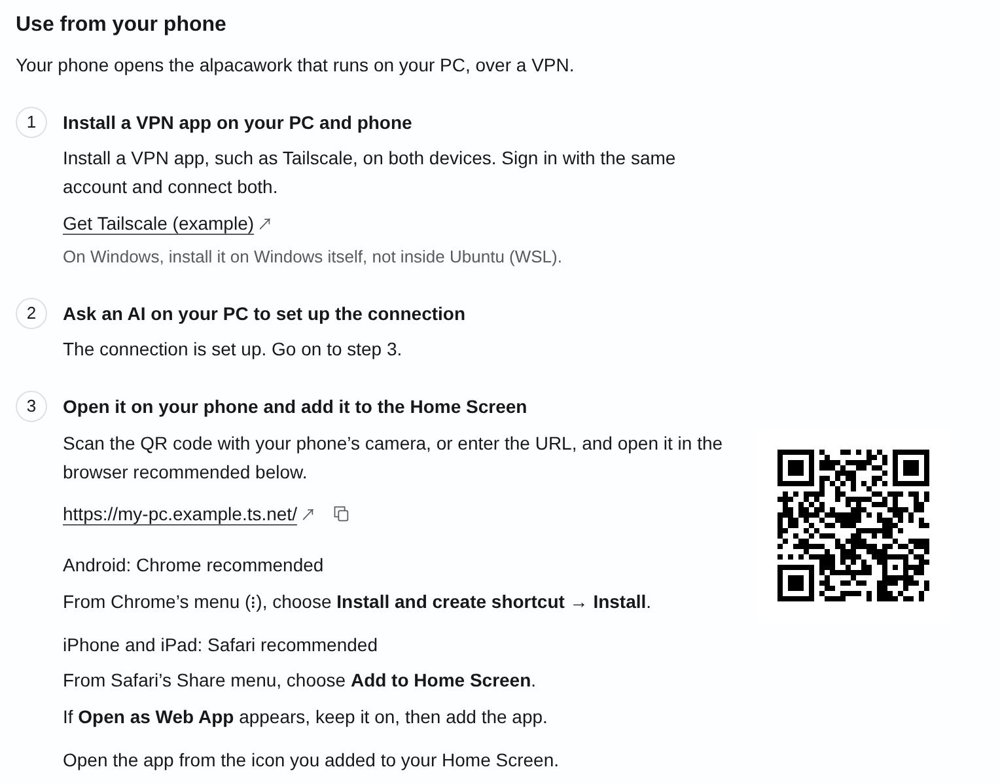
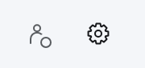

# Teléfono y notificaciones

## Usarlo desde tu teléfono

En el teléfono abres la pantalla de alpacawork que se ejecuta en tu PC. La IA se ejecuta en el PC, así que no dejes que el PC entre en suspensión mientras lo usas.

El PC y el teléfono se conectan por VPN. Aquí se usa [Tailscale](https://tailscale.com/) (gratis para uso personal).

1. Instala Tailscale en el PC y en el teléfono, e inicia sesión con la misma cuenta. En Windows, instálalo del lado de Windows.
2. Inicia Claude Code o Codex en una terminal del PC y pídele “Haz que alpacawork se pueda usar desde mi teléfono”.
3. En la pantalla del PC, abre “Configuración (el engranaje) → App y teléfono” y escanea con el teléfono el código QR que aparece.
4. Sigue los pasos de la pantalla para añadirla a la pantalla de inicio (en iPhone con Safari, en Android con Chrome).

La pantalla no tiene inicio de sesión. Conecta a la VPN solo tus propios dispositivos y no uses opciones que la publiquen en internet (como Tailscale Funnel). Si pierdes un dispositivo, quítalo de la VPN.

Para indicar qué corregir, lo más rápido es marcarlo en una captura de pantalla, pegarla en el cuadro de texto y añadir las palabras con el dictado por voz.

## Recibir notificaciones

Cuando es tu turno (una pregunta, un informe o una IA detenida), te llega una notificación. Actívalas en cada dispositivo donde quieras recibirlas.

1. Abre “Configuración (el engranaje) → Personal”.
2. En “Notificaciones push”, pulsa “Recibir en este dispositivo” y, si el navegador pide permiso, concédelo.

En iPhone, hazlo abriendo la pantalla desde el icono que añadiste a la pantalla de inicio.

Mientras usas alpacawork no llegan. Empiezan a llegar 30 segundos después de cambiar a otra app, o 5 minutos después de dejar de usar la pantalla abierta.

## Silenciar las notificaciones

- Durante un rato: en el botón con forma de persona de arriba a la derecha (a la izquierda del engranaje), elige “Pausar 1 hora” u otra opción.

  

- Cada noche: activa “Horas de silencio diarias” en “Configuración (el engranaje) → Personal”. Al terminar, los avisos que sigan pendientes llegan juntos en una sola notificación.
- Por tipo: en la misma sección “Notificaciones”, puedes activar o desactivar cada tipo de aviso. “Cuando una tarea se completa” empieza desactivado.

## Si algo no funciona

- No aparece el código QR: falta el paso 2. Pídeselo a la IA del PC.
- No se abre en el teléfono: comprueba que la VPN está conectada en los dos y que el PC no está en suspensión. Usa la URL que empieza por `https://`.
- Aparece “Abre la pantalla por HTTPS”: vuelve a abrirla con la URL `https://`. En iPhone, ábrela desde el icono de la pantalla de inicio.
- No llegan notificaciones: comprueba que no las silenciaste y que ese tipo no está desactivado.

## Usarlo desde Claude Code o Codex

Si llamas a la skill de alpacawork en una conversación normal (`/alpacawork` en Claude Code, `$alpacawork` en Codex), esa conversación pasa a ser tu punto de contacto y puedes pedir igual que en el cuadro de texto de la pantalla.
