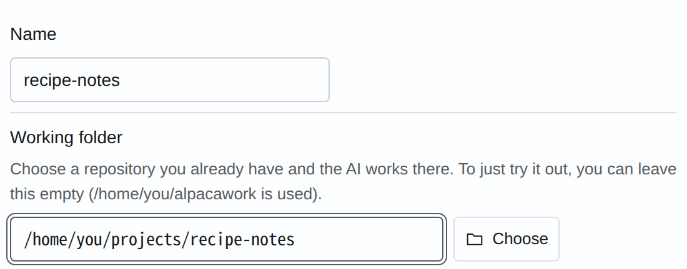
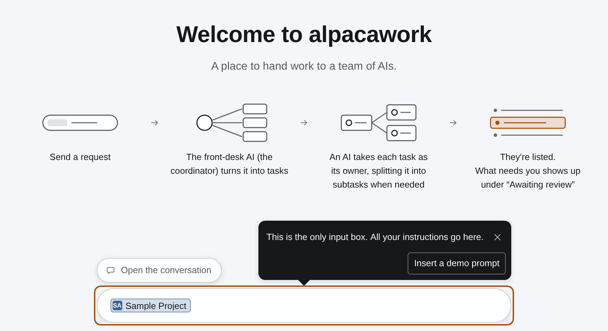
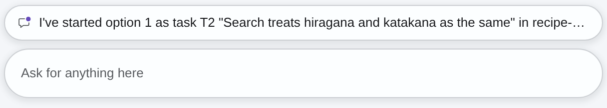
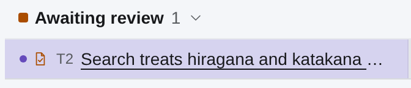

# Getting started

This takes you from installing alpacawork to asking the AI for one thing and checking the result. It takes about 15 minutes, including the time spent waiting for the AI.

## Before you start

- Your PC needs to run macOS (Apple silicon), Linux (x64, with a systemd user session, which most desktop and server installs have) or Windows (WSL2 with systemd on, the default for Ubuntu). On Windows, read [On Windows](manage.md#on-windows) first.
- Have Claude Code or Codex ready to use on this PC.
- The AI changes files without asking for confirmation. It runs with your user account's permissions on this PC, so it can reach beyond the folder it works in.

## 1. Install

Paste the text below, unchanged, into Claude Code or Codex on your PC. The AI installs whatever is missing, then installs alpacawork. If it asks for permission to run a command, allow it.

```text
Download the following document, read all of it, and follow its steps to install alpacawork on this PC.
https://raw.githubusercontent.com/alpacakit/alpacawork/main/skills/alpacawork/references/setup.md
```

To install it from your own terminal, install Node.js 24.16 or later, then run these two lines in order and press Enter when asked.

```sh
npm install -g alpacawork
alpacawork setup
```

## 2. Open the screen

When the install finishes, the screen opens in your browser. If it didn't, or you closed it later, ask Claude Code or Codex like this. The AI opens the screen in your browser or tells you its URL.

```text
/alpacawork open the screen
```

In Codex, write `$alpacawork` instead of `/alpacawork`. From a terminal, this command opens it too.

```sh
alpacawork open
```

You can also open the URL setup printed at the end, such as `http://127.0.0.1:43127/`, in your browser.

This URL stays the same even after you restart the PC. Bookmark it. alpacawork starts by itself when you log in to the PC, so you don't need to start it each time.

If you install it as an app, you can also open it again from its icon in the Dock or the taskbar. How to install it is at the end of the next step, "3. Choose a project".

If you can't open it, see [The screen doesn't open](troubleshooting.md#the-screen-doesnt-open).

## 3. Choose a project

Go through the screen's four steps in order.

1. Choose the screen's language and theme, and press "Next".
2. Check that the AIs you will use are "On", and press "Next". Here you can also choose whether to send usage data to the developers ([what is sent](telemetry.md)).
3. In the next step, keep the selections as they are and press "Install (number) skills".
4. Name the project, choose your repository's folder as the "Working folder" if you use an existing one (find it with "Choose", or type the path in the field), and press "Finish setup".



A project is one folder for the AI to work in, together with the ground rules for working there (the project policy). To use an existing repository, make its folder the working folder. If you are only trying it out, leave the working folder empty (the AI works in the data folder, `~/alpacawork`). You can start without writing a project policy. Write here what you don't want the AI to do ([how to write it](projects.md#project-policy)).

After you press "Finish setup", Chrome and Edge ask whether to install alpacawork as an app. Press "Install and start" to be able to open it again from its icon in the Dock or the taskbar. If you choose "Start in the browser", you can install it later with "Install" in "Settings (the gear) → App & phone". In Safari on a Mac, install it with "File → Add to Dock" in the menu (macOS Sonoma or later).

## 4. Send a request

When setup is finished, you see "Welcome to alpacawork" and a picture of how a request becomes tasks and moves along. Until your first request is done, guide balloons appear at the key places on the screen.



Write what you want done in the input box at the bottom of the screen, and send it.

If you are only trying it out, press "Insert a demo prompt" in the balloon, and send the text it puts in as is. It asks for an HTML page that shows "Hello" in two fonts, and for the AI to then ask you which one is better. The HTML is made in the working folder.

In an existing repository, make your first request one that doesn't change any files.

```text
Read the contents of this folder and sum up what it is for in 3 lines. Don't change any files. Then suggest 3 pieces of work I could ask for next, and ask me which one to go ahead with.
```

Once sent, the start of the reply from the front-desk AI (the coordinator) appears above the input box. Press it to read the whole reply.



A request you hand over as a job shows up after a moment as a task, with a row under "In progress" in the list. A request that only needs a reply doesn't become a task. If the reply in the repository example has suggestions, send the one you want in the input box, like "Go ahead with 1", and it becomes a task. If you send the repository request first, the demo button goes away; to try the demo later, show the guide again (at the end of "5. Check when it's your turn").

While the AI works on a task, you don't need to watch the screen.

## 5. Check when it's your turn

When a question or a report arrives from the AI, the task moves to "Awaiting review". Press the row to open it.



- For a question, press one option, and the answer goes into the input box. Send it as is to answer (pressing alone doesn't deliver it). You can also send a different message without choosing an option. Once you answer, the AI carries on, and a report arrives when it is finished.
- For a report, read it, and if it is good, press "Done" (the check mark) at the bottom of the screen. If you want changes or want to ask for more, keep the task open, write it in the input box and send (for the demo, "Make one more version so I can compare them.").


Once the task moves to "Done", you are finished ("Done" starts collapsed; press the heading to open it). Send your next request from the same input box.

When you mark your first task done, the balloons finish by telling you how to clear the conversation with the front-desk AI, what to do to use another repository, and where to find the steps for using alpacawork from your phone. To see the guide again, press "Show again" under "Getting-started guide" in "Settings (the gear) → Personal".

## What to read next

- [How to use it](guide.md) — everyday use
- [Fit it to your work](projects.md) — how to write the policy, which AIs to use
- [Troubleshooting](troubleshooting.md)
