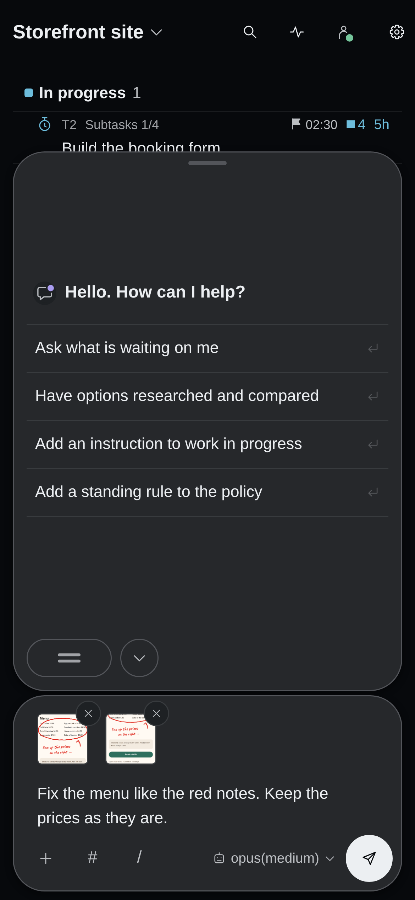

# Getting started

This guide takes you from installing alpacawork to using it day to day. Work through steps 1 to 3 in order to make a first request, answer a question from the AI, and check a result. Read step 4 onward when you need it.

**Try it first**

1. [Install](#1-install)
2. [Make your first request](#2-make-your-first-request)
3. [Follow progress and respond](#3-follow-progress-and-respond)

**Use it for your own work**

4. [Write the ground rules for the AI](#4-write-the-ground-rules-for-the-ai)
5. [Use it from your phone](#5-use-it-from-your-phone)
6. [Use it from Claude Code or Codex](#6-use-it-from-claude-code-or-codex)

**Maintain it**

7. [Stop, update or uninstall](#7-stop-update-or-uninstall)

See also: [What is stored, and what is sent out](#what-is-stored-and-what-is-sent-out), [Troubleshooting](#troubleshooting). For how alpacawork works and why, see [The ideas behind alpacawork](concept.md).

The screen starts in the language you used with the AI that installed it. You can change it at the top right of the setup screen, and later under Settings (the gear) → Personal → Display language.

## 1. Install

alpacawork is a tool for one person, on their own PC. To use it from other devices, such as a phone, connect through a VPN ([Use it from your phone](#5-use-it-from-your-phone)).

alpacawork starts AI agents such as Claude Code and Codex with full permissions, without asking for confirmation. The AI can do whatever it could if you ran it yourself with full permissions. You can write what it should not do, or should ask you about first, in the project policy ([how to write it](#4-write-the-ground-rules-for-the-ai)).

To install it, you ask an AI to do it.

1. **Paste the install text.** Copy the text under [Install in the README](https://github.com/alpacakit/alpacawork/blob/main/README.md#install) and paste it unchanged into an AI agent on your PC (such as Claude Code or Codex).
2. **The AI installs it.** It checks that alpacawork can run on this PC, installs what is missing, and starts alpacawork. You don't run commands or answer confirmations along the way. If your AI agent itself asks for permission to run a command, allow it.
3. **The setup screen opens in your browser.** The AI also tells you its URL. After you restart the PC and log in, the same URL works again. If you forget the URL, ask the AI, or run `alpacawork workspace url` in a terminal.

The setup screen has three steps: the AI agents to use (and whether to send [usage data](telemetry.md)), the [skills](#skills) to install, and your first project. Each step explains itself, and everything in it can be changed later in Settings.

### Requirements

- macOS (Apple silicon), Linux (x64, glibc), or Windows (inside WSL2; see [On Windows](#on-windows) below)
- [Node.js](https://nodejs.org/) 24.16 or later
- Chrome or Edge 111, Safari 16.4 (iOS/iPadOS 16.4 on iPhone and iPad), or Firefox 128, or later. Older browsers show a blank page
- An AI agent you are signed in to (such as Claude Code or Codex)

During the install, the AI checks these, and installs Node.js if it is missing.

### Supported AI agents

| AI agent | What it needs |
| --- | --- |
| [Claude Code](https://claude.com/claude-code), [Codex](https://github.com/openai/codex) | A sign-in through its own CLI |
| [GitHub Copilot](https://github.com/features/copilot) | Nothing to install: it is bundled with alpacawork. It runs on your GitHub CLI sign-in (`gh auth login`) |
| Grok Build (`grok`), Antigravity (`agy`), pi (`pi`) | A sign-in, or an API key. alpacawork can only tell whether these are installed, not whether they are signed in |

The first step of the setup screen shows which of these are installed on this PC and, for the first three, whether they are signed in. You enable the ones to use there. Later, you can change this under Settings → Server.

Within one request, you can split the roles, for example design with Claude Code and implementation with Codex.

Each AI agent runs with your current plan and settings.

- **Claude Code**: `CLAUDE.md`, skills, MCP, hooks and memory are used from their usual places, unchanged
- **Codex**: Your usual settings, `AGENTS.md`, skills, MCP and hooks are used. Only the conversation history and memory are kept in a separate place for alpacawork (`~/.codex-alpacawork`)

AI usage is billed, and limited, under your AI agents' plans, and each AI running at the same time counts toward them. At first, up to 8 run at once. You can change this with "Max concurrent runs" under Settings → Server on the screen.

### On Windows

On Windows, alpacawork, Node.js and the AI agents all go inside Ubuntu on WSL2 (a way to run Linux inside Windows). Paste the install text into an AI agent started inside Ubuntu, too.

If you don't have WSL2 or Ubuntu yet, paste the same install text into an AI agent running on Windows, and it walks you through setting them up first. To install them yourself, run `wsl --install` in PowerShell opened as administrator ([Microsoft's instructions](https://learn.microsoft.com/windows/wsl/install)).

alpacawork runs inside Ubuntu, and you open its screen in a browser on Windows. It runs only while Ubuntu is running.

- **Keep one Ubuntu window open while you use it.** This also applies while you use it from your phone. If you close every Ubuntu window, Ubuntu may stop, and alpacawork and any AI at work stop with it.
- **After restarting Windows, open Ubuntu from the Start menu.** alpacawork then starts automatically, with your tasks as you left them. You don't need to install it again.

## 2. Make your first request

Until you have tasks, the screen shows example requests to try. Press one to put it in the input box, then send it unchanged. Each example shows a different flow: AIs running different models building candidates in parallel for you to pick from, the AI asking you to pick an idea and then building it, and checking a result and marking it done. Each is a short practice run that takes a few minutes.


At first, alpacawork uses the default agent you chose in setup. To change it, press "Set as default" on the AI you want under Settings (the gear) → Server. If an AI isn't signed in, or its executable can't be found, the same screen tells you what to do next. For details such as setting the executable's location, see the [configuration guide](../skills/alpacawork/references/config.md#executable-location-and-sign-in-status).

### Choose the folder to work in

You choose the folder the AI works in during setup, under "Working folder" in the third step. To change it later, press the project name at the top of the screen, open its settings, and enter the folder's location in "Working folder" (for example `/Users/yourname/shop-site`). If you leave it empty, the AI works in the data folder (`~/alpacawork`).

The AI also reads the `AGENTS.md` and `CLAUDE.md` in that folder (instruction files for that folder, which an AI reads every time). To keep separate pieces of work apart, add projects with "New project" in the same menu.

### Ask

There is one input box, and everything you send goes to the coordinator, the AI that is your point of contact. Write what you want done in plain words and send it. Additions and changes to work already under way go in the same box.

```text
Find out why the tests are failing, and fix it.
```

```text
Add a "News" box at the top of the home page where we can post things like unexpected closures.
```

The coordinator turns your request into a task, hands it to an AI that owns the task (the owner), and writes the specific instructions for that owner. Owners do the work, so you can keep making requests without waiting for earlier ones to finish. The coordinator works out the order and who does what.

You can ask for more than work. From the same input box, you can ask the coordinator to change settings, resume an AI that stopped, create a project, update alpacawork and more. Most things can be done just by asking, without hunting for the right place on the screen.


**Task badge**: A tag in the input box showing a task's number and title. It is added when you open a task, and you can also pick a task with "#" in the input box. The badge only hints to the coordinator which task you mean; you don't have to add one. The coordinator decides which task your request goes to, based on what you wrote and the work under way. It may also split one request across several tasks.

**Model and effort**: The model and effort you choose next to the send button apply to the coordinator only. Its job is to organize tasks and pass requests to owners, so we recommend a capable model at low or medium effort; high effort is rarely needed. This picker does not set the owners' models. Those follow the project policy or your request, and if neither specifies one, the default in the settings is used (for examples of how to write this, see [The ideas behind alpacawork](concept.md#say-it-in-words-not-settings)).


## 3. Follow progress and respond

The list shows your tasks, grouped by state.


| Group | Meaning |
| --- | --- |
| In progress | An AI is working on it |
| Needs attention | **Your turn.** It stopped, for example because an AI's run failed |
| Awaiting review | **Your turn.** A question, or a result to check |
| Waiting | Waiting for something else, such as another reply |
| Not started | Not started yet |
| On hold | Something you put aside for later |
| Done | Finished |

It becomes your turn in one of three ways.

### Answer a question

When the AI can't decide something on its own, it asks you, with options, reasons and a recommendation. Pick an option or write your own answer, then send it.


### Check a result

When a task is finished, it appears under Awaiting review. Read the report, and if it looks good, press "Done" (the check mark button). If you want changes, describe them in the input box and send it.

On a phone, swipe a card right for "Done" or "Send", or left for "Hold". After you mark one done, the next card opens.

<p>
  &nbsp;&nbsp;
  
</p>

### Decide when something stops

If an AI's run fails, for example, the task appears under Needs attention. Open it to see why it stopped. To continue, press "Retry", or send something like "carry on" from the input box. To give up on it, press "Stop". If it stopped for another reason, follow the guidance shown with the reason and send an instruction from the input box.


## 4. Write the ground rules for the AI

In "Project policy" in the project's settings, write in plain sentences what the AI may decide on its own and what it should ask you about. What you write reaches every owner in that project. You can also ask in the chat: "Add … to the policy".


```text
Goal: Make the shop's site easy to read on phones, and publish it
How to work: For changes to the look, show me a sample and ask before building
Decide on your own: How to proceed, testing and cleanup; decide without asking and report
Don't: Publish or send anything outside without my approval
```

For how to handle a single job, write it in the request itself ("Make three versions and compare them", "When it's done, have another AI check it"). As usual, the AI also reads the `AGENTS.md` and `CLAUDE.md` in the working folder and uses your current skills.

The project policy is a set of ground rules given to the AI, not a mechanism that enforces them. To limit what the AI can reach at all, run it on a separate PC or under a separate OS user (the account you log in to the PC with).

There is no dedicated memory feature. The back-and-forth on each task stays in its records and is passed to the AI when you ask it to continue. Put anything it should always keep in mind in the project policy. If you need more, install a memory skill; it works without changes.

### Skills

A skill is a set of instructions that tells agents how to work. The second step of setup offers three that make tasks easier to hand off (askmeclearly, doyourjob and alpacawork-betterquality) and says what each one is for. They are installed to `~/.agents/skills` in your home folder and linked so that Claude Code can use them. You can remove them later.

A project uses only the skills named in its project policy. Setup adds one line to the policy for each skill you installed, stating when it is used. To start using a skill later, ask in the chat, for example "Use the quality add-on in this project".

The optional majority and try-and-keep add-ons are maintained separately in a private repository. Existing installations and project policy selections remain in effect. See [Private add-ons](../skills/alpacawork/references/setup.md#private-add-ons) for access and installation requirements.

## 5. Use it from your phone

On a phone, you open the screen of the alpacawork running on your PC. The AI runs on the PC, so keep the PC on and set it not to sleep while you use alpacawork (a laptop stops when you close the lid).

You can also install alpacawork on another PC that is always on, and use it from your everyday PC or from your phone. The steps for connecting from a Claude Code or Codex conversation on your everyday PC are in the [setup guide](../skills/alpacawork/references/setup.md#connect).


Connect the PC and the phone through a VPN (a way to connect your own devices securely), and open alpacawork at an HTTPS URL (an HTTP URL doesn't work). [Tailscale](https://tailscale.com/) (free for personal use) provides both.

You do these five things yourself. The AI does the rest of the setup on the PC.

1. **Install Tailscale on the PC and the phone, and log in with the same account.** On Windows, install it on Windows, not inside Ubuntu.
2. **Ask an AI agent on the PC (such as Claude Code or Codex), "Make alpacawork usable from my phone".** The PC's screen has the full instruction to copy, under Settings (the gear) → App & phone.
3. **On the PC's screen, open Settings (the gear) → App & phone.** A QR code and steps appear under "Use from your phone"; scan the code with your phone's camera to open alpacawork.

   

4. **Add it to your home screen.** Follow the steps on the screen (use Safari on iPhone and Chrome on Android). It then opens like an app.
5. **Turn on notifications.** Open it from the icon you added to the home screen, go to Settings → Personal → Notifications, and press "Receive on this device". You are notified when it is your turn. No notifications are sent while you are using alpacawork. They start 30 seconds after you leave the screen you last touched (another app, another tab or a locked screen), or once you have been idle for 5 minutes with the screen open (you can change the 5 minutes with "Away when idle" on the same screen).

The alpacawork screen has no login. Only connect your own devices to the VPN.

- Don't use settings that expose it to the internet (Tailscale Funnel, port forwarding on your router and so on)
- Don't use it on a shared PC or on a phone you lend to others (what you read stays in that device's browser; to remove it, clear the site's data in the browser)
- If you lose a device, remove it from the VPN

### Tips for giving instructions on a phone

Marking up a screenshot to show what to fix, and adding a few words by voice input, is quicker than typing out an explanation.

<table>
  <tr>
    <td align="center" valign="top" width="33%"><b>1. Mark it up</b><br><br><sub>Write directly on the screenshot</sub></td>
    <td align="center" valign="top" width="33%"><b>2. Share it, and talk</b><br><br><sub>Share or paste it into the input box. Add words with the keyboard's voice input</sub></td>
    <td align="center" valign="top" width="33%"><b>3. Send it</b><br><br><sub>The coordinator turns it into a task and hands it to an owner</sub></td>
  </tr>
</table>

On Android, if you installed alpacawork as an app (from Chrome, for example), you can send a picture to the input box with the share button. On iPhone, copy the screenshot and paste it into the input box, or pick it with "+" in the input box.

## 6. Use it from Claude Code or Codex

You can also make requests from your usual Claude Code or Codex conversation instead of the alpacawork screen (these are the two agents whose conversations can act as the coordinator). At the start of the conversation, call the alpacawork skill once (`/alpacawork` in Claude Code, `$alpacawork` in Codex). That conversation then acts as your coordinator: just write what you want done, or "Tell me where things stand".

If `/alpacawork` doesn't appear in Claude Code, ask Claude Code, "Make `~/.agents/skills/alpacawork` usable as a Claude Code skill".

## 7. Stop, update or uninstall

### Stop the AI's work

Open the task, press "Change state", choose "Stopped", and press "Update". Work on that task and the tasks under it stops. You can also ask in the chat: "Stop the … task".

### Stop or restart alpacawork

The alpacawork server starts automatically when you log in to the PC (on Windows, when you open Ubuntu). To stop or start it manually, run the following in a terminal.

- Linux, WSL2
  - Stop: `systemctl --user stop alpacawork.service`
  - Start: `systemctl --user start alpacawork.service`
- macOS
  - Stop: `launchctl bootout gui/$(id -u)/alpacawork.service`
  - Start: `launchctl bootstrap gui/$(id -u) ~/Library/LaunchAgents/alpacawork.service.plist`

Stopping the server does not stop the AI's work in progress. To stop the work, first set the task to "Stopped" as described above.

### Update

When a new version is available, a mark appears on Settings (the gear). Open Settings, press "Update", and when it finishes, press "Reload". You can update even while AIs are working (some versions ask you to try again once their work has finished).

### Uninstall

Ask an AI agent (such as Claude Code or Codex), "Uninstall alpacawork". To do it yourself, run these two lines in a terminal, in order.

```sh
alpacawork uninstall
npm uninstall -g alpacawork
```

The first command lists what it removes and what it keeps. Read the list, then press Enter. alpacawork can't be uninstalled while an AI is working.

- Removes: the automatic start, the alpacawork program, and the skills it installed
- Keeps: the data folder (`~/alpacawork`; your tasks and records). Delete it yourself if you don't need it

## What is stored, and what is sent out

The contents of your tasks and conversations are never sent to the developer. The AI exchanges the same data with its provider as when you use Claude Code, Codex or another agent directly.

| What | Where |
| --- | --- |
| Task contents, conversations, result files, AI output | The data folder on your PC (`~/alpacawork` by default). Secrets the AI read while working can remain in its output. Don't hand this folder to anyone |
| Instructions to the AI, and what the AI read | Your AI's provider (Anthropic, OpenAI and others) |
| Checks for a new version, and update downloads | npm (where alpacawork is distributed). Checked automatically while the server runs |
| Notifications to your phone (the task's number and title, the report's title) | Your browser's notification service (Google, Apple and others), encrypted in transit |
| Usage data (only if you choose to send it) | The developer. It contains no conversations, task contents, files or names ([Usage data](telemetry.md)) |

Don't put API keys or other secrets in the chat, the project policy, or the launch options in the settings: what you write stays in the records. Deleting a task leaves its files behind, so it doesn't remove a secret.

## Troubleshooting

The quickest way to learn how to use or fix something is to ask the AI. It can read the steps for configuration, updates and recovery in the alpacawork skill.

- **If the screen opens**: Just ask in the chat, for example "Why isn't the booking form task moving?" or "Set up Codex too."
- **If the screen doesn't open**: On Windows, open Ubuntu first, then open the screen again ([On Windows](#on-windows)). If it still doesn't open, start an AI agent (such as Claude Code or Codex) in a terminal, call the alpacawork skill ([how](#6-use-it-from-claude-code-or-codex)), and paste the error you saw to ask for help.

Don't delete the data folder (`~/alpacawork`) or record files yourself to start over; you may lose data.

If you find a vulnerability, don't post it in a public issue; report it following the steps in [SECURITY.md](https://github.com/alpacakit/alpacawork/blob/main/SECURITY.md).

## For AI agents

From here on is guidance for an AI that reads this page to do the work. People don't need to read it.

When the user asks you to do any of the work on this page, read the guide in the table below without summarizing it, and follow it. Links to the guides are relative to this page. After installation, the same files are also in `~/.agents/skills/alpacawork/`. The user's request covers the work in the guide: do it yourself, and ask the user only where the guide says to.

| Work | Guide to read, and what to observe |
| --- | --- |
| Install | Read all of "Install" in the [setup guide](../skills/alpacawork/references/setup.md#install) and go in that order. First check whether it is already installed. Run `alpacawork setup --yes` yourself, without handing the user commands or asking for approval step by step; the guide lists in one place what only the user can do |
| When the user asks you to create a project | The setup screen already asks for the first project's folder, policy and skills, so do not ask about them right after installation. When the user asks you to create a project, follow [What to ask first](../skills/alpacawork/references/setup.md#what-to-ask-first): ask one at a time about what is not decided yet, such as the folder to work in, and write each answer where that table says to save it |
| Install the add-ons | `alpacawork skills update` installs them. It installs alpacawork and alpacawork-betterquality; check update approval before running it. Existing private add-ons are kept unchanged. Owners use only the ones written in the project policy. How to write that is in [Sync the skills](../skills/alpacawork/references/setup.md#sync-the-skills) and [What to ask first](../skills/alpacawork/references/setup.md#what-to-ask-first) |
| Make it usable from a phone later | Read [Connect](../skills/alpacawork/references/setup.md#connect) and [Change the installation](../skills/alpacawork/references/setup.md#change-the-installation). Three things are needed: a route from the device to the PC (a VPN), an HTTPS entry point (for example `tailscale serve`), and `--public-host`, which gives the name of that entry point. Set `--public-host` by running `alpacawork setup --yes --public-host <name>`. Don't set it up to be exposed to the internet |
| A conversation in which the alpacawork skill was called | Read `~/.agents/skills/alpacawork/SKILL.md` and act as the coordinator (the user's point of contact). For Claude Code to use the skills alpacawork installed, a link in `~/.claude/skills` is needed. If `/alpacawork` doesn't appear, read [Sync the skills](../skills/alpacawork/references/setup.md#sync-the-skills) and check whether the link exists |
| Update, uninstall | These are operations with outside effects. Uninstall only when the user asks for it, with `alpacawork uninstall --yes`. Before updating, check the scope of approval in the project policy, then, if it says nothing, in the applicable `AGENTS.md`; if approval is required, or neither says anything, get the user's approval. The steps, and the conditions under which they are refused, are in [Update](../skills/alpacawork/references/setup.md#update) and [Uninstall](../skills/alpacawork/references/setup.md#uninstall) |
| A task doesn't move, the server doesn't start, an update stopped partway | Read [Troubleshooting](../skills/alpacawork/references/troubleshoot.md). Don't delete the installation records or data to start over |
