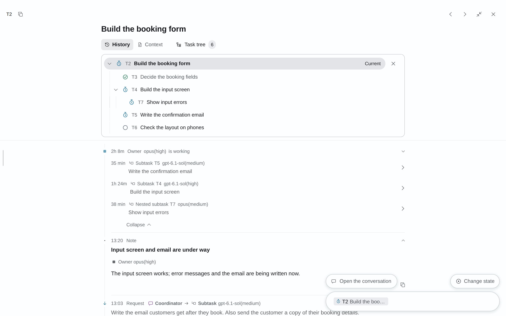

# alpacawork の考え方

alpacawork が何をするものか、1つの依頼がどう進むか、どんな考えで作られているかをまとめます。考え方を知って、alpacawork をより使いこなしたい人のための文書です。使い方の手順は [はじめかた](getting-started.md) にあります。

## 何を解決するか

AI エージェントにいくつもの仕事を並べて任せると、どこで何を頼んだかを覚え、進み具合を見て回り、割り振りを決める「管理する仕事」が人に残ります。alpacawork は、その仕事を AI に任せます。あなたは、やりたいことを伝え、AI からの質問に答え、できあがったものを確かめます。

## しくみ

  

あなたが「お店のサイトに予約フォームを作って」と頼んだとします。

1. **頼みごとは、すべて窓口の AI（コーディネーター）に伝えます。** 新しい仕事も、進んでいる仕事への追加や変更も、同じチャット欄に書きます。「いま何が進んでいる？」と聞けば、状況を答えます。
2. **コーディネーターが、いまの仕事を見たうえで、進め方を決めます。** 進んでいるタスクへの追加として担当に渡すか、新しいタスクにするか、ほかのタスクが終わってから始めるかを判断し、担当の AI（責任者）につなぎます。迷うところは、あなたに確かめます。チャットは、すぐ次の依頼を受けられます。
3. **責任者が、タスクを最後まで進めます。** 仕事を「予約の項目を決める」「入力画面を作る」「送信後のメールを作る」「スマートフォンで表示を確かめる」のように小さなタスクに分け、それぞれに合う AI に任せます。待たなくてよいものは、並んで進みます。
4. **あなたの判断が要るときに、あなたの番になります。** AI が自分で決められないこと（たとえば、予約の項目に何を入れるか）は、案と理由、おすすめを添えた質問で届きます。できあがると、報告と一緒に「確認待ち」に並ぶので、確かめて完了にします。直してほしい点があれば、書いて送り返します。AI の実行が失敗して止まったときも、あなたの番です。あなたの番が来たら、スマートフォンに通知を送れます。

誰が何を頼み、どの AI が何をしたかは、タスクごとの履歴に残ります。あとから開けば、経緯をたどれます。

入力欄で選ぶモデルとエフォートは、コーディネーターのものです。担当の AI のモデルは、プロジェクト方針や依頼で指定します（[頼む](getting-started.md#頼む)）。

担当の AI は、あなたの PC に入っている Claude Code や Codex などの AI エージェントそのものです。alpacawork は、新しい AI を持ち込みません。受け持つのは、タスクの記録と、AI への仕事の受け渡しです。

## 登場するもの

| 名前 | 説明 |
| --- | --- |
| プロジェクト | 仕事のまとまり。AI が作業するフォルダと、AI への約束ごと（プロジェクト方針）を持ちます |
| タスク | 1つの仕事。大きな仕事は、AI が子のタスクに分けます |
| コーディネーター | あなたの窓口になる AI。進んでいる仕事を見て、頼まれたことを新しいタスクにするか、いまのタスクに足すかを決め、担当につなぎます |
| 責任者 | 1つのタスクの結果に責任を持つ AI |
| 作業者 | 責任者が手伝いに呼ぶ AI |
| あなたの番 | あなたが決めないと進まない状態。質問、できあがりの確認、AI の実行が失敗して止まったときなどです |

## 設計の考え方

### 余計なことをしない

alpacawork が受け持つのは、タスクの管理と、AI に仕事を渡して結果を受け取るための仕組みです。AI がどう進め、どう報告するかといった細かいところは、本体で決め込みません。自分に合った進め方にしたいときは、望むことをプロジェクト方針や `AGENTS.md` に書いたり、ふだんと同じように手順をスキルにまとめたりすれば、そのように変えられます（[設定ではなく、言葉で伝える](#設定ではなく言葉で伝える)）。

いま使っているスキルや MCP、`AGENTS.md` も、そのまま働きます。あなたが育ててきた環境は、alpacawork で動く AI にもそのまま活きます。AI の動きを見張ったり止めたりする仕組みを間に挟まないので、そのための余計な時間やトークンもかかりません。

### 人がするのは、判断と確認だけ

進め方、割り振り、確かめ方は AI が決めます。タスクどうしの順番や、担当の AI の会話を続けるか新しくするか、別の AI に引き継ぐかといった管理も、AI の側で扱います。あなたは、進み具合や順番を調べて割り振りを考えなくても、同じ入力欄に続けて頼めます。

あなたに届くのは、あなたにしか決められないことです。

- 好みや方向を選ぶ質問（案と理由、おすすめが付きます）
- できあがったものの確認
- 外に影響する操作の承認（公開や削除など）

どこで人に聞くかは、AI への約束ごとです。仕組みとして止めるものではありません（[AI への約束ごとを書く](getting-started.md#4-ai-への約束ごとを書く)）。

### 画面に置くのは、本当に使うものだけ

使わないものは作らず、表示もしません。設定の変更、プロジェクトの作成、更新など、たいていの操作は、コーディネーターに普通の言葉で頼めるので、作業ごとのボタンや入力欄は、ほとんど要りません。

画面の中心に置くのは、できあがったものと、あなたの判断が要ることです。頼んだことは状態ごとに一覧に並び、どれが進んでいて、どれがあなたを待っているかが分かります。AI とのやり取りの細かい経緯は、必要なときに開いて確かめられます。

使うものだけに絞っているので、スマートフォンの画面でも無理なく使えます。

### 設定ではなく、言葉で伝える

AI にしてほしいことは、設定の項目ではなく、普通の文で書きます。

- **プロジェクト方針**: そのプロジェクトのすべての担当に伝わる約束ごと。「見た目に関わる変更は、作る前に見本を見せる」「試験は変更した範囲だけ流す」のように書きます。何を任せ、何を聞いてほしいかを書いておくと、その分だけ質問が減ります。
- **`AGENTS.md`・`CLAUDE.md`**: プロジェクトに設定した作業フォルダにあるものを、AI はいつもどおり読みます。

その場の頼みごとも、同じように文で書きます。たとえば、次のように頼めます。

- 「この作業は、Claude Code の opus、エフォート high でやって」
- 「案は、Claude Code と Codex に別々に作らせて、比べて見せて」
- 「できあがったら、作った AI とは別のモデルに確かめさせて」
- 「試験は、変更に関係するものだけ流して」
- 「担当の AI が混乱してきたようなので、新しい AI に替えて続きを進めて」

担当を替えても、決めたことと成果はタスクの記録に残っているので、新しい AI はそこから続けます。いつもそうしてほしいことは、プロジェクト方針に書いておきます（例: 「実装は Codex、できあがりの確認は Claude Code」）。

## 向いていない使い方

- **チームでの共有**: 1人で使う道具です。画面のログインと、利用者を分ける仕組みは、いまのところありません。
- **インターネットへの公開**: ほかの端末からは、VPN を通して自分の端末だけでつなぐ前提です（[スマートフォンで使う](getting-started.md#5-スマートフォンで使う)）。
