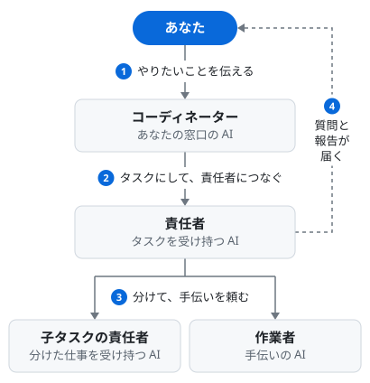

# alpacawork の考え方

依頼を送ったあと裏で何が起きるのか、あなたは何をすればよいのかを説明します。

## 何をする道具か

AI にいくつもの仕事を任せると、どこで何を頼んだかを覚え、進み具合を見て回り、次に誰に何をさせるかを決める仕事が、人に残ります。alpacawork は、この管理の仕事も AI に任せます。

あなたがするのは、頼む、質問に答える、できあがりを確かめる、の3つです。どれもスマートフォンでできるように作っています。

## 会話ではなく、タスクを単位に進める

AI エージェントを使うツールの多くは、AI との会話を単位に仕事を進めます。alpacawork は、タスクを単位に進めます。タスクごとに、そのとき要る AI を割り当てます。

そのため、画面の中心にあるのはタスクの一覧です。頼むのは画面の下の入力欄からで、窓口の AI との会話は「会話を開く」で読めます。

タスクを単位にしているのは、次の理由からです。

- **知りたいのは、会話より結果。** できあがったもの、残っていること、あなたへの質問が、タスクごとにまとまります。長い会話をさかのぼって探さずに済みます。
- **タスクと会話は、1対1にならない。** 仕事の中身は途中で変わり、1つの仕事が何回もの会話にまたがります。タスクごとに会話を作っても、じきにずれます。alpacawork では記録がタスクに残るので、会話を新しくしても経緯と結果は消えません。
- **AI を替えても、仕事は続く。** 担当の AI を別のモデルや Claude Code から Codex に替えても、新しい AI はタスクの記録から続きを始めます。
- **1つのタスクを、複数の AI で進められる。** 作る AI と確かめる AI のように、役目ごとに AI を付けられます。
- **大きな仕事は、タスクの階層で管理する。** 仕事を子タスクに分け、プロジェクトにまとめます。どこまで進んだかは一覧で分かります。

## 1つの依頼の進み方

「お店のサイトに予約フォームを作って」と頼んだとします。図の番号は、下の文の番号と同じです。

  

1. 入力欄に書いた依頼は、窓口の AI（コーディネーター）に届きます。
2. コーディネーターは、新しいタスクにするか、進んでいるタスクに足すかを決め、そのタスクを受け持つ AI（責任者）につなぎます。
3. 責任者は、仕事を「予約の項目を決める」「入力画面を作る」「スマートフォンで表示を確かめる」のような子タスクに分け、それぞれを受け持つ責任者に任せます。手伝いが要るときは、作業者（手伝いの AI）を呼びます。待たなくてよいものは並んで進みます。子タスクの結果は、その上の責任者に戻ります。
4. 「予約の項目に何を入れるか」のような AI が決められないことは、案とおすすめが付いた質問で届きます。できあがると報告が届きます。報告を確かめて「完了」を押せば終わりです。

画面の履歴には、この「責任者」などの役の名前が出ます。どの AI も、あなたの PC に入っている Claude Code や Codex などそのものです。

## あなたに届くもの

あなたにしか決められないことだけが届きます。質問と報告が届いたタスクは一覧の「確認待ち」に、AI の実行が止まったタスクは「対応待ち」に並びます。

- 好みや方向を選ぶ質問
- できあがったものの確認
- 公開や削除など、外に影響する操作の承認
- AI の実行が止まったときの判断

進め方、割り振り、順番、確かめ方は AI が決めます。前の依頼が終わるのを待たずに、続けて頼めます。

## 進め方は言葉で伝える

設定の項目を探す代わりに、普通の文で頼みます。

- 「この作業は opus、エフォート high でやって」
- 「案は Claude Code と Codex に別々に作らせて、比べて見せて」
- 「できあがったら、作った AI とは別のモデルに確かめさせて」
- 「担当の AI が混乱しているようなので、新しい AI に替えて続けて」

いつもそうしてほしいことは、[プロジェクト方針](projects.md#プロジェクト方針) に書きます。方針は AI への約束で、仕組みで止めるものではありません。

いま使っている `AGENTS.md`、`CLAUDE.md`、スキル、MCP も、そのまま働きます。

## 向いていない使い方

- チームでの共有: 1人で使う道具です。画面のログインはありません。
- インターネットへの公開: ほかの端末からは、VPN で自分の端末だけをつなぐ前提です。
