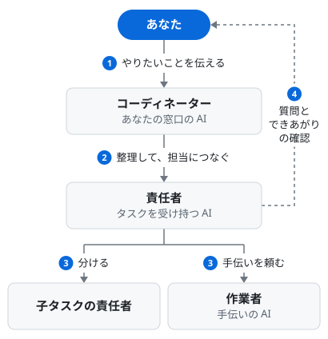

# alpacawork の考え方

依頼を送ったあと裏で何が起きるのか、あなたは何をすればよいのかを説明します。

## 何をする道具か

AI にいくつもの仕事を任せると、どこで何を頼んだかを覚え、進み具合を見て回り、次に誰に何をさせるかを決める仕事が、人に残ります。alpacawork は、この管理の仕事も AI に任せます。

あなたがするのは、頼む、質問に答える、できあがりを確かめる、の3つです。どれもスマートフォンでできるように作っています。

## 1つの依頼の進み方

「お店のサイトに予約フォームを作って」と頼んだとします。

  

1. 入力欄に書いた依頼は、窓口の AI（コーディネーター）に届きます。
2. コーディネーターは、新しいタスクにするか、進んでいるタスクに足すかを決め、そのタスクを受け持つ AI（責任者）に渡します。
3. 責任者は、仕事を「予約の項目を決める」「入力画面を作る」「スマートフォンで表示を確かめる」のような子タスクに分け、それぞれ別の AI に任せます。待たなくてよいものは並んで進みます。
4. 「予約の項目に何を入れるか」のような、AI が決められないことは、案とおすすめが付いた質問であなたに届きます。
5. できあがると報告が届きます。確かめて「完了」を押せば終わりです。

画面の履歴に出る「責任者」「作業者」（責任者が手伝いに呼ぶ AI）は、この役の名前です。どの AI も、あなたの PC に入っている Claude Code や Codex などそのものです。

## あなたに届くもの

あなたにしか決められないことだけが届きます。

- 好みや方向を選ぶ質問
- できあがったものの確認
- 公開や削除など、外に影響する操作の承認
- AI の実行が止まったときの判断

進め方、割り振り、順番、確かめ方は AI が決めます。前の依頼が終わるのを待たずに、続けて頼めます。

## 進め方は言葉で伝える

設定の項目を探す代わりに、普通の文で頼みます。

- 「この作業は opus、エフォート high でやって」
- 「案は Claude Code と Codex に別々に作らせて、比べて見せて」
- 「できあがったら、作った AI とは別のモデルに確かめさせて」
- 「担当の AI が混乱しているようなので、新しい AI に替えて続けて」

いつもそうしてほしいことは、[プロジェクト方針](projects.md#プロジェクト方針) に書きます。方針は AI への約束で、仕組みで止めるものではありません。

いま使っている `AGENTS.md`、`CLAUDE.md`、スキル、MCP も、そのまま働きます。

## 向いていない使い方

- チームでの共有: 1人で使う道具です。画面のログインはありません。
- インターネットへの公開: ほかの端末からは、VPN で自分の端末だけをつなぐ前提です。
