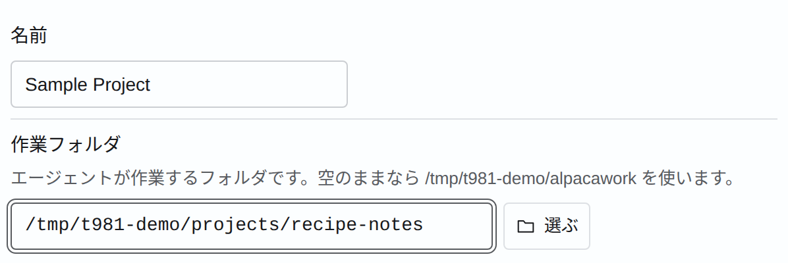
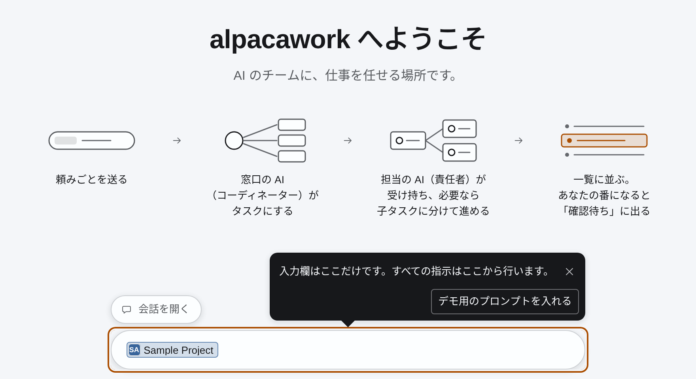
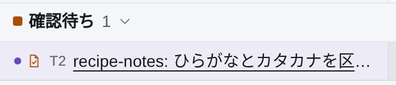
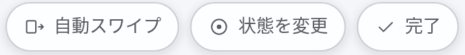

# はじめかた

alpacawork を入れて、AI に1件頼み、できあがりを確かめるまでの手順です。AI の作業を待つ時間を入れて15分ほどです。

## 始める前に

- PC は macOS（Apple シリコン）、Linux（x64。systemd のユーザーセッションが要ります。多くのデスクトップやサーバーでは最初から有効です）、Windows（WSL2。systemd を有効にして使います。Ubuntu では既定で有効です）のどれかです。Windows では [Windows で使うとき](manage.md#windows-で使うとき) を先に読みます。
- Claude Code か Codex を、この PC で使える状態にしておきます。
- AI は確認を求めずにファイルを書き換えます。あなたの PC のユーザーの権限で動くので、作業するフォルダの外にも届きます。

## 1. インストールする

PC の Claude Code や Codex に、次の文をそのまま貼り付けます。AI が足りないものを入れてから、alpacawork をインストールします。コマンドの実行の許可を求められたら、許可します。

```text
次のドキュメントをダウンロードして全文を読み、その手順に従ってこの PC に alpacawork をインストールしてください。
https://raw.githubusercontent.com/alpacakit/alpacawork/main/skills/alpacawork/references/setup.md
```

自分のターミナルで入れるときは、Node.js 24.16 以降を入れてから、次の2行を順に実行し、聞かれたら Enter を押します。

```sh
npm install -g alpacawork
alpacawork setup
```

## 2. 画面を開く

インストールが終わると、ブラウザで画面が開きます。開かなかったときや、あとで閉じたときは、Claude Code か Codex に次のように頼みます。AI がブラウザで画面を開くか、画面の URL を伝えます。

```text
/alpacawork 画面開いて
```

Codex では `/alpacawork` を `$alpacawork` に変えます。ターミナルからは次のコマンドでも開けます。

```sh
alpacawork open
```

セットアップの最後に出た `http://127.0.0.1:43127/` のような URL をブラウザで開いても開けます。

この URL は、PC を再起動しても変わりません。ブックマークしておきます。alpacawork は PC にログインすると自動で動くので、毎回起動する必要はありません。

アプリとして入れると、Dock やタスクバーのアイコンからも開き直せます。入れ方は、次の「3. プロジェクトを決める」の終わりにあります。

開けないときは [画面が開かない](troubleshooting.md#画面が開かない) を見ます。

## 3. プロジェクトを決める

画面の4つのステップを、順に進めます。

1. 画面の言語とテーマを選んで、「次へ」を押します。
2. 使う AI が「有効」になっているのを確かめて、「次へ」を押します。使用統計データを開発元に送るかも、ここで選べます（[送る内容](telemetry.md)）。
3. 次のステップは、選ばれたまま「（数）個のスキルをインストール」を押します。
4. プロジェクトの名前を決め、すでにあるリポジトリで使うならそのフォルダを「作業フォルダ」に選んで（「選ぶ」で探すか、欄にパスを打ちます）、「セットアップを完了」を押します。



プロジェクトは、AI に作業させるフォルダ1つと、そこでの約束（プロジェクト方針）の組です。すでにあるリポジトリで使うときは、そのフォルダを作業フォルダにします。試すだけなら、作業フォルダは空のままにします（データの置き場の `~/alpacawork` で作業します）。プロジェクト方針は書かなくても始められます。AI にしてほしくないことは、ここに書きます（[書き方](projects.md#プロジェクト方針)）。

「セットアップを完了」を押すと、Chrome か Edge では、アプリとして入れるかを聞かれます。「アプリとして入れて始める」を押すと、Dock やタスクバーのアイコンから開き直せるようになります。「ブラウザのまま始める」を選んでも、あとから「設定（歯車）→ アプリ・スマホ」の「インストール」で入れられます。Mac の Safari では、メニューの「ファイル → Dock に追加」（macOS Sonoma 以降）で入れます。

## 4. 依頼を送る

セットアップが終わると、「alpacawork へようこそ」と、依頼がタスクになって進む流れの図が出ます。最初の1件の間は、画面の要所に吹き出しの案内が出ます。



画面の下の入力欄に、やってほしいことを書いて送ります。

試すだけなら、吹き出しの「デモ用のプロンプトを入れる」を押して、入った文をそのまま送ります。"Hello" を2種類のフォントで表示する HTML を作り、どちらが良いかを質問してくる依頼です。HTML は作業フォルダに作られます。

すでにあるリポジトリなら、最初はファイルを書き換えない依頼にします。

```text
このフォルダの中身を読んで、何のためのものかを3行でまとめてください。ファイルは変更しないでください。そのうえで、次に頼める作業の案を3つ出して、どれを進めるか私に聞いてください。
```

送ると、入力欄の上に窓口の AI（コーディネーター）の返事の始めが出ます。押すと全文を読めます。


仕事として任せた依頼は、少しすると一覧の「作業中」にタスクとして1行出ます。返事だけで済む依頼は、タスクになりません。リポジトリの例で返事に案が書かれたときは、進めたい案を「1 を進めてください」のように入力欄で送ると、タスクになります。先にリポジトリの依頼を送るとデモのボタンは消えるので、あとからデモを試すときは、案内をもう一度表示します（「5. あなたの番で確かめる」の終わり）。

AI がタスクを進めている間は、画面を見ていなくてかまいません。

## 5. あなたの番で確かめる

AI から質問か報告が届くと、タスクが「確認待ち」に移ります。行を押して開きます。



- 質問なら、案を1つ押すと答えが入力欄に入ります。そのまま送ると答えになります（押すだけでは届きません）。案を選ばずに、別の文を送ってもかまいません。答えると AI が続きを進め、終わると報告が届きます。
- 報告なら、読んでよければ、画面の下の「完了」（チェックの印）を押します。直してほしいときや続けて頼みたいときは、タスクを開いたまま入力欄に書いて送ります（デモなら「もう1パターン作って」）。



タスクが「完了」に移れば終わりです（「完了」は初めは閉じていて、見出しを押すと開きます）。次の依頼も同じ入力欄から送ります。

最初の1件を完了にすると、吹き出しが最後に、窓口の AI との会話の消し方、別のリポジトリで使うとき、スマホから使う手順の置き場所を伝えて終わります。案内は、「設定（歯車）→ 自分」の「はじめかたの案内」の「もう一度表示」で、もう一度見られます。

## 次に読むもの

- [使いかた](guide.md) — 毎日の操作
- [自分の仕事に合わせる](projects.md) — 方針の書き方、使う AI
- [困ったとき](troubleshooting.md)
