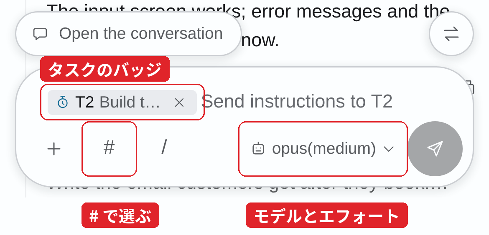
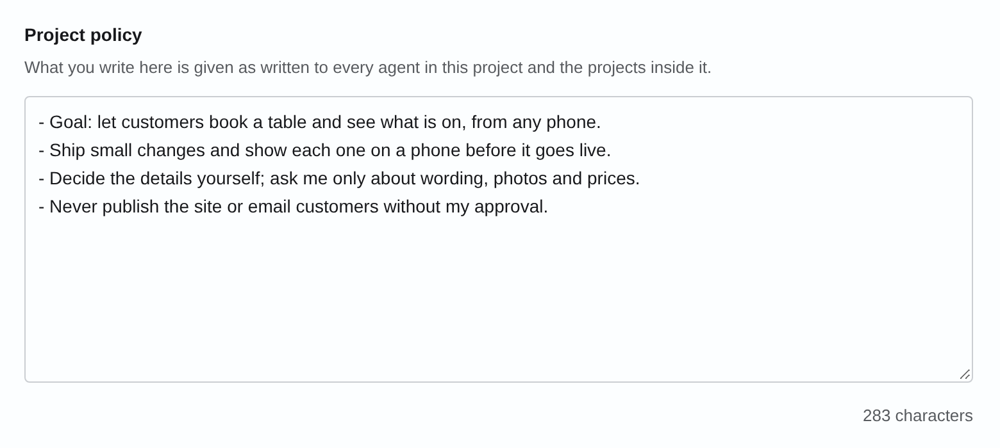

# はじめかた

alpacawork を入れてから、ふだん使えるようになるまでの手引きです。1〜3 を順に進めると、最初の依頼をして、AI からの質問に答え、できあがりを確かめるところまで試せます。4 から先は、必要になったときに読んでください。

**まず試す**

1. [インストールする](#1-インストールする)
2. [最初の依頼をする](#2-最初の依頼をする)
3. [進み具合を見て、返事をする](#3-進み具合を見て返事をする)

**自分の仕事に使う**

4. [AI への約束ごとを書く](#4-ai-への約束ごとを書く)
5. [スマートフォンで使う](#5-スマートフォンで使う)
6. [いつもの Claude Code・Codex から使う](#6-いつもの-claude-codecodex-から使う)

**入れたあとの手入れ**

7. [止める・更新する・アンインストールする](#7-止める更新するアンインストールする)

そのほか: [保存されるもの・外へ送られるもの](#保存されるもの外へ送られるもの)、[困ったとき](#困ったとき)。しくみと考え方は、[alpacawork の考え方](concept.md) にまとめてあります。

この文書の画像には、英語の画面のものがあります。画面の言語は、インストールを頼んだ AI とのやり取りに使った言語で始まります。セットアップの画面の右上で変えられ、あとからは「設定（歯車）→ 自分 → 表示言語」で変えられます。

## 1. インストールする

alpacawork は、自分の PC で、自分1人で使うための道具です。スマートフォンなど外から使うときは、VPN でつなぎます（[スマートフォンで使う](#5-スマートフォンで使う)）。

alpacawork は、Claude Code や Codex を、確認を求めないフル権限で起動します。AI にできることは、自分でフル権限で使うときと変わりません。やってほしくないことや、確認してほしいことは、プロジェクト方針に書けます（[書き方](#4-ai-への約束ごとを書く)）。

インストールは、AI に頼みます。

1. **指示文を貼り付けます。** [README の「インストール」](https://github.com/alpacakit/alpacawork/blob/main/README.ja.md#インストール) にある指示文を、PC に入れてある AI エージェント（Claude Code や Codex など）に、そのまま貼り付けます。
2. **AI がインストールします。** AI は、この PC で動かせるかを確かめ、足りないものを入れて、alpacawork を起動します。途中で、あなたがコマンドを実行したり、確認に答えたりする必要はありません。お使いの AI エージェント自身がコマンドの実行の許可を求めたときは、許可してください。
3. **セットアップの画面が、ブラウザで開きます。** URL は AI も伝えます。PC を再起動しても、ログインすれば同じ URL で開けます。URL を忘れたら、AI に聞くか、ターミナルで `alpacawork workspace url` を実行します。

セットアップの画面のステップは3つで、使う AI エージェント（と、[使用統計データ](telemetry.md)を送信するかどうか）、インストールする[スキル](#スキル)、最初のプロジェクトを順に決めます。説明は各ステップにあり、どの内容も、あとから設定で変えられます。

### 動作環境

- macOS（Apple シリコン）、Linux（x64、glibc）、Windows（WSL2 の中。下の [Windows で使うとき](#windows-で使うとき)）
- [Node.js](https://nodejs.org/ja) 24.16 以降
- Chrome・Edge 111 以降、Safari 16.4 以降（iPhone・iPad は iOS／iPadOS 16.4 以降）、Firefox 128 以降。これより古いと画面が真っ白になります
- サインインしてある AI エージェント（Claude Code や Codex など）

インストールの中で AI が確かめ、Node.js が無ければインストールします。

### 使える AI エージェント

| AI エージェント | 必要なもの |
| --- | --- |
| [Claude Code](https://claude.com/claude-code)、[Codex](https://github.com/openai/codex) | それぞれの CLI でのサインイン |
| [GitHub Copilot](https://github.com/features/copilot) | インストールは要りません（alpacawork に同梱）。GitHub CLI のサインイン（`gh auth login`）で動きます |
| Grok Build（`grok`）、Antigravity（`agy`）、pi（`pi`） | サインイン、または API キー。alpacawork が確かめられるのは、インストールされているかどうかだけで、サインインの状態は確かめられません |

この PC にどれが入っているかと、上の3つについてはサインインしてあるかが、セットアップの最初のステップに表示されます。使うものを、そこで有効にします。あとからは、画面の「設定 → サーバー」で変えられます。

1つの依頼の中で、設計は Claude Code、実装は Codex のように使い分けられます。

AI エージェントは、いまの契約と設定のまま使います。

- **Claude Code**: `CLAUDE.md`、スキル、MCP、Hooks、記憶（メモリー）を、いつもの置き場からそのまま使います
- **Codex**: 設定、`AGENTS.md`、スキル、MCP、Hooks は、いつものものを使います。会話の履歴と記憶だけを、alpacawork 用の置き場（`~/.codex-alpacawork`）に分けて保存します

AI の利用料や利用枠は、お使いの AI エージェントの契約のとおりで、同時に動かした分だけ使います。最初は、8つまで同時に動く設定です。画面の「設定 → サーバー」の「同時に動かす数」で変えられます。

### Windows で使うとき

Windows では、alpacawork も、Node.js も、AI エージェントも、WSL2（Windows の中で Linux を動かす仕組み）の Ubuntu の中に入れます。指示文も、Ubuntu の中で起動した AI エージェントに貼り付けます。

WSL2 や Ubuntu がまだ無いときは、Windows で動いている AI エージェントに同じ指示文を貼り付けると、その準備から案内します。自分で入れるときは、管理者として開いた PowerShell で `wsl --install` を実行します（[Microsoft の手順](https://learn.microsoft.com/ja-jp/windows/wsl/install)）。

alpacawork は Ubuntu の中で動き、画面は Windows のブラウザで開きます。動くのは、Ubuntu が動いている間だけです。

- **使っている間は、Ubuntu のウィンドウを1つ開いたままにします。** スマートフォンから使っている間も同じです。すべて閉じると Ubuntu が止まることがあり、alpacawork も、作業中の AI も一緒に止まります。
- **Windows を再起動したあとは、スタートメニューから Ubuntu を開きます。** Ubuntu を開くと alpacawork は自動で起動し、タスクは元のまま残っています。インストールをやり直す必要はありません。

## 2. 最初の依頼をする

タスクがまだ無い画面には、すぐ試せる依頼が例として並んでいます。例を押すと入力欄に入るので、そのまま送ってみてください。モデルの違う AI が並行して作った候補から選ぶ流れ、AI の案から選ぶと、それを作り始める流れ、できあがりを確かめて完了にする流れを、それぞれ試せます。どれも数分で終わる、短い練習です。


最初に使われる AI は、セットアップでデフォルトに選んだエージェントです。変えるときは、画面の「設定（歯車）→ サーバー」で、使う AI を「デフォルトに設定」します。サインインしていない AI や、実行ファイルが見つからない AI には、同じ画面に、次にすることが出ます。実行ファイルの場所の指定など、詳しくは [設定の手順書](../../skills/alpacawork/references/config.md#executable-location-and-sign-in-status) にあります（英語です）。

### 作業するフォルダを決める

AI に作業させるフォルダは、セットアップの3つ目のステップの「作業フォルダ」で決めます。あとから変えるときは、画面の上のプロジェクト名を押して、そのプロジェクトの設定を開き、「作業フォルダ」に、そのフォルダの場所を入れます（例: `/Users/あなたの名前/shop-site`）。入れなければ、AI はデータの置き場（`~/alpacawork`）で作業します。

フォルダにある `AGENTS.md` や `CLAUDE.md`（AI が毎回読む、フォルダごとの指示のファイル）も、AI はここから読みます。仕事ごとに分けたいときは、同じメニューの「プロジェクトを作る」で、プロジェクトを増やせます。

### 頼む

入力欄は1つで、送ったものはすべて、窓口の AI（コーディネーター）に届きます。やりたいことを普通の言葉で書いて送ります。進んでいる仕事への追加や変更も、同じ入力欄に書きます。

```text
テストが落ちている原因を調べて、直してほしい。
```

```text
トップページの上に、臨時休業などを書ける「お知らせ」の欄を足してほしい。
```

コーディネーターが、依頼をタスクにして担当の AI に任せます。担当への具体的な依頼文も、コーディネーターが考えます。作業は担当が進めるので、前の依頼が終わるのを待たずに、続けて頼めます。順番や割り振りは、コーディネーターが整理します。

頼めるのは、仕事だけではありません。設定の変更、止まった AI の再開、プロジェクトの作成、alpacawork の更新なども、同じ入力欄からコーディネーターに頼めます。画面のどこで操作するかを探さなくても、たいていのことは、頼めば済みます。

**タスクのバッジ**: 入力欄に入る、タスクの番号と題名の印です。タスクを開くと入り、入力欄の「#」からも選べます。バッジは、どのタスクの話かをコーディネーターに伝える参考情報で、付けなくてもかまいません。コーディネーターは、書かれた内容と、進んでいる仕事を見て、どのタスクに頼むかを決めます。1つの依頼を、いくつかのタスクに分けて頼むこともあります。

**モデルとエフォート**: 送信ボタンの横で選ぶモデルとエフォートは、コーディネーターのものです。コーディネーターの仕事はタスクの整理と担当への依頼なので、高性能なモデルの low か medium をおすすめします。エフォートを高くする必要は、あまりありません。担当の AI のモデルは、ここでは決まりません。プロジェクト方針や依頼に書いた指定に沿って選ばれ、指定が無ければ、設定の既定のものが使われます（書き方の例は [alpacawork の考え方](concept.md#設定ではなく言葉で伝える)）。



## 3. 進み具合を見て、返事をする

一覧には、頼んだタスクが状態ごとに並びます。


| 区分 | 意味 |
| --- | --- |
| 作業中 | AI が作業しています |
| 対応待ち | **あなたの番です。** AI の実行が失敗した、などの理由で止まっています |
| 確認待ち | **あなたの番です。** 質問か、できあがりの確認です |
| 待機中 | ほかの返事などを待っています |
| 未着手 | まだ始まっていません |
| 保留 | あなたが後回しにしたものです |
| 完了 | 終わったものです |

あなたの番は、次の3つです。

### 質問に答える

AI が自分で決められないことは、案と理由、おすすめを添えて聞いてきます。案を選ぶか、自分の言葉で書いて送ります。

### できあがりを確かめる

頼んだタスクが終わると、確認待ちに並びます。報告を読み、よければ「完了」（チェックのボタン）を押します。直してほしいときは、入力欄に直してほしい点を書いて送ります。

スマートフォンでは、カードを右へスワイプすると「完了」や「送る」、左へスワイプすると「保留」になります。完了にすると、続けて次のカードが開きます。


### 止まったときに決める

AI の実行が失敗したときなどは、対応待ちに並びます。タスクを開くと、止まった理由が出ます。続けてほしければ「やり直す」を押すか、入力欄に「続けて」のように書いて送ります。やめるなら「止める」を押します。ほかの理由で止まったときは、理由に書かれた案内に沿って、入力欄から指示を送ります。

## 4. AI への約束ごとを書く

「何を任せて、何を聞いてほしいか」は、プロジェクトの設定の「プロジェクト方針」に、普通の文で書きます。書いた文は、そのプロジェクトのすべての担当に伝わります。チャットで「方針に〜を足して」と頼んでも書けます。



```text
目的: お店のサイトを、スマートフォンで見やすくして公開する
進め方: 見た目に関わる変更は、作る前に見本を見せて聞く
任せること: 進め方、試験、片付けは聞かずに決めて報告する
しないこと: 公開と外部への送信は、承認なしにしない
```

その場だけの進め方は、依頼にそのまま書きます（「3案作って比べて」「できたら、別の AI に確かめさせて」）。作業するフォルダにある `AGENTS.md` や `CLAUDE.md`、いま使っているスキルも、AI はいつもどおり読みます。

プロジェクト方針は AI への約束で、仕組みとして止めるものではありません。AI が扱える範囲そのものを限りたいときは、作業用の PC か OS ユーザー（PC にログインするためのアカウント）を分けて、そこで動かします。

記憶（メモリー）のための専用の機能はありません。タスクごとのやり取りは記録に残り、続きを頼むと AI に渡ります。いつも覚えておいてほしいことはプロジェクト方針に書きます。それ以上が要るときは、記憶のためのスキルを入れれば、そのまま働きます。

### スキル

スキルは、エージェントに作業の進め方を伝える手順書です。セットアップの2つ目のステップに、タスクを任せやすくするスキルが3つ（askmeclearly、doyourjob、alpacawork-betterquality）、それぞれ何のために入れるかの説明と一緒に表示されます。インストール先はホームフォルダの `~/.agents/skills` で、Claude Code からも使えるようにリンクします。あとで削除できます。

プロジェクトで使われるのは、プロジェクト方針に書かれたスキルだけです。セットアップでは、インストールしたスキルごとに、いつ使うかを添えた1行が方針に入ります。あとから使うときは、チャットで「このプロジェクトで品質のアドオンを使って」のように頼みます。

majority と try-and-keep は非公開リポジトリで別に配布します。導入済みのものとプロジェクト方針の指定は維持されます。新しく入れるときの権限と手順は [Private add-ons](../../skills/alpacawork/references/setup.md#private-add-ons) にあります。

## 5. スマートフォンで使う

スマートフォンでは、PC で動いている alpacawork の画面を開いて使います。AI は PC の上で動くので、使っている間は PC を起動したままにし、スリープしない設定にします（ノート PC は、ふたを閉じると止まります）。

いつも電源を入れてある別の PC に alpacawork を入れて、手元の PC やスマートフォンから使うこともできます。手元の Claude Code や Codex の会話からつなぐ手順は、[セットアップの手順書](../../skills/alpacawork/references/setup.md#connect) にあります（英語です）。

PC とスマートフォンは、VPN（自分の端末どうしを安全につなぐ仕組み）でつなぎ、HTTPS の URL で開きます（HTTP の URL では開けません）。[Tailscale](https://tailscale.com/)（個人利用は無料）なら、どちらも用意できます。

あなたがすることは、次の5つです。PC 側の残りの準備は、AI が行います。

1. **PC とスマートフォンに Tailscale を入れ、同じアカウントでログインします。** Windows では、Ubuntu の中ではなく Windows に入れます。
2. **PC の AI エージェント（Claude Code や Codex など）に、「alpacawork をスマートフォンから使えるようにして」と頼みます。** PC の画面の「設定（歯車）→ アプリ・スマホ」に、コピーして貼れる指示文があります。
3. **PC の画面で「設定（歯車）→ アプリ・スマホ」を開きます。** 「スマホから使う」に QR コードと手順が出るので、スマートフォンのカメラで読み取って開きます。

   

4. **ホーム画面に追加します。** 画面に出る手順どおりに進めます（iPhone は Safari、Android は Chrome を使います）。アプリのように開けるようになります。
5. **通知を受け取ります。** ホーム画面に追加したアイコンから開き、「設定 → 自分 → 通知」で「この端末で受け取る」を押します。あなたの番が来たときに通知されます。alpacawork を操作している間は通知は送られません。最後に触った画面から別のアプリやタブへ移る（または画面をロックする）と30秒後に、画面を開いたまま操作をやめたときは5分後に届きます（5分は同じ画面の「操作がないと離席に」で変えられます）。

alpacawork の画面にログインはありません。VPN でつなぐ端末は、自分のものだけにします。

- インターネットに公開する設定（Tailscale Funnel、ルーターのポート開放など）は使いません
- 共用の PC や、人に貸すスマートフォンでは使いません（読んだ内容が、その機器のブラウザに残ります。消すには、ブラウザでサイトのデータを消去します）
- 端末をなくしたら、VPN からその端末を外します

### スマートフォンでの伝え方のコツ

直してほしいところはスクリーンショットに書き込み、言葉は音声入力で足すと、文章を打って説明するより早く伝えられます。

<table>
  <tr>
    <td align="center" valign="top" width="33%"><b>1. 書き込む</b><br><br><sub>スクリーンショットに、そのまま書き込みます</sub></td>
    <td align="center" valign="top" width="33%"><b>2. 共有して、話す</b><br><br><sub>共有か貼り付けで入力欄へ。言葉は、キーボードの音声入力で足します</sub></td>
    <td align="center" valign="top" width="33%"><b>3. 送る</b><br><br><sub>窓口の AI が、タスクにして担当に任せます</sub></td>
  </tr>
</table>

アプリとしてインストールした Android（Chrome など）なら、共有のボタンから入力欄へ送れます。iPhone では、スクリーンショットをコピーして入力欄に貼り付けるか、入力欄の「＋」から選びます。

## 6. いつもの Claude Code・Codex から使う

alpacawork の画面を使わずに、いつもの Claude Code や Codex の会話から頼むこともできます（会話が窓口になるのは、この2つです）。会話の最初に1回、alpacawork スキルを呼びます（Claude Code は `/alpacawork`、Codex は `$alpacawork`）。そのあとは、やりたいことや「いまの状況を教えて」をそのまま書けば、その会話が窓口になります。

Claude Code で `/alpacawork` が出ないときは、Claude Code に「`~/.agents/skills/alpacawork` を、Claude Code のスキルとして使えるようにして」と頼みます。

## 7. 止める・更新する・アンインストールする

### AI の作業を止める

タスクを開いて「状態を変更」を押し、「中止」を選んで「更新」を押します。そのタスクと、下のタスクの作業が止まります。チャットで「〜のタスクを止めて」と頼んでも止められます。

### alpacawork を止める・起動し直す

alpacawork のサーバーは、PC にログインすると自動で起動します（Windows では、Ubuntu を開くと起動します）。手で止める・起動するときは、ターミナルで次を実行します。

- Linux・WSL2
  - 止める: `systemctl --user stop alpacawork.service`
  - 起動する: `systemctl --user start alpacawork.service`
- macOS
  - 止める: `launchctl bootout gui/$(id -u)/alpacawork.service`
  - 起動する: `launchctl bootstrap gui/$(id -u) ~/Library/LaunchAgents/alpacawork.service.plist`

サーバーを止めても、動いている AI の作業は止まりません。作業を止めたいときは、先に上の「中止」をします。

### 更新する

新しい版が出ると、画面の設定（歯車）に印が付きます。設定を開いて「アップデート」を押し、終わったら「再読み込み」を押します。作業中の AI がいても始められます（版によっては、AI の作業が終わってからやり直すよう案内されます）。

### アンインストールする

AI エージェント（Claude Code や Codex など）に、「alpacawork をアンインストールして」と頼みます。自分で行うときは、ターミナルで次の2行を順に実行します。

```sh
alpacawork uninstall
npm uninstall -g alpacawork
```

1行目は、消すものと残すものを表示します。読んでから Enter を押します。AI が作業している間は、アンインストールできません。

- 消すもの: 自動起動の登録、alpacawork のプログラム、入れたスキル
- 残すもの: データの置き場（`~/alpacawork`。タスクと記録）。要らなければ、自分で消します

## 保存されるもの・外へ送られるもの

タスクや会話の中身が、開発元に送られることはありません。AI の提供元との通信は、Claude Code や Codex などを直接使うときと同じです。

| 何が | どこへ |
| --- | --- |
| タスクの内容、やり取り、成果のファイル、AI の出力 | あなたの PC のデータの置き場（既定は `~/alpacawork`）。AI が作業中に読んだ秘密が、出力に残ることがあります。このフォルダを人に渡さないでください |
| AI への指示と、AI が読んだ内容 | お使いの AI の提供元（Anthropic、OpenAI など） |
| 新しい版があるかの確認と、更新のダウンロード | npm（alpacawork の配布元）。サーバーが動いている間、自動で確かめます |
| スマートフォンへの通知（タスクの番号と題名、報告の題） | ブラウザの通知サービス（Google、Apple など）を、暗号化されて通ります |
| 使用統計データ（送信を選んだ場合だけ） | 開発元。会話やタスクの中身、ファイル、名前は含みません（[使用統計データ](telemetry.md)） |

API キーなどの秘密を、チャット、プロジェクト方針、設定の起動オプションに書かないでください。書いた内容は記録に残ります。タスクを削除してもファイルは残るので、削除は秘密を消す手段になりません。

## 困ったとき

使い方や直し方は、AI に聞くのが早道です。AI は alpacawork スキルから、設定・更新・復旧の手順を読めます。

- **画面が開けるとき**: チャットでそのまま聞きます。「予約フォームのタスクが進まないのはなぜ？」「Codex も使えるようにして」
- **画面が開けないとき**: Windows では、先に Ubuntu を開いてから、もう一度画面を開きます（[Windows で使うとき](#windows-で使うとき)）。それでも開けないときは、ターミナルで AI エージェント（Claude Code や Codex など）を起動し、alpacawork スキルを呼んで（[呼び方](#6-いつもの-claude-codecodex-から使う)）、表示されたエラーを貼って相談します。

データの置き場（`~/alpacawork`）や記録のファイルを、自分で消してやり直さないでください。データを失うことがあります。

脆弱性を見つけたときは、公開の Issue に書かず、[SECURITY.md](https://github.com/alpacakit/alpacawork/blob/main/SECURITY.md) の手順で知らせてください（英語です）。

## AI エージェント向け

ここから下は、AI がこのページを読んで作業するときの案内です。人は読まなくてかまいません。

利用者にこのページの作業を頼まれたら、下の表の手順書を、要約せずに読んで進めてください。手順書へのリンクは、このページからの相対パスです。インストール後は、同じものが `~/.agents/skills/alpacawork/` にもあります。手順書にある作業は、利用者の依頼の範囲です。自分で進め、利用者に聞くのは、手順書が聞くと定めていることだけにします。

| 作業 | 読む手順書と、守ること |
| --- | --- |
| インストール | [セットアップの手順書](../../skills/alpacawork/references/setup.md#install) の「Install」を全文読み、その順に進めます。最初に、すでに入っていないかを確かめます。`alpacawork setup --yes` は自分で実行し、利用者にコマンドを渡したり、手順ごとに承認を求めたりしません。利用者にしかできないことは、手順書の1か所にまとめてあります |
| プロジェクトを作るよう頼まれたとき | 最初のプロジェクトのフォルダ・方針・スキルはセットアップの画面で決めるので、インストールの直後には聞きません。プロジェクトを作るよう頼まれたら、[What to ask first](../../skills/alpacawork/references/setup.md#what-to-ask-first) に沿って、作業するフォルダなど、まだ決まっていないことを1つずつ聞き、答えを、その表にある保存先に書きます |
| アドオンを入れる | `alpacawork skills update` で入ります。本体と alpacawork-betterquality が入るので、更新の承認範囲を確認します。導入済みの非公開アドオンはそのまま残ります。担当の AI が使うのは、プロジェクト方針に書いたものだけです。書き方は [Sync the skills](../../skills/alpacawork/references/setup.md#sync-the-skills) と [What to ask first](../../skills/alpacawork/references/setup.md#what-to-ask-first) にあります |
| あとからスマートフォンで使えるようにする | [Connect](../../skills/alpacawork/references/setup.md#connect) と [Change the installation](../../skills/alpacawork/references/setup.md#change-the-installation) を読みます。要るのは、端末から PC への経路（VPN）、HTTPS の入口（例: `tailscale serve`）、その入口の名前を伝える `--public-host` の3つです。`--public-host` は、`alpacawork setup --yes --public-host <名前>` を実行して設定します。インターネットに公開する設定はしません |
| alpacawork スキルを呼ばれた会話 | `~/.agents/skills/alpacawork/SKILL.md` を読み、窓口（コーディネーター）として動きます。alpacawork が入れたスキルを Claude Code から使うには、`~/.claude/skills` にリンクが要ります。`/alpacawork` が出ないときは、[Sync the skills](../../skills/alpacawork/references/setup.md#sync-the-skills) を読み、リンクがあるかを確かめます |
| 更新、アンインストール | 外に影響する操作です。アンインストールは、利用者に頼まれたときだけ、`alpacawork uninstall --yes` で行います。更新は、実行する前に、プロジェクト方針、そこに定めがなければ適用される `AGENTS.md` の順で承認の範囲を確かめ、承認が要る場合と定めが無い場合は、利用者の承認を得ます。手順と、断られる条件は [Update](../../skills/alpacawork/references/setup.md#update) と [Uninstall](../../skills/alpacawork/references/setup.md#uninstall) にあります |
| タスクが進まない、サーバーが起動しない、更新が途中で止まった | [Troubleshooting](../../skills/alpacawork/references/troubleshoot.md) を読みます。設置の記録やデータを消して、最初からやり直しません |
