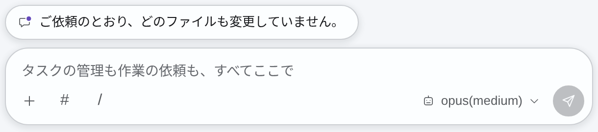

# はじめかた

alpacawork を入れて、AI に1件頼み、できあがりを確かめるまでの手順です。AI の作業を待つ時間を入れて15分ほどです。

## 始める前に

- PC は macOS（Apple シリコン）、Linux（x64。systemd のユーザーセッションが要ります。多くのデスクトップやサーバーでは最初から有効です）、Windows（WSL2。systemd を有効にして使います。Ubuntu では既定で有効です）のどれかです。Windows では [Windows で使うとき](manage.md#windows-で使うとき) を先に読みます。
- Claude Code か Codex を、この PC で使える状態にしておきます。
- AI は確認を求めずにファイルを書き換えます。あなたの PC のユーザーの権限で動くので、作業するフォルダの外にも届きます。

## 1. インストールする

PC の Claude Code や Codex に、次の文をそのまま貼り付けます。AI が足りないものを入れてから、alpacawork をインストールします。コマンドの実行の許可を求められたら、許可します。

```text
次のドキュメントをダウンロードして全文を読み、その手順に従ってこの PC に alpacawork をインストールしてください。
https://raw.githubusercontent.com/alpacakit/alpacawork/main/skills/alpacawork/references/setup.md
```

自分のターミナルで入れるときは、Node.js 24.16 以降を入れてから、次の2行を順に実行し、聞かれたら Enter を押します。

```sh
npm install -g alpacawork
alpacawork setup
```

## 2. 画面を開く

インストールが終わると、ブラウザで画面が開きます。開かなかったときや、あとで閉じたときは、Claude Code か Codex に次のように頼みます。AI がブラウザで画面を開くか、画面の URL を伝えます。

```text
/alpacawork 画面開いて
```

Codex では `/alpacawork` を `$alpacawork` にします。ターミナルからは次のコマンドでも開けます。

```sh
alpacawork open
```

セットアップの最後に出た `http://127.0.0.1:43127/` のような URL をブラウザで開いても開けます。

この URL は、PC を再起動しても変わりません。ブックマークしておきます。alpacawork は PC にログインすると自動で動くので、毎回起動する必要はありません。

開けないときは [画面が開かない](troubleshooting.md#画面が開かない) を見ます。

## 3. プロジェクトを決める

画面の4つのステップを、順に進めます。

1. 画面の言語とテーマを選んで、「次へ」を押します。
2. 使う AI が「有効」になっているのを確かめて、「次へ」を押します。
3. 次のステップは、おすすめのままインストールのボタンを押します。
4. プロジェクトの名前を決め、すでにあるリポジトリで使うならそのフォルダを「作業フォルダ」に選んで、「セットアップを完了」を押します。


プロジェクトは、AI に作業させるフォルダ1つと、そこでの約束（プロジェクト方針）の組です。すでにあるリポジトリで使うときは、そのフォルダを作業フォルダにします。試すだけなら、作業フォルダは空のままにします（データの置き場の `~/alpacawork` で作業します）。プロジェクト方針は例のままで始められます。

## 4. 依頼を送る

画面の下の入力欄に、やってほしいことを書いて送ります。送ると、入力欄の上に返事の始めが出ます。押すと全文を読めます。



すでにあるリポジトリなら、最初はファイルを書き換えない依頼にします。

```text
このフォルダの中身を読んで、何のためのものかを3行でまとめてください。ファイルは変更しないでください。そのうえで、次に頼める作業の案を3つ出して、どれを進めるか私に聞いてください。
```

AI がフォルダを読み、まとめと作業の案を返事に書きます（タスクにして質問で聞いてくることもあります）。返事のときは、進めたい案を「1 を進めてください」のように入力欄で送ると、タスクになって一覧に1行出ます。

試すだけなら、画面の例の「ミニゲームの案から選んで、作ってもらう」を押して送ります。

AI がタスクを進めている間は、画面を見ていなくてかまいません。

## 5. あなたの番で確かめる

AI から質問か報告が届くと、タスクが「確認待ち」に移ります。タスクを開きます。


- 質問なら、案を1つ押してから送ります。押すだけでは届きません。答えると AI が続きを進め、終わると報告が届きます。
- 報告なら、読んでよければ、画面の下の「完了」（チェックの印）を押します。直してほしいときは、直す点を入力欄に書いて送ります。


タスクが「完了」に移れば終わりです（「完了」は初めは閉じていて、見出しを押すと開きます）。次の依頼も同じ入力欄から送ります。

## 次に読むもの

- [使いかた](guide.md) — 毎日の操作
- [自分の仕事に合わせる](projects.md) — 方針の書き方、使う AI
- [困ったとき](troubleshooting.md)
