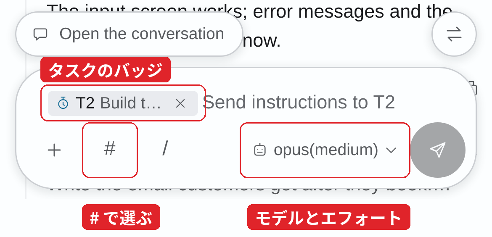
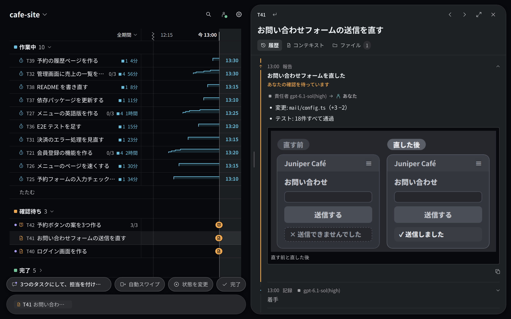
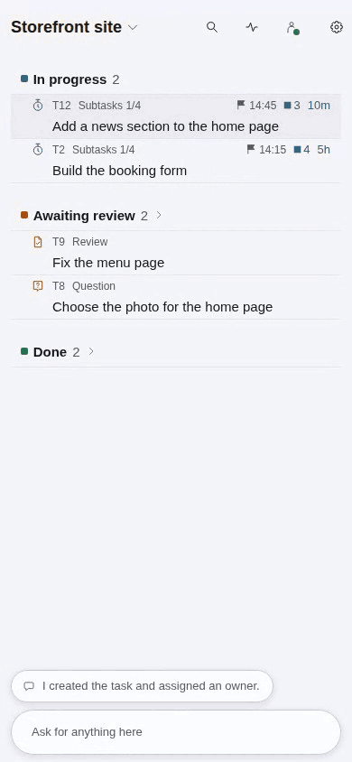

# 使いかた

画面での毎日の操作をまとめたページです。[はじめかた](getting-started.md) で最初の依頼を済ませたあとに、必要なところを読んでください。ほかのページは [ドキュメントの入口](README.md) から引けます。

- [頼みかた](#頼みかた)
- [一覧の見かた](#一覧の見かた)
- [タスクを開く](#タスクを開く)
- [あなたの番](#あなたの番)
- [あとで扱う・やめる・片づける](#あとで扱うやめる片づける)

## 頼みかた

入力欄は1つで、送ったものはすべて、窓口の AI（コーディネーター）に届きます。やりたいことを普通の言葉で書いて送ります。進んでいる仕事への追加や変更も、同じ入力欄に書きます。

```text
テストが落ちている原因を調べて、直してほしい。
```

```text
トップページの上に、臨時休業などを書ける「お知らせ」の欄を足してほしい。
```

コーディネーターが、依頼をタスクにして担当の AI に任せます。担当への具体的な依頼文も、コーディネーターが考えます。作業は担当が進めるので、前の依頼が終わるのを待たずに、続けて頼めます。順番や割り振りは、コーディネーターが整理します。

進め方の指定（「3案作って比べて」「できたら、別の AI に確かめさせて」）も、依頼にそのまま書きます。いつもそうしてほしいことは、[プロジェクト方針](projects.md#プロジェクト方針) に書きます。

### 依頼を送る

- **PC**: Enter で送信、Shift+Enter で改行です。
- **スマートフォンなど、タッチで操作する端末**: Enter は改行です。送信ボタンで送ります。

送った直後の3秒間は、「送信しました」の横に「取り消す」が出ます。押すと送信を取り消し、書いた文が入力欄に戻ります。

送った文は入力欄から消え、入力欄の上に、送信の状況やコーディネーターの返事の冒頭が出ます。担当の AI が作業を始めると、一覧の「作業中」にタスクが出ます。進まないときは [送ったのに進まない](troubleshooting.md#送ったのに進まない) を見てください。

### タスクやプロジェクトを指定する

**タスクのバッジ**は、入力欄に入る、タスクの番号と題名の印です。タスクを開くと入り、入力欄の「#」からも選べます。「#」からは、プロジェクトも選べます。バッジは、どのタスクの話かをコーディネーターに伝える参考情報で、付けなくてもかまいません。コーディネーターは、書かれた内容と、進んでいる仕事を見て、どのタスクに頼むかを決めます。1つの依頼を、いくつかのタスクに分けて頼むこともあります。



### ファイルを添付する

入力欄の「＋」（添付）からファイルを選びます。画像は、貼り付けや、画面へのドラッグ＆ドロップでも入ります。1回の送信で添付できるのは20件までです。1つのファイルの大きさの上限は、[設定](reference.md#サーバー) で変えられます。

スマートフォンでスクリーンショットに書き込んで送る方法は、[スマートフォンでの伝え方のコツ](remote.md#スマートフォンでの伝え方のコツ) にあります。

### モデルとエフォート

送信ボタンの横で選ぶモデルとエフォートは、コーディネーターのものです。コーディネーターの仕事はタスクの整理と担当への依頼なので、高性能なモデルの low か medium をおすすめします。エフォートを高くする必要は、あまりありません。選んだものは、その端末のブラウザに残ります。

担当の AI のモデルは、ここでは決まりません。プロジェクト方針や依頼に書いた指定に沿って選ばれ、指定が無ければ、設定のデフォルトのものが使われます（書き方の例は [alpacawork の考え方](concept.md#設定ではなく言葉で伝える)、選べるモデルを足す手順は [モデルやエフォートを足す](projects.md#モデルやエフォートを足す)）。

コーディネーターを別の種類の AI エージェントに替えるとき（Claude Code から Codex へ、など）は、新しい会話が要ります。下の「会話を消す」で会話を新しくしてから選びます。

### コーディネーターとの会話

入力欄の上の表示を押すと、コーディネーターとのやり取り（会話）が開きます。これまでに送った文と返事を読めます。

- **送った文が順番を待っているとき**: 「今すぐ送る」で、コーディネーターの作業の区切りに読んでもらえます。「取り消す」で取り下げられます。
- **会話を新しくするとき**: 会話のいちばん下の「会話を消す」を押し、「もう一度で消去」と出たら、もう一度押します。消えるのはコーディネーターとの会話だけで、タスクとその履歴は残ります。順番を待っていた文は取り下げられ、コーディネーターが処理している途中なら、その処理も止まります。処理が終わってから消してください。

### 画面に無い操作を頼む

頼めるのは、仕事だけではありません。次のようなことも、同じ入力欄からコーディネーターに頼めます。画面のどこで操作するかを探さなくても、たいていのことは、頼めば済みます。

- 設定の変更（「同時に動かす数を4にして」「方針に〜を足して」）
- 止まった AI の再開、担当の AI の交代
- プロジェクトの作成
- タスクのアーカイブや削除（[タスクを片づける](#タスクを片づける)）
- alpacawork の更新

アプリの設定で分からないことも、同じ入力欄で聞けます。たいていの設定は、AI が変更まで行います。AI エージェントへのサインインや API キーの入力など、いくつかは自分で行います。

## 一覧の見かた

一覧には、頼んだタスクが状態ごとに並びます。



### 区分

| 区分 | 意味 |
| --- | --- |
| 作業中 | AI が作業しています |
| 対応待ち | **あなたの番です。** AI の実行が失敗した、などの理由で止まっています |
| 確認待ち | **あなたの番です。** 質問か、できあがりの確認です |
| 待機中 | ほかの返事などを待っています |
| 未着手 | まだ始まっていません |
| 保留 | あなたが後回しにしたものです |
| 完了 | 終わったものです。中止したタスクもここに入ります |

- **「待機中」「保留」「完了」は、初めは閉じています。** 見出しを押すと開きます。完了にしたタスクが見当たらないときは、「完了」の見出しを押します。
- 「作業中」は4件、「確認待ち」は10件まで出ます。それより多いときは「あと N件」を押します。
- タスクが1件も無い区分は、出ません。
- タスクを開いたときや検索の結果では、報告の確認を待つタスクに「レビュー待ち」と出ます。一覧では「確認待ち」に並びます（「確認待ち」には、質問が届いたタスクも並びます）。

そのほかの言葉は [画面の言葉](reference.md#画面の言葉) にあります。

### 行に出る印

| 印 | 意味 |
| --- | --- |
| 行の左の小さな点 | 前に開いたあとで、変わったことがあります。開くと消えます |
| 「順番待ち」 | AI の実行が、空きを待っています（同時に動かす数の上限に達している、など） |
| 「T12 待ち」「後続 T15」 | T12 が終わるのを待っています／このタスクが終わるのを T15 が待っています |
| 「失敗」「上限停止」など（対応待ちの行） | 止まった理由です（[止まったときに決める](#止まったときに決める)） |
| 時間 | 作業中は AI が動いた時間の合計、そのほかは、その状態になってからの時間です |

### 子のタスク

AI は、大きな仕事を子のタスクに分けて進めます。一覧に並ぶのは、頼んだ単位のタスク（いちばん上のタスク）です。子のタスクは、あなたの番になったときなどに、一覧に1行で出ます。

子のタスクの全体は、タスクを開いて「タスクツリー」を押すと見られます。

### プロジェクトで絞る・検索する

- **プロジェクトで絞る**: 画面の左上のプロジェクト名を押し、プロジェクトを選びます。一覧と検索が、そのプロジェクトに絞られます。プロジェクトが2つ以上あるときは、「すべてのプロジェクト」で全部を並べられます。
- **検索する**: 「タスクを検索」（スマートフォンでは虫眼鏡のボタン）に、題・本文の言葉か、タスクの番号を入れます。

## タスクを開く

一覧の行を押すと、タスクが開きます（PC では右側、スマートフォンでは下から）。題の下で、見るものを切り替えます。

| 名前 | 見られるもの |
| --- | --- |
| 履歴 | 質問、報告、依頼など、そのタスクのやり取りの全部。新しいものが上です。最初に開いています |
| コンテキスト | そのタスクのゴール、方針、結論、成果物など、AI が書いたまとめ |
| ファイル | AI が作ったファイル。「成果物」（あなたが開くもの）と「作業ファイル」に分かれています。ファイルがあるときだけ出ます |
| タスクツリー | 親と子のタスク。親か子があるときだけ出ます |
| 依存 | このタスクが待っているタスク（待ち先）と、このタスクを待っているタスク（後続）。待ち合うタスクがあるときだけ出ます |

ファイルや差分を押すと、その場で開きます。文書、画像、動画、コードの差分を見られ、「ダウンロード」ができます。文字のファイルは「内容をコピー」もできます。

## あなたの番

質問や報告が届くと、タスクが一覧の「確認待ち」に移ります。AI の実行が止まったときは「対応待ち」に移ります。どちらも、あなたが決めるまで進みません。

### 質問に答える

タスクを開くと、質問と、答えの案が出ます。おすすめの案には「おすすめ」と理由が付いています。

1. 案を押します。答えが入力欄に入ります。もう一度押すと外れます。
2. 送信します。**送るまでは、答えは届きません。**

- **案のどれでもないとき**: 「それ以外」を押し、入力欄に自分の言葉で書いて送ります。案が無い質問は「書いて答える」を押して書きます。
- **質問がいくつかあるとき**: 「問 1/3」のように出ます。それぞれに答えを選んでから、まとめて送ります。
- **「中止」の案があるとき**: 選んで送ると、そのタスクを止めます。

### 報告を確かめる

報告を読み、ファイルや差分があれば開いて確かめます。

- **よければ**: 「完了」（チェックのボタン）を押します。押すまで、タスクは終わりません。
- **直してほしいとき**: タスクを開いたまま、直してほしい点を入力欄に書いて送ります。担当の AI に伝わり、直したあとで、また報告が届きます。

### 止まったときに決める

AI の実行が失敗したときなどは、対応待ちに並びます。タスクを開くと、題の下に、止まった理由が出ます。

- **「やり直す」「止める」が出ているとき**: 続けてほしければ「やり直す」、やめるなら「止める」を押します。
- **「続ける」が出ているとき**: AI どうしの自動のやり取りが、上限の回数に達して止まっています。続けてよければ「続ける」を押します。
- **ボタンが無いとき**: 理由に書かれた案内に沿って、入力欄から指示を送ります。

理由ごとの意味と、利用上限に達したときの対応は、[タスクが「対応待ち」にある](troubleshooting.md#タスクが対応待ちにある) にあります。

### 次のタスクへ進む

「完了」を押すと、続けて、確認待ちの次のタスクが開きます。全部済むと「確認待ちに全部答えました」と出るので、「閉じる」を押して一覧に戻ります。

入力欄から答えを送ったときは、そのタスクに留まります。送ったあとも次のタスクへ移るようにするには、入力欄の上の「自動スワイプ」をオンにします（その端末のブラウザに残ります）。

スマートフォンでは、カードを右へスワイプすると「完了」や「送る」、左へスワイプすると「保留」になります。質問のカードを右へスワイプして送れるのは、答えを選ぶか書くかしたあとです。



## あとで扱う・やめる・片づける

### 保留にする

いま決めたくないタスクは、保留にします。タスクを開いて「状態を変更」を押し、「保留」を選んで「更新」を押します（スマートフォンでは、カードを左へスワイプしても同じです）。

頼んだ単位のタスク（いちばん上のタスク）を保留にすると、質問が届いていても「確認待ち」から外れ、一覧の「保留」に入ります。子のタスクを保留にしたときは、「保留」には並ばず、「確認待ち」に残ることがあります。あとで開くときは、親のタスクを開いて「タスクツリー」から開きます。保留にしても、動いている AI の作業は止まりません。止めるときは [作業を止める](#作業を止める) を使います。

戻すときは、保留にしたタスクを開いて「状態を変更」を押し、戻り先として出ている状態（「作業中」「レビュー待ち」など）を選んで「更新」を押します。

### 作業を止める

タスクを開いて「状態を変更」を押し、「中止」を選んで「更新」を押します。そのタスクと、下のタスクの作業が止まります。入力欄で「〜のタスクを止めて」と頼んでも止められます。

中止の直後に「取り消す」は出ません。中止したタスクは、一覧の「完了」に入ります。止めたタスクをもう一度進めたいときは、入力欄で頼みます。

### 操作を取り消す

送信、完了、保留、保留を外す操作は、直後の3秒間に出る「取り消す」で取り消せます。中止には「取り消す」は出ません。

### タスクを片づける

タスクをアーカイブしたり削除したりするボタンは、画面にありません。入力欄で頼みます。

```text
終わったタスクを、まとめてアーカイブして。
```

- **アーカイブ**: 終わったタスクを一覧から外します。ふだんの片づけには、こちらを使います。
- **削除**: 間違えて作ったタスクを、一覧から外します。

どちらも、タスクのファイルは残り、あとで一覧に戻せます。戻すときは、「完了」を開き、いちばん下の「アーカイブ・削除 N件」を押して、戻したいタスクの「元に戻す」を押します。
