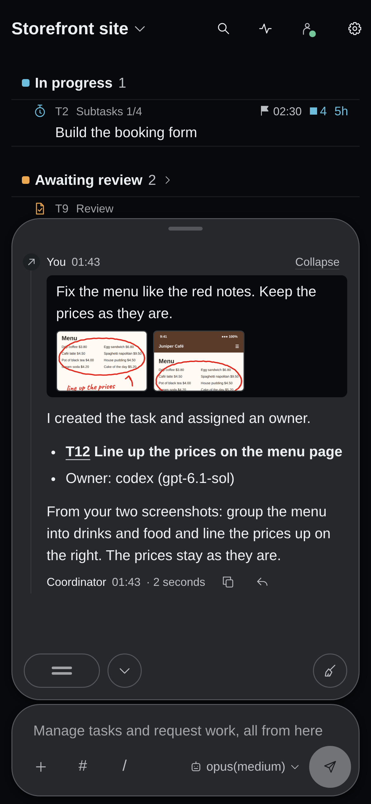

# スマートフォンやいつもの会話から使う

PC のブラウザのほかに、スマートフォンと、いつもの Claude Code・Codex の会話から使う手順をまとめたページです。あなたの番を知らせる通知も、ここにあります。ほかのページは [ドキュメントの入口](README.md) から引けます。

- [スマートフォンで使う](#スマートフォンで使う)
- [通知](#通知)
- [スマートフォンでうまくいかないとき](#スマートフォンでうまくいかないとき)
- [いつもの Claude Code・Codex から使う](#いつもの-claude-codecodex-から使う)

PC でブラウザのタブではなくアプリとして開く方法は、[画面を開き直す](manage.md#画面を開き直す) にあります。

## スマートフォンで使う

スマートフォンでは、PC で動いている alpacawork の画面を開いて使います。AI は PC の上で動くので、使っている間は PC を起動したままにし、スリープしない設定にします（ノート PC は、ふたを閉じると止まります）。

いつも電源を入れてある別の PC に alpacawork を入れて、手元の PC やスマートフォンから使うこともできます。手元の Claude Code や Codex の会話からつなぐ手順は、[セットアップの手順書](../../skills/alpacawork/references/setup.md#connect) にあります（英語です）。

PC とスマートフォンは、VPN（自分の端末どうしを安全につなぐ仕組み）でつなぎ、HTTPS の URL で開きます（HTTP の URL では開けません）。[Tailscale](https://tailscale.com/)（個人利用は無料）なら、どちらも用意できます。

あなたがすることは、次の5つです。PC 側の残りの準備は、AI が行います。

1. **PC とスマートフォンに Tailscale を入れ、同じアカウントでログインします。** Windows では、Ubuntu の中ではなく Windows に入れます。
2. **PC の AI エージェント（Claude Code や Codex など）に、「alpacawork をスマートフォンから使えるようにして」と頼みます。** PC の画面の「設定（歯車）→ アプリ・スマホ」に、コピーして貼れる指示文があります。
3. **PC の画面で「設定（歯車）→ アプリ・スマホ」を開きます。** 「スマホから使う」に QR コードと手順が出るので、スマートフォンのカメラで読み取って開きます。

   

4. **ホーム画面に追加します。** 画面に出る手順どおりに進めます（iPhone は Safari、Android は Chrome を使います）。アプリのように開けるようになります。
5. **通知を受け取ります。** ホーム画面に追加したアイコンから開き、[この端末で受け取る](#この端末で受け取る) の手順で登録します。

alpacawork の画面にログインはありません。VPN でつなぐ端末は、自分のものだけにします。

- インターネットに公開する設定（Tailscale Funnel、ルーターのポート開放など）は使いません
- 共用の PC や、人に貸すスマートフォンでは使いません（読んだ内容が、その機器のブラウザに残ります。消すには、ブラウザでサイトのデータを消去します）
- 端末をなくしたら、VPN からその端末を外します

スマートフォンでの操作（スワイプで完了・保留）は、[次のタスクへ進む](guide.md#次のタスクへ進む) にあります。

### スマートフォンでの伝え方のコツ

直してほしいところはスクリーンショットに書き込み、言葉は音声入力で足すと、文章を打って説明するより早く伝えられます。

<table>
  <tr>
    <td align="center" valign="top" width="33%"><b>1. 書き込む</b>  スクリーンショットに、そのまま書き込みます</td>
    <td align="center" valign="top" width="33%"><b>2. 共有して、話す</b>  共有か貼り付けで入力欄へ。言葉は、キーボードの音声入力で足します</td>
    <td align="center" valign="top" width="33%"><b>3. 送る</b>  窓口の AI が、タスクにして担当に任せます</td>
  </tr>
</table>

アプリとしてインストールした Android（Chrome など）なら、共有のボタンから入力欄へ送れます。iPhone では、スクリーンショットをコピーして入力欄に貼り付けるか、入力欄の「＋」から選びます。

## 通知

あなたの番が来たとき（質問、できあがりの確認、AI の実行が止まったとき）に、スマートフォンや PC へ通知を送れます。

### この端末で受け取る

通知は、端末（ブラウザ）ごとに登録します。受け取りたいスマートフォンと PC のそれぞれで、次のとおりにします。

1. 「設定（歯車）→ 自分」を開きます。
2. 「通知」の「プッシュ通知」で、「この端末で受け取る」を押します。
3. ブラウザが通知の許可を求めたら、許可します。

iPhone・iPad では、ホーム画面に追加したアイコンから開いた画面で行います（iOS・iPadOS 16.4 以降）。

### 届くタイミング

alpacawork を操作している間は、通知は送られません。最後に触った画面から別のアプリやタブへ移る（または画面をロックする）と30秒後に、画面を開いたまま操作をやめたときは5分後に、届くようになります。5分は、「設定（歯車）→ 自分」の「操作がないと離席に」で変えられます。

### 通知を止める

- **しばらく止める**: 画面の上の、人の形のボタン（通知の状態）を押し、「1時間止める」「2時間止める」か、朝まで止める項目（「明日 08:00 まで止める」など）を選びます。戻すときは、同じ場所で「再開する」を押します。
- **夜の間など、毎日決まった時間に止める**: 「設定（歯車）→ 自分」の「毎日止める時間帯」をオンにし、「止める時刻」と「再開する時刻」を選びます（初めは 22:00 〜 08:00）。時間帯が明けると、まだあなたを待っている知らせが、1通にまとめて届きます（その間に開いて読んだものや、もう済んだものは届きません）。

どちらも、登録したすべての端末に効きます。

### 知らせの種類を選ぶ

「設定（歯車）→ 自分」の「通知」で、知らせの種類ごとにオン・オフを選べます。登録したすべての端末に効きます。

| 項目 | 初め |
| --- | --- |
| タスクがレビュー待ちになったとき（できあがりの確認） | オン |
| タスクがあなたに質問したとき | オン |
| 対応が要る返事（AI の実行が止まったとき） | オン |
| タスクが完了したとき | オフ |
| タスクが中止になったとき | オン |
| 端末の負荷が厳しいとき | オン |

### 登録した端末を外す

「設定（歯車）→ 自分」の「登録した端末」に、通知を受け取る端末が並びます。使わなくなった端末やなくした端末は、「削除」を押して外します。ほかの端末からも外せます。

## スマートフォンでうまくいかないとき

| 起きていること | すること |
| --- | --- |
| 「アプリ・スマホ」に QR コードが出ない（「手順2が終わると、ここにQRコードが出ます。」と出ている） | 手順2（PC の AI に接続の準備を頼む）がまだ済んでいません。PC の AI エージェントに頼みます |
| スマートフォンで開けない | PC とスマートフォンの両方で、VPN がつながっているかを確かめます。PC が起動していてスリープしていないか（Windows では Ubuntu のウィンドウが開いているか）を確かめます。URL は `https://` で始まるものを使います。PC のブラウザで使っている `http://127.0.0.1:...` の URL は、スマートフォンからは開けません |
| 「この環境では受け取れません。HTTPS で画面を開いてください（iPhone は先にホーム画面へ追加）。」と出る | `https://` の URL で開き直します。iPhone では、ホーム画面に追加したアイコンから開きます |
| 「このサイトの通知がブロックされています。」と出る | ブラウザ（スマートフォンでは OS）の設定で、このサイトの通知を許可してから、もう一度「この端末で受け取る」を押します |
| 登録したのに通知が来ない | alpacawork の画面を使っている間は届きません（[届くタイミング](#届くタイミング)）。通知を止めていないか（[通知を止める](#通知を止める)）、その種類がオフになっていないか（[知らせの種類を選ぶ](#知らせの種類を選ぶ)）を確かめます。「タスクが完了したとき」は、初めはオフです |

それでも直らないときは、PC の AI エージェントに、起きていることをそのまま伝えて相談します（[AI に相談するときに渡すもの](troubleshooting.md#ai-に相談するときに渡すもの)）。

## いつもの Claude Code・Codex から使う

alpacawork の画面を使わずに、いつもの Claude Code や Codex の会話から頼むこともできます（会話が窓口になるのは、この2つです）。会話の最初に1回、alpacawork スキルを呼びます（Claude Code は `/alpacawork`、Codex は `$alpacawork`）。そのあとは、やりたいことや「いまの状況を教えて」をそのまま書けば、その会話が窓口になります。

Claude Code で `/alpacawork` が出ないときは、Claude Code に「`~/.agents/skills/alpacawork` を、Claude Code のスキルとして使えるようにして」と頼みます。
