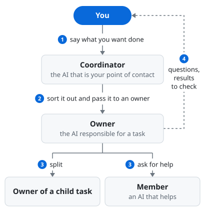
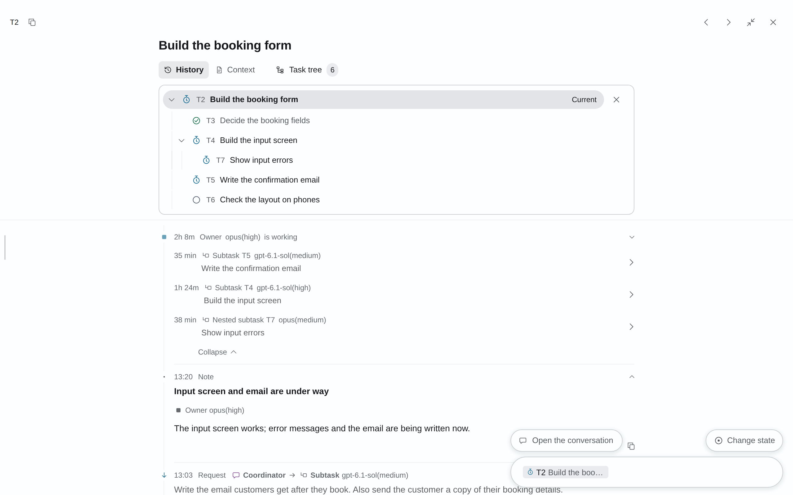

# As ideias por trás do alpacawork

Esta página explica para que serve o alpacawork, como uma solicitação passa por ele e o raciocínio por trás do seu design. Ela é para quem quer entender as ideias e aproveitar melhor o alpacawork. Para instruções passo a passo, consulte [Primeiros passos](getting-started.md).

## O que ele resolve

Quando você entrega vários trabalhos a agentes de IA ao mesmo tempo, o trabalho de gerenciá-los fica com você: lembrar o que pediu e onde, acompanhar o andamento de cada um e decidir quem faz o quê. O alpacawork passa esse trabalho para a IA. Você diz o que quer que seja feito, responde às perguntas da IA e revisa o que ela fez.

## Por que ele foi criado

Já existem muitos serviços que permitem dar instruções pelo celular à IA que está no seu PC, entre eles o Claude e o ChatGPT. Mas todos partem do princípio de que você trabalha no PC. No celular, quase tudo o que dá para fazer são operações de apoio, como ver o andamento ou pedir correções simples. Acompanhar o trabalho e revisar os resultados em uma tela pequena foi mais estressante do que eu imaginava. Foi por isso que comecei a criar o alpacawork.

Desde o início, criei o alpacawork pensando em levar o trabalho adiante pelo celular. Para que você não precise acompanhar o andamento em detalhes em uma tela pequena, o gerenciamento das tarefas e das IAs fica com a IA, e você só precisa falar com a IA que é seu ponto de contato (o coordenador).

## Como funciona

  

Suponha que você peça: “Crie um formulário de reservas para o site da loja.”

1. **Toda solicitação vai para o coordenador, a IA que é seu ponto de contato.** Trabalhos novos e acréscimos ou mudanças em trabalhos em andamento vão todos no mesmo campo de mensagem. Pergunte “O que está em andamento agora?” e ele responde.
2. **O coordenador olha o trabalho já em andamento e decide como prosseguir.** Ele decide se acrescenta a solicitação a uma tarefa já em andamento, se cria uma nova tarefa ou se a inicia depois que outras tarefas terminarem; em seguida, passa a solicitação à IA responsável pela tarefa (o responsável). Se ficar em dúvida, ele confirma com você. O chat já fica pronto para a sua próxima solicitação.
3. **O responsável leva a tarefa até o fim.** Ele divide o trabalho em tarefas menores, como “Definir os campos da reserva”, “Criar a tela de preenchimento”, “Escrever o e-mail enviado após a reserva” e “Verificar como fica no celular”, e delega cada uma a uma IA adequada. As partes que não dependem umas das outras avançam em paralelo.
4. **Chega a sua vez quando é preciso que você decida.** O que a IA não consegue decidir sozinha (por exemplo, quais campos o formulário de reservas deve ter) chega a você como uma pergunta com opções, motivos e uma recomendação. Quando o trabalho termina, a tarefa aparece em “Aguardando revisão” com um relatório; revise e marque a tarefa como concluída, ou descreva o que precisa mudar e devolva-a. Se a execução de uma IA falhar e parar, também é a sua vez. O alpacawork pode notificar o seu celular sempre que for a sua vez.

O histórico de cada tarefa registra quem pediu o quê e o que cada IA fez, para que você possa reconstituir depois o que aconteceu.

O modelo e o esforço que você escolhe no campo de mensagem valem para o coordenador. Os modelos dos responsáveis você define na política do projeto ou na sua solicitação ([Pedir](getting-started.md#pedir)).

Os responsáveis são os próprios agentes de IA que estão no seu PC, como o Claude Code e o Codex. O alpacawork não acrescenta nenhuma IA própria; ele mantém o registro das tarefas e cuida de passar o trabalho para a IA e recebê-lo de volta.

## Os elementos

| Nome | Descrição |
| --- | --- |
| Projeto | Um conjunto de trabalhos, com a pasta em que a IA trabalha e as regras básicas para a IA (a política do projeto) |
| Tarefa | Um trabalho. A IA divide um trabalho grande em subtarefas |
| Coordenador | A IA que é seu ponto de contato. Ela olha o trabalho em andamento, decide se uma solicitação vira uma nova tarefa ou entra em uma tarefa atual e a repassa a um responsável |
| Responsável | A IA que responde pelo resultado de uma tarefa |
| Membro | Uma IA que um responsável chama para ajudar |
| Sua vez | Uma situação que só avança quando você age: uma pergunta, um resultado para revisar, a execução de uma IA que falhou e parou, entre outros |

## Princípios de design

### Não faz mais do que precisa

O alpacawork cuida do gerenciamento de tarefas e da mecânica de passar o trabalho para a IA e receber os resultados de volta. Ele não dita os detalhes de como a IA trabalha nem de como ela relata. Para que a IA trabalhe do seu jeito, escreva o que você quer na política do projeto ou no `AGENTS.md`, ou coloque os passos em uma skill, como você já faz com o seu agente de IA ([Diga com palavras, não com configurações](#diga-com-palavras-não-com-configurações)).

As skills, o MCP e o `AGENTS.md` que você usa hoje continuam funcionando sem mudanças, e o ambiente que você construiu também beneficia a IA que trabalha no alpacawork. Nada fica no meio do caminho para vigiar ou interromper o que a IA faz, então não há gasto extra de tempo nem de tokens com isso.

### As pessoas só decidem e revisam

A IA decide como prosseguir, quem faz o quê e como verificar o trabalho. Ela também cuida do gerenciamento: a ordem entre as tarefas, se continua a conversa de um responsável ou inicia uma nova, e se transfere o trabalho para outra IA. Você pode continuar fazendo solicitações no mesmo campo de mensagem, sem precisar acompanhar o andamento ou a ordem para descobrir quem deve fazer o quê.

Só chega a você o que só você pode decidir.

- Perguntas sobre preferências e direção (com opções, motivos e uma recomendação)
- Revisão do que foi feito
- Aprovação de operações com efeitos externos (como publicar ou excluir)

São as regras básicas que dizem quando a IA deve perguntar a você; nenhum mecanismo as impõe ([Escrever as regras básicas para a IA](getting-started.md#5-escrever-as-regras-básicas-para-a-ia)).

### Na tela, só o que você usa

O que não é usado não é criado nem exibido. Você pode pedir ao coordenador, em linguagem simples, a maioria das operações, como alterar configurações, criar um projeto e atualizar; por isso, são necessários poucos botões e formulários para trabalhos específicos.

A tela se concentra no que foi feito e no que depende da sua decisão. Suas solicitações são listadas por status, para que você veja o que está avançando e o que está esperando por você. Você pode abrir a troca detalhada de mensagens com a IA quando precisar.

Como a tela traz apenas o que você usa, ela cabe bem em um celular.

### Diga com palavras, não com configurações

Escreva o que você quer que a IA faça em frases simples, e não por meio de configurações.

- **Política do projeto**: regras básicas que chegam a todos os responsáveis do projeto. Escreva coisas como “Para mudanças na aparência, mostre uma prévia antes de criar” ou “Rode apenas os testes da área que mudou”. Quanto mais você disser sobre o que a IA pode decidir e sobre o que ela deve perguntar a você, menos perguntas você recebe.
- **`AGENTS.md`, `CLAUDE.md`**: como de costume, a IA lê os que estão na pasta de trabalho do projeto.

As solicitações para o trabalho do momento também são frases simples. Por exemplo:

- “Faça isso com o opus do Claude Code, com esforço high”
- “Peça ao Claude Code e ao Codex que cada um faça uma versão e depois compare as duas para mim”
- “Quero que isso fique pronto rápido, então divida o trabalho e faça as partes em paralelo”
- “Quando terminar, peça que um modelo diferente do que criou verifique o resultado”
- “Rode apenas os testes relacionados à mudança”
- “A IA que está trabalhando nisso parece ter se confundido; troque por uma nova IA e continue”

Quando o responsável é substituído, as decisões e os resultados ficam nos registros da tarefa, então a nova IA continua a partir dali. Coloque na política do projeto o que você quer sempre (por exemplo, “Implementação com o Codex, verificação dos resultados com o Claude Code”).

## Para o que ele não serve

- **Uso em equipe**: é uma ferramenta para uma pessoa só. Por enquanto, a tela não tem login e não há como separar usuários.
- **Exposição à internet**: ele pressupõe que os outros dispositivos se conectem por uma VPN em que só estão os seus próprios dispositivos ([Usar pelo celular](getting-started.md#6-usar-pelo-celular)).
