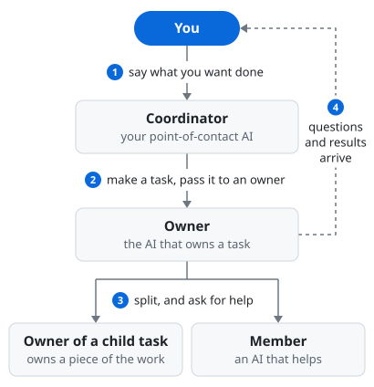
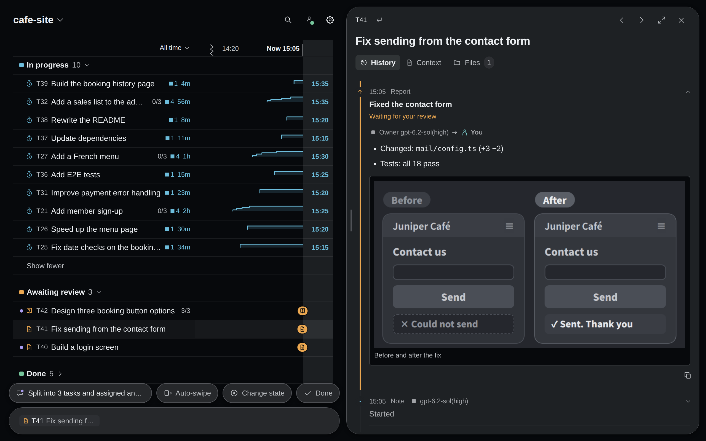

# As ideias por trás do alpacawork

Esta página explica o que acontece nos bastidores depois que você envia uma solicitação e o que cabe a você fazer.

## Para que serve

Quando você entrega vários trabalhos à IA, fica com você o trabalho de lembrar o que pediu e onde, acompanhar o andamento de cada um e decidir quem faz o quê em seguida. O alpacawork entrega também esse trabalho de gerenciamento à IA.

Você faz três coisas: pede, responde às perguntas e revisa o resultado. Tudo foi feito para funcionar também no celular.

## O trabalho avança por tarefas, não por conversas

A maioria das ferramentas para agentes de IA organiza o trabalho em torno da conversa com a IA. O alpacawork organiza em torno de tarefas. Cada tarefa recebe IAs adequadas ao trabalho, e essas IAs podem ser trocadas no meio do caminho.

Por isso, a tela mostra as tarefas que você pediu, não conversas com a IA. Você pede pelo campo de mensagem na parte de baixo da tela. A resposta do coordenador aparece acima do campo de mensagem; pressione-a para abrir a conversa.

O trabalho é organizado por tarefas por estes motivos:

- **O que você quer saber é o resultado, não a conversa.** O que foi feito, o que falta e as perguntas para você ficam reunidos por tarefa. Não é preciso voltar por uma conversa longa para encontrá-los.
- **Tarefas e conversas não se correspondem um a um.** O que um trabalho envolve muda no caminho. Em uma conversa se misturam vários trabalhos, e um trabalho se estende por várias conversas. No alpacawork o registro fica na tarefa, então começar uma conversa nova não apaga o histórico nem os resultados.
- **Troque a IA, e o trabalho continua.** Seja trocando a IA atribuída por outro modelo, seja passando do Claude Code para o Codex, a nova IA continua a partir do registro da tarefa.
- **Uma tarefa pode avançar com várias IAs.** Você pode colocar uma IA em cada papel, como uma que constrói e outra que revisa.
- **A IA gerencia trabalhos grandes como uma hierarquia de tarefas.** A IA divide o trabalho em subtarefas, e as tarefas ficam separadas por projeto. Na lista, você vê até onde cada uma chegou.

## Como uma solicitação avança

Suponha que você peça: “Crie um formulário de reservas para o site da loja”. Os números da figura são os mesmos do texto abaixo.

  

1. A solicitação que você escreve no campo de mensagem chega à IA que é seu ponto de contato (o coordenador).
2. O coordenador decide se cria uma nova tarefa ou se acrescenta a uma tarefa em andamento e passa essa tarefa à IA que cuida dela (o responsável).
3. O responsável divide o trabalho em subtarefas, como “Definir os campos da reserva”, “Criar a tela de preenchimento” e “Conferir a exibição no celular”, e entrega cada uma a um responsável próprio. Quando precisa de ajuda, chama membros (IAs que ajudam). O que não precisa esperar avança em paralelo. O resultado de cada subtarefa volta ao responsável acima dela.
4. O que a IA não consegue decidir, como “Quais campos colocar na reserva”, chega a você como uma pergunta com opções e uma recomendação. Quando o trabalho fica pronto, chega um relatório. Revise o relatório e pressione “Concluir” para terminar.

No histórico da tela aparecem os nomes dos papéis, como “Responsável”. Todas essas IAs são o próprio Claude Code, Codex ou outro agente que está no seu PC.

## O que chega até você

Só chega a você o que só você pode decidir. As tarefas com uma pergunta ou um relatório ficam em “Aguardando revisão” na lista, e as tarefas em que a execução da IA parou ficam em “Requer atenção”.

- Perguntas para escolher preferências ou direção
- Revisão do que ficou pronto
- Aprovação de operações com efeitos externos, como publicar ou excluir
- Decisões quando a execução da IA para

A IA decide a forma de trabalhar, a divisão do trabalho, a ordem e a forma de verificar. Você pode continuar pedindo sem esperar a solicitação anterior terminar.

## Diga como prosseguir com palavras

Em vez de procurar itens nas configurações, peça em frases simples.

- “Faça este trabalho com o opus, esforço high”
- “Peça ao Claude Code e ao Codex que cada um faça uma proposta e me mostre as duas comparadas”
- “Quando terminar, peça que um modelo diferente do que criou verifique”
- “A IA responsável parece ter se confundido; troque por uma nova IA e continue”

O que você quer sempre, escreva na [política do projeto](projects.md#política-do-projeto). A política é um combinado com a IA, não um mecanismo que a impede.

O `AGENTS.md`, o `CLAUDE.md`, as skills e o MCP que você usa hoje continuam funcionando como estão.

## Para o que ele não serve

- Uso em equipe: é uma ferramenta para uma pessoa só. A tela não tem login.
- Exposição à internet: ele pressupõe que os outros dispositivos se conectem por uma VPN em que só estão os seus próprios dispositivos.
