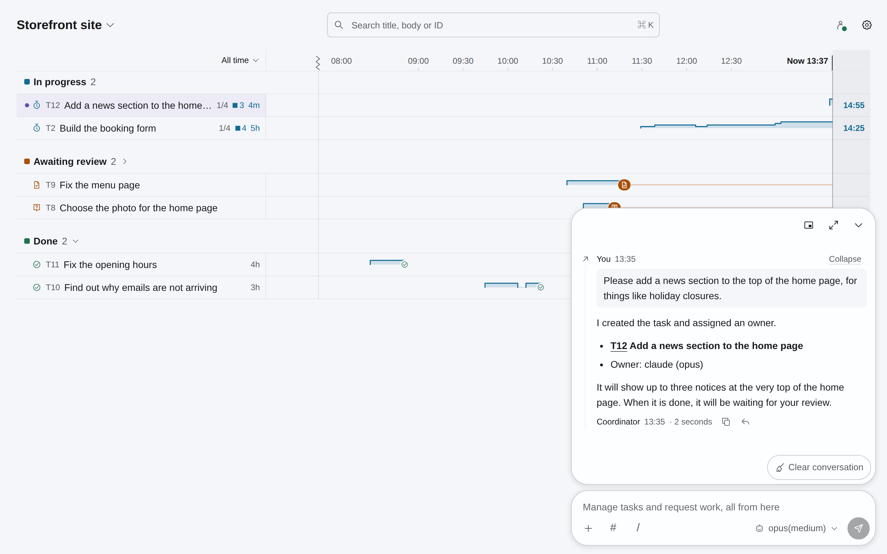
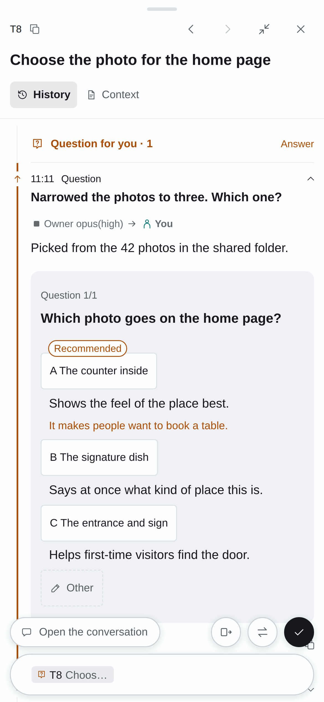
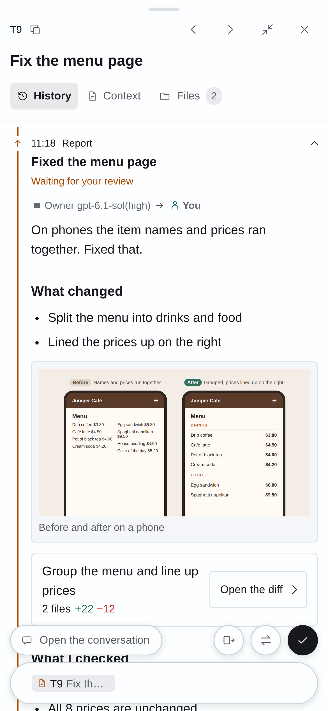

# Primeiros passos

Este guia leva você da instalação do alpacawork ao uso no dia a dia. Siga os passos 1 a 3 em ordem para fazer uma primeira solicitação, responder a uma pergunta da IA e revisar um resultado. Leia do passo 4 em diante quando precisar.

**Experimente primeiro**

1. [Instalar](#1-instalar)
2. [Fazer a primeira solicitação](#2-fazer-a-primeira-solicitação)
3. [Acompanhar o andamento e responder](#3-acompanhar-o-andamento-e-responder)

**Use no seu trabalho**

4. [Escrever as regras básicas para a IA](#4-escrever-as-regras-básicas-para-a-ia)
5. [Usar pelo celular](#5-usar-pelo-celular)
6. [Usar a partir do Claude Code ou do Codex](#6-usar-a-partir-do-claude-code-ou-do-codex)

**Manutenção**

7. [Parar, atualizar ou desinstalar](#7-parar-atualizar-ou-desinstalar)

Veja também: [O que é armazenado e o que é enviado para fora](#o-que-é-armazenado-e-o-que-é-enviado-para-fora), [Solução de problemas](#solução-de-problemas). Para saber como o alpacawork funciona e por quê, consulte [As ideias por trás do alpacawork](concept.md).

As imagens deste guia mostram a tela em inglês. A tela começa no idioma que você usou com a IA que fez a instalação. Você pode mudá-lo no canto superior direito da tela de configuração inicial e, depois, em Configurações (a engrenagem) → Pessoal → Idioma de exibição.

## 1. Instalar

O alpacawork é uma ferramenta para uma pessoa só, no próprio PC. Para usá-lo em outros dispositivos, como um celular, conecte-se por uma VPN ([Usar pelo celular](#5-usar-pelo-celular)).

O alpacawork inicia agentes de IA, como o Claude Code e o Codex, com permissões totais, sem pedir confirmação. A IA pode fazer tudo o que poderia fazer se você a executasse por conta própria com permissões totais. Você pode escrever na política do projeto o que ela não deve fazer, ou o que deve perguntar a você antes ([como escrever](#4-escrever-as-regras-básicas-para-a-ia)).

Para instalar, você pede a uma IA.

1. **Cole o texto de instalação.** Copie o texto da seção [Instalar](https://github.com/alpacakit/alpacawork/blob/main/README.pt-BR.md#instalar) do README e cole-o, sem alterações, em um agente de IA no seu PC (como o Claude Code ou o Codex).
2. **A IA instala.** Ela verifica se o alpacawork pode rodar neste PC, instala o que falta e inicia o alpacawork. Você não executa comandos nem responde a confirmações durante o processo. Se o seu próprio agente de IA pedir permissão para executar um comando, permita.
3. **A tela de configuração inicial abre no navegador.** A IA também informa a URL. Depois que você reiniciar o PC e fizer login, a mesma URL volta a funcionar. Se esquecer a URL, pergunte à IA ou execute `alpacawork workspace url` em um terminal.

A tela de configuração inicial tem três etapas: os agentes de IA a usar (e se você quer enviar [dados de uso](telemetry.md)), as [skills](#skills) a instalar e o seu primeiro projeto. Cada etapa traz a própria explicação, e tudo o que está nela pode ser alterado depois em Configurações.

### Requisitos

- macOS (Apple silicon), Linux (x64, glibc) ou Windows (dentro do WSL2; veja [No Windows](#no-windows) abaixo)
- [Node.js](https://nodejs.org/pt-br) 24.16 ou posterior
- Chrome ou Edge 111, Safari 16.4 (iOS/iPadOS 16.4 no iPhone e no iPad) ou Firefox 128, ou versões posteriores. Navegadores mais antigos mostram uma página em branco
- Um agente de IA em que você já fez login (como o Claude Code ou o Codex)

Durante a instalação, a IA verifica esses itens e instala o Node.js se ele estiver faltando.

### Agentes de IA compatíveis

| Agente de IA | O que ele exige |
| --- | --- |
| [Claude Code](https://claude.com/claude-code), [Codex](https://github.com/openai/codex) | Login pela própria CLI |
| [GitHub Copilot](https://github.com/features/copilot) | Nada a instalar: ele vem junto com o alpacawork. Funciona com o login da sua GitHub CLI (`gh auth login`) |
| Grok Build (`grok`), Antigravity (`agy`), pi (`pi`) | Login ou uma chave de API. O alpacawork só consegue saber se eles estão instalados, não se estão com login feito |

A primeira etapa da tela de configuração inicial mostra quais deles estão instalados neste PC e, para os três primeiros, se estão com login feito. É ali que você ativa os que vai usar. Depois, você pode mudar isso em Configurações → Servidor.

Quando uma empresa de IA lança um modelo novo, você mesmo pode adicioná-lo. Peça no chat, por exemplo “Adicione o Gemini 4 aos modelos do Antigravity”, e a IA o adiciona às configurações. Você também pode editar os modelos por conta própria em Configurações → Servidor.

Em uma mesma solicitação, você pode dividir os papéis: por exemplo, o design com o Claude Code e a implementação com o Codex.

Cada agente de IA roda com o seu plano e as suas configurações atuais.

- **Claude Code**: o `CLAUDE.md`, as skills, o MCP, os hooks e a memória são usados dos lugares de sempre, sem mudanças
- **Codex**: são usados as suas configurações de sempre, o `AGENTS.md`, as skills, o MCP e os hooks. Só o histórico de conversas e a memória ficam em um lugar separado para o alpacawork (`~/.codex-alpacawork`)

O uso de IA é cobrado, e limitado, de acordo com os planos dos seus agentes de IA, e cada IA em execução ao mesmo tempo conta para eles. No início, até 8 rodam ao mesmo tempo. Você pode mudar isso em “Máx. de execuções simultâneas”, em Configurações → Servidor, na tela.

### No Windows

No Windows, o alpacawork, o Node.js e os agentes de IA ficam todos dentro do Ubuntu no WSL2 (uma forma de rodar o Linux dentro do Windows). Cole o texto de instalação também em um agente de IA iniciado dentro do Ubuntu.

Se você ainda não tem o WSL2 ou o Ubuntu, cole o mesmo texto de instalação em um agente de IA rodando no Windows, e ele orienta você a configurá-los primeiro. Para instalá-los por conta própria, execute `wsl --install` no PowerShell aberto como administrador ([instruções da Microsoft](https://learn.microsoft.com/pt-br/windows/wsl/install)).

O alpacawork roda dentro do Ubuntu, e você abre a tela dele em um navegador no Windows. Ele só roda enquanto o Ubuntu está em execução.

- **Mantenha uma janela do Ubuntu aberta enquanto usa o alpacawork.** Isso também vale enquanto você o usa pelo celular. Se você fechar todas as janelas do Ubuntu, o Ubuntu pode parar, e o alpacawork e qualquer IA em atividade param junto.
- **Depois de reiniciar o Windows, abra o Ubuntu pelo menu Iniciar.** O alpacawork então inicia automaticamente, com as suas tarefas como você as deixou. Não é preciso instalar de novo.

## 2. Fazer a primeira solicitação

Enquanto você não tem tarefas, a tela mostra exemplos de solicitações para experimentar. Clique em um para colocá-lo no campo de mensagem e envie sem alterar. Cada exemplo mostra um fluxo diferente: IAs com modelos diferentes criando candidatos em paralelo para você escolher, a IA pedindo que você escolha uma ideia e então criando o que foi escolhido, e a revisão de um resultado para marcá-lo como concluído. Cada um é um treino curto, que leva poucos minutos.


No início, o alpacawork usa o agente padrão que você escolheu na configuração inicial. Para mudar, clique em “Definir como padrão” na IA desejada, em Configurações (a engrenagem) → Servidor. Se uma IA não estiver com login feito, ou se o executável dela não for encontrado, a mesma tela diz o que fazer em seguida. Para detalhes como definir o local do executável, consulte o [guia de configuração](../../skills/alpacawork/references/config.md#executable-location-and-sign-in-status) (em inglês).

### Escolher a pasta de trabalho

Você escolhe a pasta em que a IA trabalha durante a configuração inicial, em “Local do código”, na terceira etapa. Para mudar depois, clique no nome do projeto no topo da tela, abra as configurações dele e informe o local da pasta em “Local do código” (por exemplo, `/Users/seunome/site-da-loja`). Se você deixar em branco, a IA trabalha na pasta de dados (`~/alpacawork`).

A IA também lê o `AGENTS.md` e o `CLAUDE.md` dessa pasta (arquivos de instruções daquela pasta, que uma IA lê todas as vezes). Para manter trabalhos diferentes separados, adicione projetos com “Novo projeto”, no mesmo menu.

### Pedir

Há um único campo de mensagem, e tudo o que você envia vai para o coordenador, a IA que é seu ponto de contato. Escreva em linguagem simples o que você quer que seja feito e envie. Acréscimos e mudanças em trabalhos já em andamento vão no mesmo campo.

```text
Descubra por que os testes estão falhando e corrija.
```

```text
Adicione uma área de “Avisos” no topo da página inicial, para a gente publicar coisas como fechamentos imprevistos.
```

O coordenador transforma a sua solicitação em uma tarefa, delega-a a uma IA responsável pela tarefa (o responsável) e escreve as instruções específicas para esse responsável. São os responsáveis que fazem o trabalho, então você pode continuar fazendo solicitações sem esperar as anteriores terminarem. O coordenador organiza a ordem e quem faz o quê.

Você pode pedir mais do que trabalho. No mesmo campo de mensagem, você pode pedir ao coordenador que altere configurações, retome uma IA que parou, crie um projeto, atualize o alpacawork e muito mais. A maioria das coisas se resolve só pedindo, sem procurar o lugar certo na tela.

Se tiver dúvida sobre qualquer configuração do app, pergunte também ali. A IA consegue mudar a maioria das configurações por você. Algumas etapas, como o login em um agente de IA e a inclusão de chaves de API, ficam com você.


**Etiqueta da tarefa**: um rótulo no campo de mensagem que mostra o número e o título de uma tarefa. Ela é adicionada quando você abre uma tarefa, e você também pode escolher uma tarefa com “#” no campo de mensagem. A etiqueta só indica ao coordenador de qual tarefa você está falando; você não precisa adicionar uma. O coordenador decide para qual tarefa vai a sua solicitação, com base no que você escreveu e no trabalho em andamento. Ele também pode dividir uma solicitação entre várias tarefas.

**Modelo e esforço**: o modelo e o esforço que você escolhe ao lado do botão de enviar valem só para o coordenador. O trabalho dele é organizar tarefas e repassar solicitações aos responsáveis, por isso recomendamos um modelo capaz com esforço low ou medium; o esforço high raramente é necessário. Esse seletor não define os modelos dos responsáveis. Eles seguem a política do projeto ou a sua solicitação e, se nenhuma das duas especificar um, é usado o padrão das configurações (para exemplos de como escrever isso, veja [As ideias por trás do alpacawork](concept.md#diga-com-palavras-não-com-configurações)).


## 3. Acompanhar o andamento e responder

A lista mostra as suas tarefas, agrupadas por status.



| Grupo | Significado |
| --- | --- |
| Em andamento | Uma IA está trabalhando na tarefa |
| Requer atenção | **Sua vez.** A tarefa parou, por exemplo, porque a execução de uma IA falhou |
| Aguardando revisão | **Sua vez.** Uma pergunta ou um resultado para revisar |
| Aguardando | Esperando outra coisa, como outra resposta |
| Não iniciadas | Ainda não começaram |
| Adiadas | O que você deixou para depois |
| Concluídas | Terminadas |

A sua vez chega de uma destas três formas.

### Responder a uma pergunta

Quando a IA não consegue decidir algo sozinha, ela pergunta a você, com opções, motivos e uma recomendação. Escolha uma opção ou escreva a sua própria resposta e envie.



### Revisar um resultado

Quando uma tarefa termina, ela aparece em Aguardando revisão. Leia o relatório e, se estiver tudo certo, clique em “Concluir” (o botão com a marca de verificação). Se quiser mudanças, descreva-as no campo de mensagem e envie.

No celular, deslize um cartão para a direita para “Concluir” ou “Enviar”, ou para a esquerda para “Adiar”. Depois que você marca uma tarefa como concluída, o próximo cartão abre.

<p>
  &nbsp;&nbsp;
  
</p>

### Decidir o que fazer quando algo parar

Se a execução de uma IA falhar, por exemplo, a tarefa aparece em Requer atenção. Abra-a para ver por que ela parou. Para continuar, clique em “Tentar novamente” ou envie algo como “continue” pelo campo de mensagem. Para desistir dela, clique em “Parar”. Se ela parou por outro motivo, siga a orientação exibida junto com o motivo e envie uma instrução pelo campo de mensagem.


## 4. Escrever as regras básicas para a IA

Em “Política do projeto”, nas configurações do projeto, escreva em frases simples o que a IA pode decidir sozinha e o que ela deve perguntar a você. O que você escreve chega a todos os responsáveis daquele projeto. Você também pode pedir no chat: “Adicione … à política”.


```text
Objetivo: deixar o site da loja fácil de ler no celular e publicá-lo
Como trabalhar: para mudanças na aparência, me mostre uma prévia e pergunte antes de criar
Decida por conta própria: como prosseguir, testes e limpeza; decida sem perguntar e relate
Não faça: publicar ou enviar qualquer coisa para fora sem a minha aprovação
```

Para dizer como tratar um trabalho específico, escreva na própria solicitação (“Faça três versões e compare”, “Quando terminar, peça que outra IA verifique”). Como de costume, a IA também lê o `AGENTS.md` e o `CLAUDE.md` da pasta de trabalho e usa as suas skills atuais.

A política do projeto é um conjunto de regras básicas dadas à IA, não um mecanismo que as impõe. Para limitar de fato o que a IA consegue alcançar, execute-a em um PC separado ou com um usuário separado do sistema operacional (a conta com que você faz login no PC).

Não há um recurso dedicado de memória. A troca de mensagens de cada tarefa fica nos registros dela e é passada à IA quando você pede que ela continue. Coloque na política do projeto tudo o que ela deve ter sempre em mente. Se precisar de mais, instale uma skill de memória; ela funciona sem mudanças.

### Skills

Uma skill é um conjunto de instruções que diz aos agentes como trabalhar. A segunda etapa da configuração inicial oferece três que facilitam delegar tarefas (askmeclearly, doyourjob e alpacawork-betterquality) e diz para que serve cada uma. Elas são instaladas em `~/.agents/skills`, na sua pasta pessoal, e vinculadas para que o Claude Code possa usá-las. Você pode removê-las depois.

Um projeto usa apenas as skills indicadas na política do projeto. A configuração inicial adiciona à política uma linha para cada skill que você instalou, dizendo quando ela é usada. Para começar a usar uma skill depois, peça no chat, por exemplo: “Use o complemento de qualidade neste projeto”.

Os complementos opcionais majority e try-and-keep são mantidos separadamente em um repositório privado. As instalações existentes e as seleções na política do projeto continuam valendo. Consulte [Private add-ons](../../skills/alpacawork/references/setup.md#private-add-ons) (em inglês) para os requisitos de acesso e de instalação.

## 5. Usar pelo celular

No celular, você abre a tela do alpacawork que roda no seu PC. A IA roda no PC, então mantenha o PC ligado e configure-o para não entrar em suspensão enquanto você usa o alpacawork (o notebook para de funcionar quando você fecha a tampa).

Você também pode instalar o alpacawork em outro PC que fique sempre ligado e usá-lo pelo seu PC do dia a dia ou pelo celular. Os passos para se conectar a partir de uma conversa do Claude Code ou do Codex no seu PC do dia a dia estão no [guia de configuração inicial](../../skills/alpacawork/references/setup.md#connect) (em inglês).


Conecte o PC e o celular por uma VPN (uma forma de conectar com segurança os seus próprios dispositivos) e abra o alpacawork em uma URL HTTPS (uma URL HTTP não funciona). O [Tailscale](https://tailscale.com/) (gratuito para uso pessoal) oferece as duas coisas.

Estas cinco coisas ficam por sua conta. A IA cuida do restante da configuração no PC.

1. **Instale o Tailscale no PC e no celular e faça login com a mesma conta.** No Windows, instale-o no próprio Windows, não dentro do Ubuntu.
2. **Peça a um agente de IA no PC (como o Claude Code ou o Codex): “Configure o alpacawork para que eu possa usá-lo no meu celular”.** A tela do PC traz a instrução completa para copiar, em Configurações (a engrenagem) → App e celular.
3. **Na tela do PC, abra Configurações (a engrenagem) → App e celular.** Um QR code e os passos aparecem em “Usar pelo celular”; leia o código com a câmera do celular para abrir o alpacawork.

   

4. **Adicione à tela inicial.** Siga os passos na tela (use o Safari no iPhone e o Chrome no Android). Depois disso, ele abre como um app.
5. **Ative as notificações.** Abra pelo ícone que você adicionou à tela inicial, vá em Configurações → Pessoal → Notificações e toque em “Receber neste dispositivo”. Você recebe uma notificação quando for a sua vez. Nenhuma notificação é enviada enquanto você está usando o alpacawork. Elas começam 30 segundos depois que você sai da tela em que tocou por último (outro app, outra aba ou a tela bloqueada), ou quando você fica 5 minutos sem atividade com a tela aberta (você pode mudar os 5 minutos em “Ausente por inatividade”, na mesma tela).

A tela do alpacawork não tem login. Conecte à VPN apenas os seus próprios dispositivos.

- Não use configurações que o exponham à internet (Tailscale Funnel, redirecionamento de portas no roteador e assim por diante)
- Não use em um PC compartilhado nem em um celular que você empresta a outras pessoas (o que você lê fica no navegador daquele dispositivo; para remover, limpe os dados do site no navegador)
- Se você perder um dispositivo, remova-o da VPN

### Dicas para dar instruções pelo celular

Fazer anotações em uma captura de tela para mostrar o que corrigir, e acrescentar algumas palavras com a digitação por voz, é mais rápido do que digitar uma explicação.

<table>
  <tr>
    <td align="center" valign="top" width="33%"><b>1. Faça anotações</b><br><br><sub>Escreva direto na captura de tela</sub></td>
    <td align="center" valign="top" width="33%"><b>2. Compartilhe e fale</b><br><br><sub>Compartilhe ou cole no campo de mensagem. Acrescente palavras com a digitação por voz do teclado</sub></td>
    <td align="center" valign="top" width="33%"><b>3. Envie</b><br><br><sub>O coordenador transforma a solicitação em tarefa e a delega a um responsável</sub></td>
  </tr>
</table>

No Android, se você instalou o alpacawork como app (pelo Chrome, por exemplo), pode enviar uma imagem para o campo de mensagem com o botão de compartilhar. No iPhone, copie a captura de tela e cole-a no campo de mensagem, ou escolha-a com “+” no campo de mensagem.

## 6. Usar a partir do Claude Code ou do Codex

Você também pode fazer solicitações na sua conversa de sempre do Claude Code ou do Codex, em vez de usar a tela do alpacawork (esses são os dois agentes cujas conversas podem atuar como coordenador). No início da conversa, chame a skill alpacawork uma vez (`/alpacawork` no Claude Code, `$alpacawork` no Codex). A partir daí, essa conversa atua como o seu coordenador: basta escrever o que você quer que seja feito, ou “Me diga como as coisas estão”.

Se `/alpacawork` não aparecer no Claude Code, peça ao Claude Code: “Deixe `~/.agents/skills/alpacawork` disponível como uma skill do Claude Code”.

## 7. Parar, atualizar ou desinstalar

### Parar o trabalho da IA

Abra a tarefa, clique em “Mudar status”, escolha “Parada” e clique em “Atualizar”. O trabalho nessa tarefa e nas tarefas abaixo dela é interrompido. Você também pode pedir no chat: “Pare a tarefa …”.

### Parar ou reiniciar o alpacawork

O servidor do alpacawork inicia automaticamente quando você faz login no PC (no Windows, quando você abre o Ubuntu). Para pará-lo ou iniciá-lo manualmente, execute o seguinte em um terminal.

- Linux, WSL2
  - Parar: `systemctl --user stop alpacawork.service`
  - Iniciar: `systemctl --user start alpacawork.service`
- macOS
  - Parar: `launchctl bootout gui/$(id -u)/alpacawork.service`
  - Iniciar: `launchctl bootstrap gui/$(id -u) ~/Library/LaunchAgents/alpacawork.service.plist`

Parar o servidor não interrompe o trabalho da IA em andamento. Para parar o trabalho, primeiro coloque a tarefa em “Parada”, como descrito acima.

### Atualizar

Quando uma nova versão está disponível, aparece um indicador em Configurações (a engrenagem). Abra Configurações, clique em “Atualizar” e, quando terminar, clique em “Recarregar”. Você pode atualizar mesmo com IAs trabalhando (algumas versões pedem que você tente de novo depois que o trabalho delas terminar).

### Desinstalar

Peça a um agente de IA (como o Claude Code ou o Codex): “Desinstale o alpacawork”. Para fazer isso por conta própria, execute estas duas linhas em um terminal, na ordem.

```sh
alpacawork uninstall
npm uninstall -g alpacawork
```

O primeiro comando lista o que ele remove e o que ele mantém. Leia a lista e pressione Enter. O alpacawork não pode ser desinstalado enquanto uma IA está trabalhando.

- Remove: a inicialização automática, o programa alpacawork e as skills que ele instalou
- Mantém: a pasta de dados (`~/alpacawork`; suas tarefas e registros). Exclua-a por conta própria se não precisar dela

## O que é armazenado e o que é enviado para fora

O conteúdo das suas tarefas e conversas nunca é enviado ao desenvolvedor. A IA troca com o provedor dela os mesmos dados de quando você usa o Claude Code, o Codex ou outro agente diretamente.

| O quê | Onde |
| --- | --- |
| Conteúdo das tarefas, conversas, arquivos de resultado, saída da IA | A pasta de dados no seu PC (`~/alpacawork` por padrão). Segredos que a IA leu enquanto trabalhava podem permanecer na saída dela. Não entregue essa pasta a ninguém |
| Instruções para a IA e o que a IA leu | O provedor da sua IA (Anthropic, OpenAI e outros) |
| Verificações de nova versão e downloads de atualização | npm (onde o alpacawork é distribuído). A verificação é automática enquanto o servidor está em execução |
| Notificações para o seu celular (o número e o título da tarefa, o título do relatório) | O serviço de notificações do seu navegador (Google, Apple e outros), com criptografia durante a transmissão |
| Dados de uso (somente se você escolher enviar) | O desenvolvedor. Não contêm conversas, conteúdo de tarefas, arquivos nem nomes ([Dados de uso](telemetry.md)) |

Não coloque chaves de API nem outros segredos no chat, na política do projeto ou nas opções de inicialização das configurações: o que você escreve fica nos registros. Excluir uma tarefa deixa os arquivos dela para trás, portanto não remove um segredo.

## Solução de problemas

A maneira mais rápida de aprender a usar ou a consertar algo é perguntar à IA. Ela pode ler, na skill alpacawork, os passos de configuração, atualização e recuperação.

- **Se a tela abrir**: é só perguntar no chat, por exemplo: “Por que a tarefa do formulário de reservas não está andando?” ou “Configure o Codex também.”
- **Se a tela não abrir**: no Windows, abra o Ubuntu primeiro e depois abra a tela de novo ([No Windows](#no-windows)). Se ainda assim não abrir, inicie um agente de IA (como o Claude Code ou o Codex) em um terminal, chame a skill alpacawork ([como](#6-usar-a-partir-do-claude-code-ou-do-codex)) e cole o erro que você viu para pedir ajuda.

Não exclua por conta própria a pasta de dados (`~/alpacawork`) nem os arquivos de registro para começar do zero; você pode perder dados.

Se você encontrar uma vulnerabilidade, não a publique em uma issue pública; relate-a seguindo os passos do [SECURITY.md](https://github.com/alpacakit/alpacawork/blob/main/SECURITY.md) (em inglês).

## Para agentes de IA

Daqui em diante, o texto é uma orientação para uma IA que lê esta página para fazer o trabalho. As pessoas não precisam ler.

Quando o usuário pedir que você faça algum dos trabalhos desta página, leia o guia indicado na tabela abaixo, sem resumi-lo, e siga-o. Os links para os guias são relativos a esta página. Depois da instalação, os mesmos arquivos também ficam em `~/.agents/skills/alpacawork/`. A solicitação do usuário cobre o trabalho descrito no guia: faça-o por conta própria e pergunte ao usuário apenas onde o guia mandar.

| Trabalho | Guia a ler e o que observar |
| --- | --- |
| Instalar | Leia toda a seção “Install” do [guia de configuração inicial](../../skills/alpacawork/references/setup.md#install) e siga essa ordem. Primeiro, verifique se ele já está instalado. Execute `alpacawork setup --yes` por conta própria, sem passar comandos ao usuário nem pedir aprovação a cada passo; o guia lista em um só lugar o que só o usuário pode fazer |
| Quando o usuário pede que você crie um projeto | A tela de configuração inicial já pergunta a pasta, a política e as skills do primeiro projeto, então não pergunte sobre isso logo após a instalação. Quando o usuário pedir que você crie um projeto, siga [What to ask first](../../skills/alpacawork/references/setup.md#what-to-ask-first): pergunte, uma coisa de cada vez, o que ainda não está decidido, como a pasta de trabalho, e escreva cada resposta onde aquela tabela manda salvar |
| Instalar os complementos | `alpacawork skills update` os instala. Ele instala alpacawork e alpacawork-betterquality; verifique a aprovação para atualizar antes de executá-lo. Os complementos privados existentes são mantidos sem mudanças. Os responsáveis usam apenas os que estão escritos na política do projeto. Como escrever isso está em [Sync the skills](../../skills/alpacawork/references/setup.md#sync-the-skills) e [What to ask first](../../skills/alpacawork/references/setup.md#what-to-ask-first) |
| Deixar pronto para usar no celular mais tarde | Leia [Connect](../../skills/alpacawork/references/setup.md#connect) e [Change the installation](../../skills/alpacawork/references/setup.md#change-the-installation). São necessárias três coisas: uma rota do dispositivo até o PC (uma VPN), um ponto de entrada HTTPS (por exemplo, `tailscale serve`) e `--public-host`, que informa o nome desse ponto de entrada. Defina `--public-host` executando `alpacawork setup --yes --public-host <nome>`. Não o configure para ficar exposto à internet |
| Uma conversa em que a skill alpacawork foi chamada | Leia `~/.agents/skills/alpacawork/SKILL.md` e atue como o coordenador (o ponto de contato do usuário). Para o Claude Code usar as skills que o alpacawork instalou, é necessário um link em `~/.claude/skills`. Se `/alpacawork` não aparecer, leia [Sync the skills](../../skills/alpacawork/references/setup.md#sync-the-skills) e verifique se o link existe |
| Atualizar, desinstalar | São operações com efeitos externos. Desinstale somente quando o usuário pedir, com `alpacawork uninstall --yes`. Antes de atualizar, verifique o escopo de aprovação na política do projeto e, se ela não disser nada, no `AGENTS.md` aplicável; se a aprovação for exigida, ou se nenhum dos dois disser nada, obtenha a aprovação do usuário. Os passos, e as condições em que eles são recusados, estão em [Update](../../skills/alpacawork/references/setup.md#update) e [Uninstall](../../skills/alpacawork/references/setup.md#uninstall) |
| Uma tarefa não anda, o servidor não inicia, uma atualização parou no meio | Leia [Troubleshooting](../../skills/alpacawork/references/troubleshoot.md). Não exclua os registros de instalação nem os dados para começar do zero |
