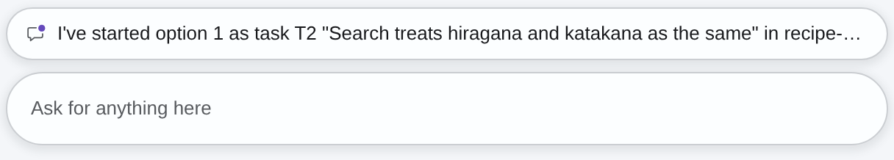

# Primeiros passos

Os passos para instalar o alpacawork, fazer uma solicitação à IA e revisar o resultado. Contando o tempo de espera pelo trabalho da IA, leva uns 15 minutos.

## Antes de começar

- O PC precisa ser macOS (Apple silicon), Linux (x64, com uma sessão de usuário do systemd, presente na maioria das instalações de desktop e servidor) ou Windows (WSL2 com o systemd ativado, o padrão no Ubuntu). No Windows, leia antes [No Windows](manage.md#no-windows).
- Deixe o Claude Code ou o Codex pronto para uso neste PC.
- A IA altera arquivos sem pedir confirmação. Ela roda com as permissões do seu usuário no PC, então alcança também o que está fora da pasta de trabalho.

## 1. Instalar

Cole o texto abaixo, sem alterações, no Claude Code ou no Codex do seu PC. A IA instala o que falta e depois instala o alpacawork. Se ela pedir permissão para executar um comando, permita.

```text
Baixe o guia abaixo, leia-o inteiro e siga as instruções para instalar o alpacawork neste PC.
https://raw.githubusercontent.com/alpacakit/alpacawork/main/skills/alpacawork/references/setup.md
```

Para instalar pelo seu próprio terminal, instale o Node.js 24.16 ou posterior, execute as duas linhas abaixo, nesta ordem, e pressione Enter quando for perguntado.

```sh
npm install -g alpacawork
alpacawork setup
```

## 2. Abrir a tela

Quando a instalação termina, a tela abre no navegador. Se não abrir, execute `alpacawork open` no terminal ou abra no navegador a URL mostrada no final, algo como `http://127.0.0.1:43127/`.

Essa URL não muda, mesmo que você reinicie o PC. Salve-a nos favoritos. O alpacawork roda automaticamente quando você faz login no PC, então não é preciso iniciá-lo toda vez.

Se não conseguir abrir, veja [A tela não abre](troubleshooting.md#a-tela-não-abre).

## 3. Escolher o projeto

Siga as quatro etapas da tela, em ordem.

1. Escolha o idioma e o tema da tela e pressione “Avançar”.
2. Ative (“On”) as IAs que vai usar e pressione “Avançar”.
3. Na etapa seguinte, deixe as recomendações como estão e pressione o botão de instalar.
4. Defina o nome do projeto e o “Local do código” e pressione “Concluir configuração”.


Um projeto é uma pasta em que a IA trabalha, junto com as regras para trabalhar nela (a política do projeto). Para usar um repositório que você já tem, escolha a pasta dele como “Local do código”. Se for só para experimentar, crie uma pasta vazia com “Escolher” → “Criar uma nova pasta”. Você pode começar com a política do projeto de exemplo, como está.

## 4. Enviar uma solicitação

Escreva o que você quer no campo de mensagem, na parte de baixo da tela, e envie. Depois de enviar, o início da resposta aparece acima do campo de mensagem. Pressione-o para ler tudo.



Em um repositório existente, comece com uma solicitação que não altere arquivos.

```text
Leia o conteúdo desta pasta e resuma em 3 linhas para que ela serve. Não altere nenhum arquivo. Depois, sugira 3 trabalhos que eu poderia pedir em seguida e me pergunte qual deles fazer.
```

A IA lê a pasta e escreve na resposta o resumo e as sugestões de trabalho (às vezes ela cria uma tarefa e faz a pergunta por lá). Se vier na resposta, envie pelo campo de mensagem a sugestão que quer seguir, como “Siga com a 1”; ela vira uma tarefa e aparece como uma linha na lista.

Em uma pasta vazia, pressione o exemplo da tela “Escolher uma ideia de minijogo e mandar criar” e envie.

Enquanto a IA trabalha na tarefa, você não precisa ficar olhando a tela.

## 5. Revisar quando for a sua vez

Quando chega uma pergunta ou um relatório da IA, a tarefa passa para “Aguardando revisão”. Abra a tarefa.


- Se for uma pergunta, pressione uma opção e depois envie. Só pressionar não envia a resposta. Quando você responde, a IA continua o trabalho e, ao terminar, envia um relatório.
- Se for um relatório, leia e, se estiver bom, pressione “Concluir” (a marca de visto), na parte de baixo da tela. Se quiser correções, escreva o que mudar no campo de mensagem e envie.


Quando a tarefa passa para “Concluídas”, terminou (“Concluídas” começa fechada; pressione o título para abrir). As próximas solicitações também vão pelo mesmo campo de mensagem.

## O que ler em seguida

- [Como usar](guide.md) — o uso do dia a dia
- [Adaptar ao seu trabalho](projects.md) — como escrever a política do projeto, as IAs que você usa
- [Solução de problemas](troubleshooting.md)
