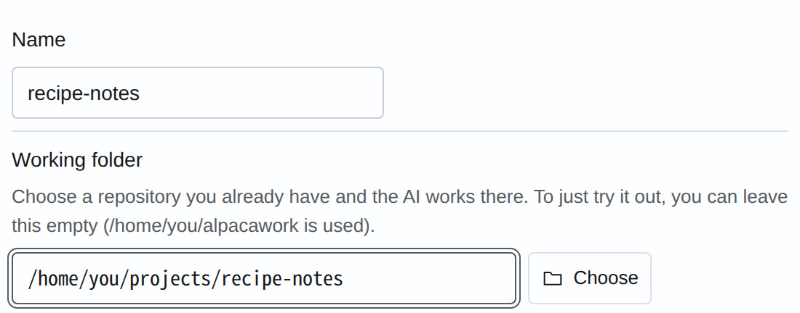
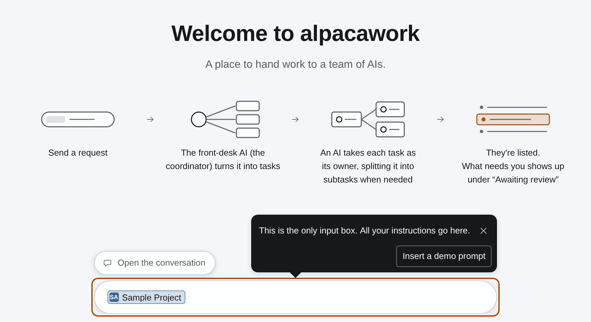
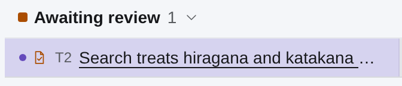

# Primeiros passos

Os passos para instalar o alpacawork, fazer uma solicitação à IA e revisar o resultado. Contando o tempo de espera pelo trabalho da IA, leva uns 15 minutos.

## Antes de começar

- O PC precisa ser macOS (Apple silicon), Linux (x64, com uma sessão de usuário do systemd, presente na maioria das instalações de desktop e servidor) ou Windows (WSL2 com o systemd ativado, o padrão no Ubuntu). No Windows, leia antes [No Windows](manage.md#no-windows).
- Deixe pronto para uso neste PC um agente de IA, como o Claude Code ou o Codex.
- A IA altera arquivos sem pedir confirmação. Ela roda com as permissões do seu usuário no PC, então alcança também o que está fora da pasta de trabalho.

## 1. Instalar

Cole o texto abaixo, sem alterações, no Claude Code ou no Codex do seu PC. A IA instala o que falta e depois instala o alpacawork. Se ela pedir permissão para executar um comando, permita.

```text
Baixe o guia abaixo, leia-o inteiro e siga as instruções para instalar o alpacawork neste PC.
https://raw.githubusercontent.com/alpacakit/alpacawork/main/skills/alpacawork/references/setup.md
```

Para instalar pelo seu próprio terminal, instale o Node.js 24.16 ou posterior, execute as duas linhas abaixo, nesta ordem, e pressione Enter quando for perguntado.

```sh
npm install -g alpacawork
alpacawork setup
```

## 2. Abrir a tela

Quando a instalação termina, a tela abre no navegador. Se não abrir, ou se você fechá-la depois, peça assim ao Claude Code ou ao Codex. A IA abre a tela no navegador ou informa a URL dela.

```text
/alpacawork abra a tela
```

No Codex, escreva `$alpacawork` no lugar de `/alpacawork`. No terminal, este comando também abre a tela.

```sh
alpacawork open
```

Você também pode abrir no navegador a URL mostrada no final da configuração inicial, algo como `http://127.0.0.1:43127/`.

Essa URL não muda, mesmo que você reinicie o PC. Salve-a nos favoritos. O alpacawork roda automaticamente quando você faz login no PC, então não é preciso iniciá-lo toda vez.

Se você instalá-la como app, também pode abri-la de novo pelo ícone no Dock ou na barra de tarefas. Como instalar está no final da próxima etapa, “3. Escolher o projeto”.

Se não conseguir abrir, veja [A tela não abre](troubleshooting.md#a-tela-não-abre).

## 3. Escolher o projeto

Siga as quatro etapas da tela, em ordem.

1. Escolha o idioma e o tema da tela e pressione “Avançar”.
2. Confira se as IAs que vai usar estão em “Ativado” e pressione “Avançar”. Aqui você também escolhe se quer enviar dados de uso aos desenvolvedores ([o que é enviado](telemetry.md)).
3. Na etapa seguinte, deixe a seleção como está e pressione “Instalar (número) skills”.
4. Dê um nome ao projeto, escolha a pasta do seu repositório como “Pasta de trabalho” se for usar um que já existe (procure com “Escolher” ou digite o caminho no campo), e pressione “Concluir configuração”.



Um projeto é uma pasta em que a IA trabalha, junto com as regras para trabalhar nela (a política do projeto). Para usar um repositório que você já tem, escolha a pasta dele como “Pasta de trabalho”. Se for só para experimentar, deixe a “Pasta de trabalho” vazia (a IA trabalha na pasta de dados, `~/alpacawork`). Você pode começar sem escrever uma política do projeto. O que você não quer que a IA faça, escreva na política do projeto ([como escrever](projects.md#política-do-projeto)).

Ao pressionar “Concluir configuração”, o Chrome e o Edge perguntam se você quer instalar o alpacawork como app. Pressione “Instalar e começar” para poder abri-lo de novo pelo ícone no Dock ou na barra de tarefas. Se escolher “Começar no navegador”, você pode instalar depois com “Instalar” em “Configurações (engrenagem) → App e celular”. No Safari do Mac, instale com “Arquivo → Adicionar ao Dock” no menu (macOS Sonoma ou posterior).

## 4. Enviar uma solicitação

Quando a configuração termina, aparecem “Boas-vindas ao alpacawork” e um esquema de como uma solicitação vira tarefas e avança. Até a sua primeira solicitação terminar, balões de orientação aparecem nos pontos principais da tela.



Escreva o que você quer no campo de mensagem, na parte de baixo da tela, e envie.

Se for só para experimentar, pressione “Inserir um prompt de demonstração” no balão e envie como está o texto inserido. É uma solicitação para criar um HTML que mostre “Hello” em duas fontes e depois perguntar a você qual é melhor.

Em um repositório existente, comece com uma solicitação que não altere arquivos.

```text
Leia o conteúdo desta pasta e resuma em 3 linhas para que ela serve. Não altere nenhum arquivo. Depois, sugira 3 trabalhos que eu poderia pedir em seguida e me pergunte qual deles fazer.
```

Depois de enviar, o início da resposta da IA da recepção (o coordenador) aparece acima do campo de mensagem. Pressione-o para ler tudo.


Uma solicitação que você confia como trabalho aparece pouco depois como tarefa, em uma linha de “Em andamento” na lista. Uma solicitação que se resolve só com uma resposta não vira tarefa. Se, no exemplo do repositório, a resposta trouxer sugestões, envie pelo campo de mensagem a sugestão que quer seguir, como “Siga com a 1”, e ela vira uma tarefa. Se você enviar primeiro a solicitação do repositório, o botão da demonstração some; para experimentar a demonstração depois, mostre a orientação de novo (no fim de “5. Revisar quando for a sua vez”).

Enquanto a IA trabalha na tarefa, você não precisa ficar olhando a tela.

## 5. Revisar quando for a sua vez

Quando chega uma pergunta ou um relatório da IA, a tarefa passa para “Aguardando revisão”. Pressione a linha para abrir.



- Se for uma pergunta, ao pressionar uma opção a resposta vai para o campo de mensagem. Envie como está para responder (só pressionar não envia a resposta). Você também pode enviar outra mensagem sem escolher nenhuma opção. Quando você responde, a IA continua o trabalho e, ao terminar, envia um relatório.
- Se for um relatório, leia e, se estiver bom, pressione “Concluir” (a marca de visto), na parte de baixo da tela. Se quiser correções ou quiser pedir mais alguma coisa, escreva no campo de mensagem com a tarefa aberta e envie (na demonstração, “Inserir um prompt de demonstração” no balão coloca “Faça mais uma versão para eu poder comparar.”).


Quando a tarefa passa para “Concluídas”, terminou (“Concluídas” começa fechada; pressione o título para abrir). As próximas solicitações também vão pelo mesmo campo de mensagem.

Ao concluir a primeira tarefa, os balões terminam mostrando, entre outras coisas, como limpar a conversa com a IA da recepção, o que fazer para usar outro repositório e onde estão os passos para usar o alpacawork pelo celular. Para ver a orientação de novo, pressione “Mostrar de novo” em “Guia de primeiros passos”, dentro de “Configurações (engrenagem) → Pessoal”.

## O que ler em seguida

- [Como usar](guide.md) — o uso do dia a dia
- [Adaptar ao seu trabalho](projects.md) — como escrever a política do projeto, as IAs que você usa
- [Solução de problemas](troubleshooting.md)
