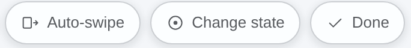

# Como usar

As operações do dia a dia, depois dos primeiros passos.

## Pedir

Escreva no campo de mensagem, com palavras simples, o que você quer e envie. No PC, Enter envia e Shift+Enter quebra a linha.

```text
Descubra por que os testes estão falhando e corrija.
```

O que você envia chega à IA que é seu ponto de contato (o coordenador). O coordenador transforma a solicitação em uma tarefa e a entrega a uma IA responsável. Você pode continuar pedindo sem esperar a solicitação anterior terminar.

Indicações de como fazer também vão direto no texto (“Faça 3 propostas e compare”, “Quando terminar, peça para outra IA verificar”). O que você quer sempre, escreva na [política do projeto](projects.md#política-do-projeto).

Para anexar imagens ou arquivos, use o “＋” do campo de mensagem ou cole.

## Pedir o que não está na tela

Mudar configurações, arrumar tarefas, retomar uma IA que parou, atualizar o alpacawork e outras coisas também podem ser pedidas no campo de mensagem. É mais rápido do que procurar onde fica a operação na tela.

```text
Arquive todas as tarefas concluídas.
```

## Como ler a lista

As tarefas ficam agrupadas por status. Você só precisa agir em duas.

| Grupo | Significado |
| --- | --- |
| Aguardando revisão | Chegou uma pergunta ou um relatório |
| Requer atenção | A execução da IA parou. Abra para ver o motivo |

“Em andamento” é o que a IA está fazendo, e “Concluídas” é o que terminou. “Concluídas” e alguns outros começam fechados; pressione o título para abrir. Os outros grupos estão na [lista de termos](reference.md#status-das-tarefas).

## Responder a perguntas

Ao abrir a tarefa, aparecem a pergunta e as opções de resposta.

1. Pressione uma opção. A resposta vai para o campo de mensagem.
2. Envie. Ela só chega depois de enviada.

Para uma resposta que não está nas opções, pressione “Outra” e escreva com suas palavras.

## Revisar relatórios

Leia o relatório e abra os arquivos e as diferenças anexados para conferir.

- Se estiver bom, pressione “Concluir” (a marca de visto), na parte de baixo da tela. A tarefa só termina quando você pressiona.
- Se quiser correções, com a tarefa aberta, escreva o que mudar no campo de mensagem e envie.



Ao pressionar “Concluir”, a próxima tarefa aguardando revisão se abre. “Mudar status”, que serve para adiar ou parar, fica no mesmo lugar.

## Tarefas paradas

Ao abrir uma tarefa em “Requer atenção”, aparecem o motivo da parada e alguns botões.

- Pressione “Continuar com a mesma IA”, “Continuar com outra IA” ou “Parar”. “Continuar com outra IA” coloca uma frase no campo de mensagem; acrescente qual IA usar e envie.
- Se aparecer “Continuar”, pressione se quiser que continue.
- Se não houver botões, dê a instrução no campo de mensagem, seguindo o aviso mostrado.

O que fazer em cada motivo está em [Solução de problemas](troubleshooting.md#uma-tarefa-parou).

## Adiar e parar

- Adiar: use quando não quiser decidir agora. Abra a tarefa e escolha “Mudar status” → “Adiada” → “Atualizar”. A IA em atividade não para.
- Parar: faz o trabalho parar. “Mudar status” → “Parada” → “Atualizar”. As tarefas abaixo dela também param.

Para tirar uma tarefa de “Adiada”, escolha para onde ela volta no mesmo “Mudar status”. Para retomar uma tarefa parada, peça no campo de mensagem.

## No celular

Deslize um cartão para a direita para “Concluir” ou “Enviar”, e para a esquerda para “Adiar”.
