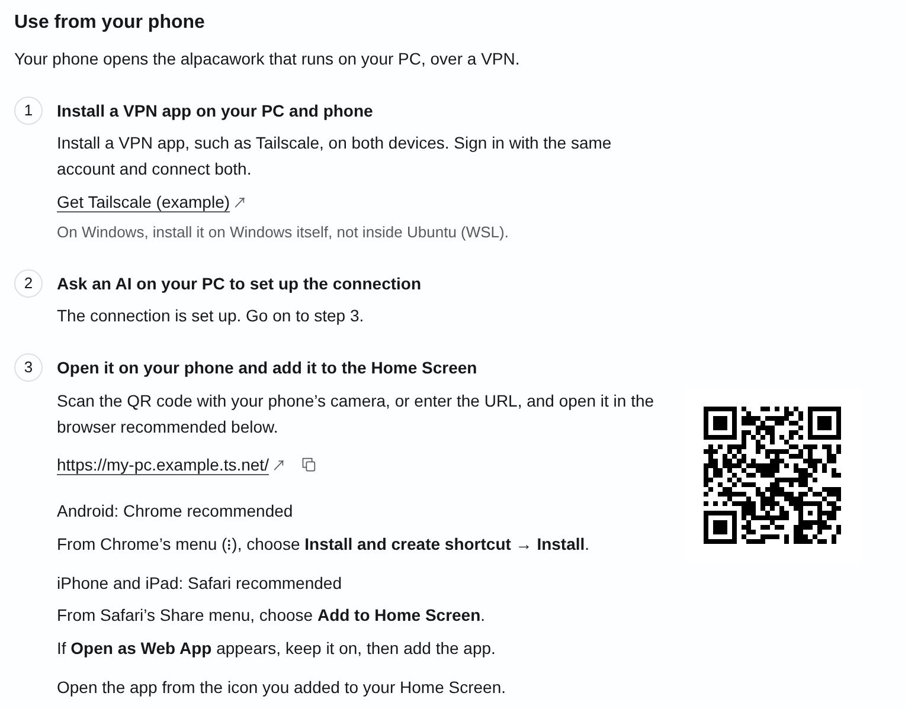

# Celular e notificações

## Usar pelo celular

No celular, você abre a tela do alpacawork que está rodando no PC. A IA roda no PC, então não deixe o PC entrar em suspensão enquanto estiver usando.

O PC e o celular se conectam por uma VPN. Aqui usamos o [Tailscale](https://tailscale.com/) (gratuito para uso pessoal).

1. Instale o Tailscale no PC e no celular e entre com a mesma conta. No Windows, instale no lado do Windows.
2. No terminal do PC, abra o Claude Code ou o Codex e peça: “Deixe o alpacawork pronto para usar pelo celular”.
3. Na tela do PC, abra “Configurações (engrenagem) → App e celular” e leia com o celular o QR code que aparece.
4. Siga as instruções da tela e adicione à tela inicial (no iPhone, pelo Safari; no Android, pelo Chrome).

A tela não tem login. Conecte à VPN só os seus próprios dispositivos e não use configurações que exponham a tela à internet (como o Tailscale Funnel). Se perder um dispositivo, remova-o da VPN.

Para mostrar o que quer corrigir, marque em uma captura de tela, cole no campo de mensagem e complete com o ditado por voz; assim fica mais rápido de explicar.

## Receber notificações

Quando chega a sua vez (uma pergunta, um relatório ou uma IA que parou), você recebe uma notificação. Registre cada dispositivo em que quer receber.

1. Abra “Configurações (engrenagem) → Pessoal”.
2. Em “Notificações push”, pressione “Receber neste dispositivo” e, se o navegador pedir permissão, permita.

No iPhone, faça isso abrindo pelo ícone que você adicionou à tela inicial.

Enquanto você está usando o alpacawork, as notificações não chegam. Elas começam a chegar 30 segundos depois de você ir para outro app, ou 5 minutos depois de parar de mexer com a tela aberta.

## Pausar as notificações

- Pausar por um tempo: no botão em forma de pessoa, no canto superior direito da tela (à esquerda da engrenagem), escolha uma opção como “Pausar por 1 hora”.

  

- Pausar toda noite: ative “Horário de silêncio diário” em “Configurações (engrenagem) → Pessoal”. Quando o horário termina, os avisos que ainda estão esperando chegam juntos em uma só notificação.
- Escolher os tipos: no mesmo lugar, em “Notificações”, você ativa ou desativa cada tipo de aviso. “Quando uma tarefa é concluída” começa desativado.

## Quando algo não funciona

- O QR code não aparece: o passo 2 ainda não foi feito. Peça à IA do PC.
- O celular não abre a tela: confira se os dois estão conectados à VPN e se o PC não está em suspensão. Use a URL que começa com `https://`.
- Aparece “Abra a tela por HTTPS”: abra de novo pela URL `https://`. No iPhone, abra pelo ícone da tela inicial.
- As notificações não chegam: confira se você não pausou as notificações e se aquele tipo não está desativado.

## Usar a partir do Claude Code ou do Codex de sempre

Se você chamar a skill alpacawork em uma conversa normal (`/alpacawork` no Claude Code, `$alpacawork` no Codex), essa conversa passa a ser o seu ponto de contato, e você pode pedir como no campo de mensagem da tela.
