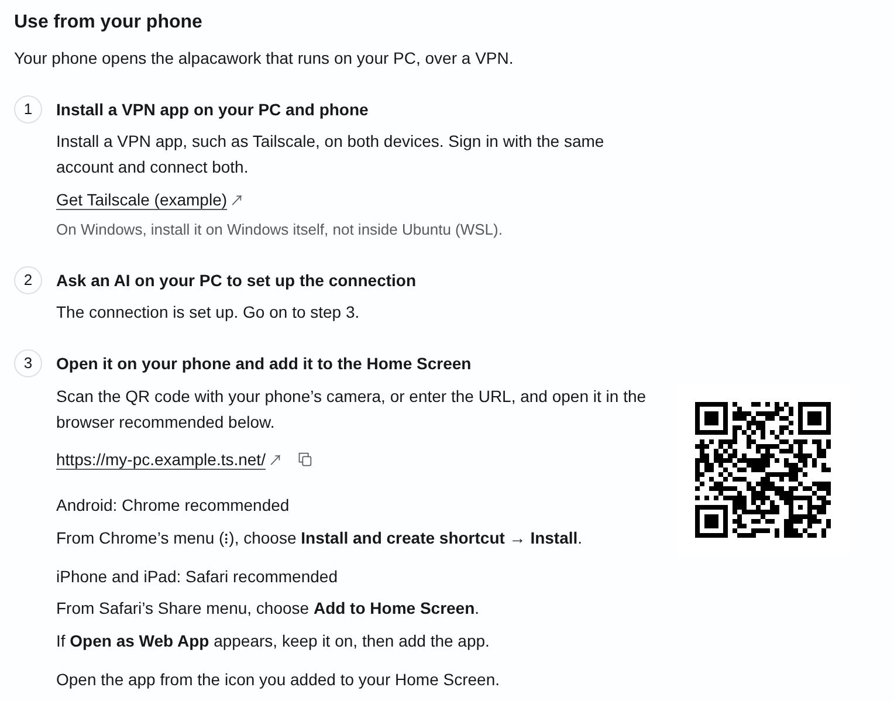

# Phone and notifications

## Use it from your phone

On a phone, you open the screen of the alpacawork running on your PC. The AI runs on the PC, so don't let the PC sleep while you use it.

Connect the PC and the phone over a VPN. This page uses [Tailscale](https://tailscale.com/) (free for personal use).

1. Install Tailscale on the PC and the phone, and log in with the same account. On Windows, install it on the Windows side.
2. Start Claude Code or Codex in a terminal on the PC, and ask: "Make alpacawork usable from my phone."
3. On the PC's screen, open "Settings (the gear) → App & phone", and scan the QR code shown there with your phone.
4. Follow the steps on the screen to add it to the Home Screen (Safari on iPhone, Chrome on Android).

The screen has no login. Connect only your own devices to the VPN, and don't use settings that expose it to the internet (such as Tailscale Funnel). If you lose a device, remove it from the VPN.

To point out what you want fixed, draw on a screenshot and paste it into the input box, then add words by voice input; it gets the message across quickly.

## Get notifications

You get a notification when it's your turn (a question, a report, or an AI that stopped). Register each device you want them on.

1. Open "Settings (the gear) → Notifications".
2. Under "Push notifications", press "Receive on this device", and allow it if the browser asks.

On an iPhone, do this after opening the screen from the icon you added to the Home Screen.

Notifications don't arrive while you are using alpacawork. They start 30 seconds after you switch to another app, or 5 minutes after you stop using the screen with it still open.

## Pause notifications

- For a while: Press the person-shaped button at the top right of the screen (left of the gear), and choose "Pause for 1 hour" or similar.

  

- Every night: Turn on "Daily quiet hours" in "Settings (the gear) → Notifications". When they end, anything still waiting arrives in one notification.
- By kind: Under "When to notify" in the same "Notifications" tab, you can turn each kind of notification on or off. "When a task is done" starts off.

## When it doesn't work

- No QR code appears: Step 2 isn't done yet. Ask the AI on the PC.
- The phone can't open it: Check that the VPN is connected on both, and that the PC isn't asleep. Use the URL that starts with `https://`.
- "Open the screen over HTTPS" appears: Open it again with the `https://` URL. On an iPhone, open it from the Home Screen icon.
- Notifications don't arrive: Check that you haven't paused them and that the kind isn't turned off.

## Use it from your usual Claude Code or Codex

Call the alpacawork skill in a usual conversation (`/alpacawork` in Claude Code, `$alpacawork` in Codex), and that conversation becomes your point of contact, where you can make requests just as in the screen's input box.
