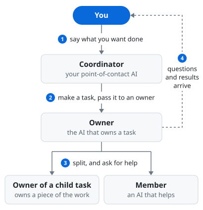
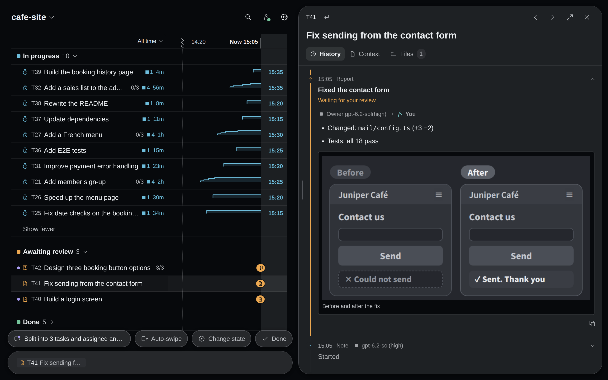

# alpacawork 的设计理念

说明发出委托后，幕后发生了什么，以及你需要做什么。

## 它是做什么的工具

把好几件工作交给 AI 后，记住在哪里委托了什么、四处查看进度、决定下一步让谁做什么，这些工作都会留给人。alpacawork 把这些管理工作也交给 AI。

你要做的只有三件事：委托、回答提问、确认成果。每一件都设计成可以在手机上完成。

## 一个委托如何推进

假设你委托“给店铺网站做一个预约表单”。图中的编号与下文的编号对应。

  

1. 写在输入框里的委托，会送到负责对接的 AI（协调员）那里。
2. 协调员决定是建成新任务，还是加到正在进行的任务中，然后把它交给负责这个任务的 AI（负责人）。
3. 负责人把工作拆成“确定预约的项目”“制作输入界面”“在手机上检查显示效果”这样的子任务，分别交给负责它们的负责人。需要帮手时，会叫来成员（帮忙的 AI）。不必相互等待的部分会并行推进。子任务的结果会回到上一层的负责人那里。
4. 像“预约项目里要放哪些内容”这类 AI 无法决定的事，会以附带选项和推荐的提问送达。完成后会送来报告。确认报告后按“完成”，就结束了。

界面的历史中，会出现“负责人”等角色名称。每个 AI 都就是你电脑上安装的 Claude Code、Codex 等本身。

## 你会收到什么

送到你这里的，只有只能由你决定的事。收到提问或报告的任务排在列表的“待验收”中，AI 的运行停住的任务排在“需要处理”中。

- 选择偏好或方向的提问
- 对完成成果的确认
- 发布、删除等影响外部的操作的批准
- AI 的运行停住时的判断

做法、分工、顺序、检查方式，由 AI 决定。不必等上一个委托完成，可以接着委托。

## 用文字告诉 AI 怎么做

不用去找设置项，用平常的句子委托即可。

- “这项工作用 opus，推理强度 high 来做”
- “让 Claude Code 和 Codex 分别做方案，比较后给我看”
- “做完后，让制作者以外的另一个模型来检查”
- “负责的 AI 好像乱了，换一个新的 AI 接着做”

希望一直这样做的，写进[项目准则](projects.md#项目准则)。项目准则是对 AI 的约定，不是靠机制来阻止。

你现在使用的 `AGENTS.md`、`CLAUDE.md`、技能和 MCP，也照常生效。

## 不适合的用法

- 团队共享：这是供一个人使用的工具。界面没有登录。
- 公开到互联网：从其他设备访问时，前提是通过 VPN 只连入你自己的设备。
