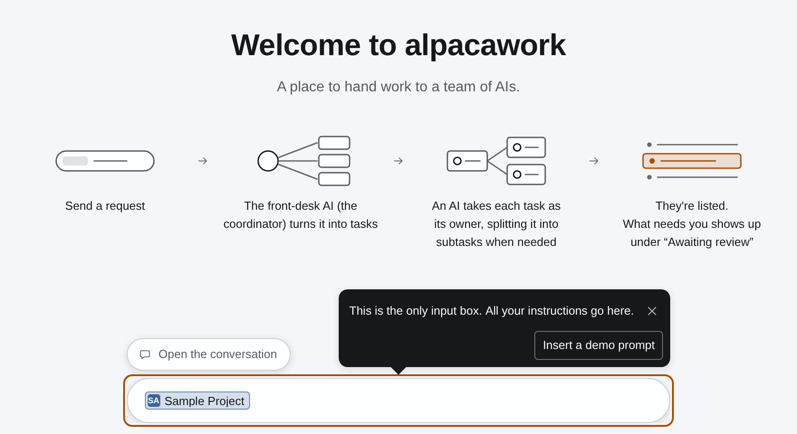

# 入门指南

这是从安装 alpacawork、委托 AI 一件事，到确认成果的步骤。算上等 AI 工作的时间，大约 15 分钟。

## 开始之前

- 电脑须为 macOS（Apple 芯片）、Linux（x64，需要 systemd 用户会话，大多数桌面和服务器安装默认具备）或 Windows（在启用 systemd 的 WSL2 中运行，Ubuntu 默认启用）之一。在 Windows 上，请先读[在 Windows 上使用](manage.md#在-windows-上使用)。
- 确保这台电脑上已经可以使用 Claude Code 或 Codex。
- AI 改写文件时不会征求确认。它以你在这台电脑上的用户权限运行，所以也能改动工作文件夹以外的地方。

## 1. 安装

把下面这段文字原样粘贴给电脑上的 Claude Code 或 Codex。AI 会先装好缺少的东西，再安装 alpacawork。如果它请求执行命令的许可，请允许。

```text
请下载下面的文档并完整阅读，然后按照其中的步骤在这台电脑上安装 alpacawork。
https://raw.githubusercontent.com/alpacakit/alpacawork/main/skills/alpacawork/references/setup.md
```

要在自己的终端里安装时，先装好 Node.js 24.16 或更高版本，再依次执行下面两行，出现提示时按 Enter。

```sh
npm install -g alpacawork
alpacawork setup
```

## 2. 打开界面

安装完成后，浏览器会打开界面。如果没有打开，或者之后把它关掉了，像下面这样请 Claude Code 或 Codex 打开。AI 会在浏览器中打开界面，或告诉你界面的 URL。

```text
/alpacawork 打开界面
```

在 Codex 中，把 `/alpacawork` 换成 `$alpacawork`。也可以在终端执行下面的命令打开。

```sh
alpacawork open
```

还可以在浏览器中打开初始设置最后显示的、形如 `http://127.0.0.1:43127/` 的 URL。

这个 URL 在电脑重启后也不会变。请把它加入书签。alpacawork 会在你登录电脑时自动运行，不需要每次启动。

安装为应用后，也能从程序坞或任务栏的图标重新打开。安装方法在下一步“3. 确定项目”的最后。

打不开时，请看[界面打不开](troubleshooting.md#界面打不开)。

## 3. 确定项目

按顺序完成界面上的 4 步。

1. 选择界面的语言和主题，按“下一步”。
2. 确认要使用的 AI 显示为“已启用”，按“下一步”。也可以在这里选择是否向开发者发送使用数据（[发送的内容](telemetry.md)）。
3. 在这一步保持已选中的内容，按“安装（数量）个技能”。
4. 确定项目的名称；在已有的仓库中使用时，把那个文件夹选为“工作文件夹”（用“选择”查找，或在栏中输入路径），然后按“完成初始设置”。


项目，是让 AI 工作的一个文件夹，加上在那里要遵守的约定（项目准则）。在已有的仓库中使用时，把那个文件夹设为工作文件夹。只是试一试的话，工作文件夹留空即可（AI 会在数据存放位置 `~/alpacawork` 中工作）。不写项目准则也能开始。不希望 AI 做的事，写在项目准则里（[写法](projects.md#项目准则)）。

按“完成初始设置”后，Chrome 和 Edge 会询问是否把 alpacawork 安装为应用。按“安装并开始”，之后就能从程序坞或任务栏的图标重新打开。如果选了“继续在浏览器中使用”，之后也可以在“设置（齿轮）→ 应用和手机”中点“安装”来安装。Mac 上的 Safari 则在菜单中选择“文件 → 添加到程序坞”安装（macOS Sonoma 或更高版本）。

## 4. 发送委托

初始设置完成后，会出现“欢迎使用 alpacawork”，以及委托变成任务并推进的流程图。在第一件委托完成之前，界面的关键位置会出现气泡提示。



在界面下方的输入框里写下想做的事并发送。

只是试一试的话，按气泡里的“插入演示提示词”，把放入的文字直接发送。这个委托是让 AI 制作一个用两种字体显示“Hello”的 HTML，然后问你哪一种更好。

如果是已有的仓库，第一次请委托一件不改写文件的事。

```text
请阅读这个文件夹的内容，用 3 行概括它是做什么用的。不要修改任何文件。然后提出 3 个接下来可以委托的工作方案，并问我要推进哪一个。
```

发送后，输入框上方会出现接待的 AI（协调员）回复的开头。点它即可阅读全文。


作为工作交给它的委托，过一会儿会变成任务，在列表的“进行中”里多出一行。只需回复就能解决的委托不会变成任务。在仓库的例子中，如果回复里写了方案，就在输入框里发送“请推进 1”这样的话，它会变成任务。如果先发送了仓库的委托，演示按钮会消失；之后想试演示时，请再次显示指引（见“5. 轮到你时确认”的末尾）。

AI 推进任务期间，你不必盯着界面。

## 5. 轮到你时确认

AI 发来提问或报告后，任务会移到“待验收”。点这一行打开它。


- 如果是提问，点一个选项，回答就会进入输入框。直接发送就成为你的回答（只点选项不会送达）。也可以不选选项，发送别的消息。回答后 AI 会继续推进，完成后会发来报告。
- 如果是报告，读过没问题，就按界面下方的“完成”（对勾图标）。想让它修改或想接着委托时，保持任务打开，在输入框里写好发送（演示的话，按气泡里的“插入演示提示词”，会放入“请再做一个版本，方便我比较。”）。


任务移到“已完成”就结束了（“已完成”起初是收起的，点标题即可展开）。下一个委托也从同一个输入框发送。

把第一件任务设为完成后，气泡最后会告诉你如何清掉与接待 AI 的对话、使用另一个仓库时怎么做，以及用手机使用的步骤在哪里等，然后结束。在“设置（齿轮）→ 个人”的“入门指引”中点“再次显示”，可以再看一遍指引。

## 下一步读什么

- [使用方法](guide.md) — 日常操作
- [按你的工作调整](projects.md) — 项目准则的写法、要使用的 AI
- [遇到问题时](troubleshooting.md)
