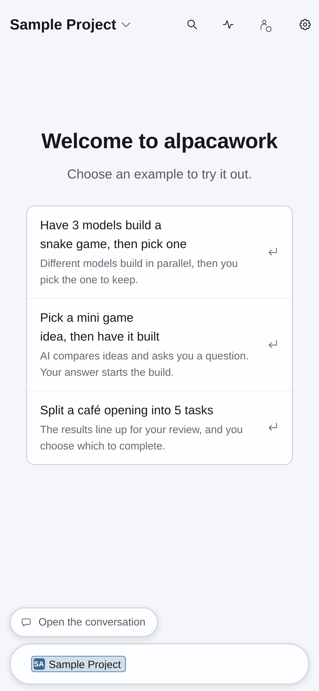
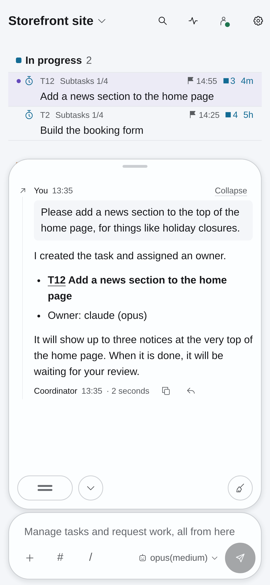
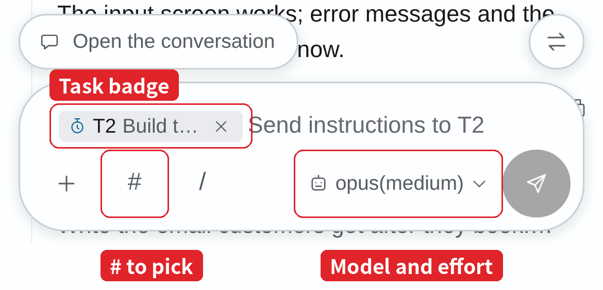
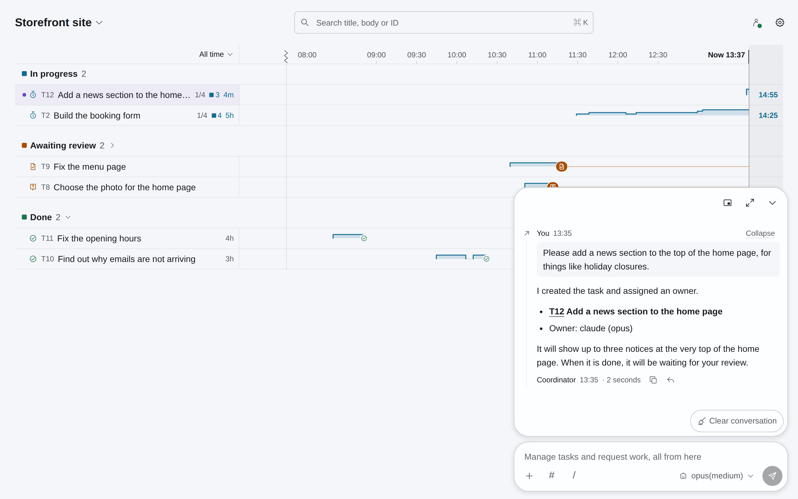
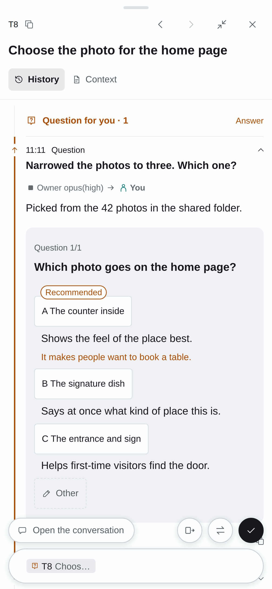
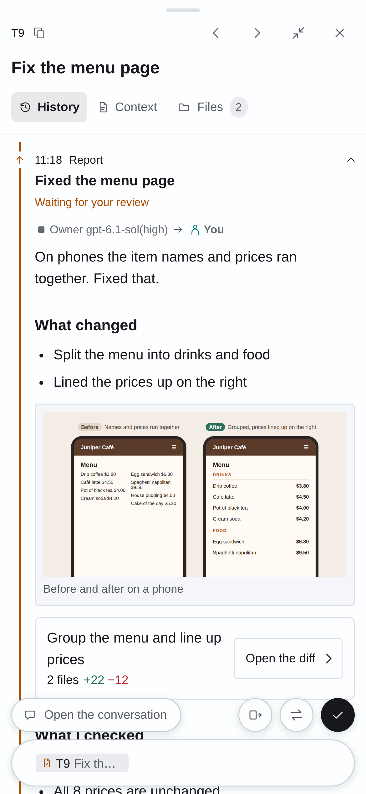
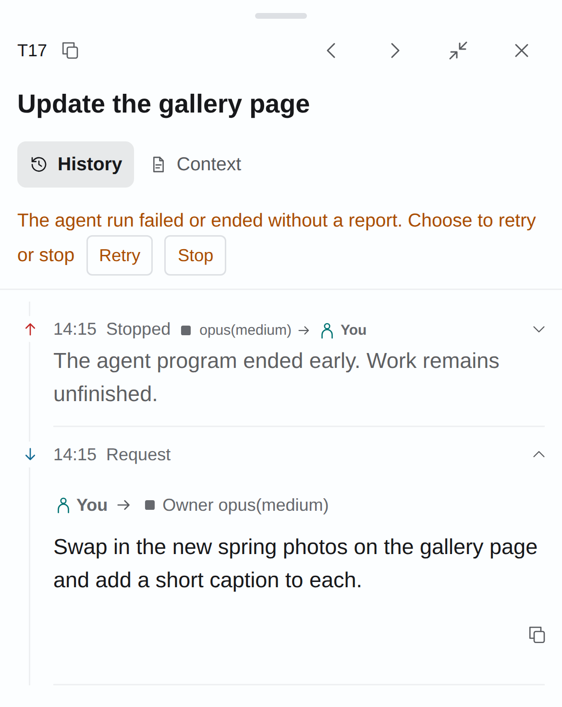
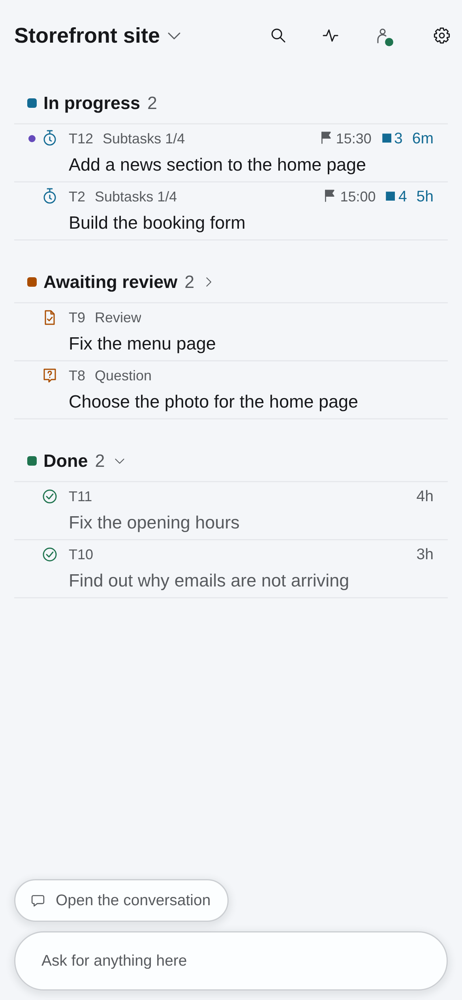
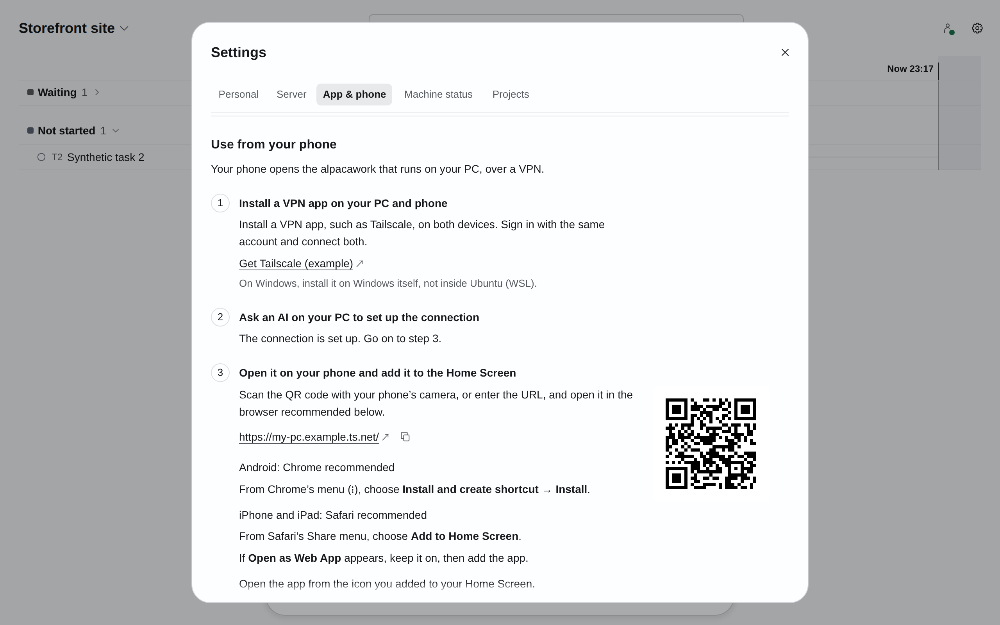

# 入门指南

本指南带你从安装 alpacawork 一直到日常使用。按顺序完成第 1 到第 4 步，就能打开界面、发起第一个委托、回答 AI 的提问并验收结果。第 5 步及之后的内容，需要时再读。

**先试一试**

1. [安装](#1-安装)
2. [打开界面](#2-打开界面)（包括没有自动打开、之后再次打开的情况）
3. [发起第一个委托](#3-发起第一个委托)
4. [查看进度并回应](#4-查看进度并回应)

**用于自己的工作**

5. [写下给 AI 的约定](#5-写下给-ai-的约定)
6. [在手机上使用](#6-在手机上使用)
7. [在 Claude Code 或 Codex 中使用](#7-在-claude-code-或-codex-中使用)

**日常维护**

8. [停止、更新或卸载](#8-停止更新或卸载)

另见：[保存了什么，向外发送了什么](#保存了什么向外发送了什么)、[遇到问题时](#遇到问题时)。alpacawork 的工作方式和设计思路，见 [alpacawork 的设计理念](concept.md)。

本文档中的图片为英文界面。界面最初使用你与负责安装的 AI 交流时所用的语言。可以在初始设置界面的右上角更改，之后也可以在“设置（齿轮）→ 个人 → 显示语言”中更改。

## 1. 安装

alpacawork 是供一个人在自己的电脑上使用的工具。要从手机等其他设备使用，需通过 VPN 连接（[在手机上使用](#6-在手机上使用)）。

alpacawork 以完全权限启动 Claude Code、Codex 等 AI 智能体，且不请求确认。AI 能做的事，与你自己以完全权限运行它时相同。不希望它做的事，或希望它先问你的事，可以写进项目准则（[写法](#5-写下给-ai-的约定)）。

安装交给 AI 来做。

1. **粘贴安装指示。** 复制 [README 的“安装”一节](https://github.com/alpacakit/alpacawork/blob/main/README.zh-CN.md#安装)中的那段文字，原样粘贴给你电脑上的 AI 智能体（例如 Claude Code 或 Codex）。
2. **AI 进行安装。** 它会检查这台电脑能否运行 alpacawork，安装缺少的东西，然后启动 alpacawork。过程中不需要你执行命令或回答确认。如果你的 AI 智能体自己请求执行命令的权限，请允许。
3. **初始设置界面会在浏览器中打开。** AI 也会告诉你它的 URL，所以即使浏览器没有打开，你也能自己打开。如果浏览器没有打开，或之后想再次打开界面，请看[打开界面](#2-打开界面)。

初始设置界面分三步：要使用的 AI 智能体（以及是否发送[使用数据](telemetry.md)）、要安装的[技能](#技能)、你的第一个项目。每一步都附有说明，其中的所有内容之后都可以在设置中更改。

### 运行要求

- macOS（Apple 芯片）、Linux（x64、glibc）或 Windows（在 WSL2 中运行；见下文[在 Windows 上使用](#在-windows-上使用)）
- [Node.js](https://nodejs.org/zh-cn) 24.16 或更高版本
- Chrome 或 Edge 111、Safari 16.4（iPhone 和 iPad 上为 iOS/iPadOS 16.4）、Firefox 128，或更高版本。更旧的浏览器会显示空白页
- 已登录的 AI 智能体（例如 Claude Code 或 Codex）

安装过程中，AI 会检查这些条件，如果没有 Node.js，会一并安装。

### 支持的 AI 智能体

| AI 智能体 | 所需条件 |
| --- | --- |
| [Claude Code](https://claude.com/claude-code)、[Codex](https://github.com/openai/codex) | 通过各自的 CLI 登录 |
| [GitHub Copilot](https://github.com/features/copilot) | 无需安装：它随 alpacawork 一同提供。使用你的 GitHub CLI 登录（`gh auth login`）运行 |
| Grok Build（`grok`）、pi（`pi`） | 登录，或 API 密钥。对于这几个，alpacawork 只能判断是否已安装，无法判断是否已登录。要使用 Gemini，请在 pi 中运行 `/login`，然后保存 Google Gemini 的 API 密钥。请参阅 [pi 的服务提供商设置](https://pi.dev/docs/latest/providers)。 |

初始设置界面的第一步会显示其中哪些已安装在这台电脑上，对于前三个，还会显示是否已登录。在那里启用要使用的智能体。之后可以在“设置 → 服务器”中更改。

各家 AI 公司推出新模型时，可以自己添加。在聊天中提出，例如“把最新的模型添加到 Codex 的模型列表”，AI 就会把它添加到设置中。也可以在界面的“设置 → 服务器”中自己编辑模型。

在同一个委托中可以分工，例如用 Claude Code 做设计、用 Codex 做实现。

每个 AI 智能体都沿用你现有的套餐和设置运行。

- **Claude Code**：`CLAUDE.md`、技能、MCP、hooks 和记忆都从原来的位置照常使用，不作改动
- **Codex**：使用你平时的设置、`AGENTS.md`、技能、MCP 和 hooks。只有对话历史和记忆单独保存在 alpacawork 专用的位置（`~/.codex-alpacawork`）

AI 的使用按你的 AI 智能体套餐计费并受其限额约束，同时运行的每个 AI 都会计入其中。一开始最多同时运行 8 个，可以在界面的“设置 → 服务器”中通过“最大并发运行数”更改。

### 在 Windows 上使用

在 Windows 上，alpacawork、Node.js 和 AI 智能体都安装在 WSL2（在 Windows 中运行 Linux 的一种方式）的 Ubuntu 里。安装指示也要粘贴给在 Ubuntu 中启动的 AI 智能体。

如果还没有 WSL2 或 Ubuntu，把同一段安装指示粘贴给在 Windows 上运行的 AI 智能体，它会先引导你完成这些准备。想自己安装的话，在以管理员身份打开的 PowerShell 中执行 `wsl --install`（[Microsoft 的说明](https://learn.microsoft.com/zh-cn/windows/wsl/install)）。

alpacawork 在 Ubuntu 中运行，界面则在 Windows 的浏览器中打开。只有 Ubuntu 运行期间它才运行。

- **使用期间请保持一个 Ubuntu 窗口打开。** 从手机使用时也是如此。如果关闭所有 Ubuntu 窗口，Ubuntu 可能会停止，alpacawork 和正在工作的 AI 也会随之停止。
- **重启 Windows 后，请从“开始”菜单打开 Ubuntu。** alpacawork 随后会自动启动，任务保持你离开时的样子。不需要重新安装。

## 2. 打开界面

alpacawork 的界面是电脑上运行的 alpacawork 提供的网页，用浏览器打开。它的 URL 形如 `http://127.0.0.1:43127/`（把 `127.0.0.1` 换成 `localhost` 也能打开）。最后的数字在安装时决定，每台电脑都不同；关闭浏览器或重启电脑后也不会变。

### 第一次打开

初始设置完成后，你会得到界面的 URL：请 AI 安装时由 AI 告诉你；自己执行 `alpacawork setup` 时，在输出的 `打开：` 一行中（终端为英文时是 `Open:`）。通常它也会自动在浏览器中打开。如果浏览器没有打开（在 Windows 上可能不会打开，通过 SSH 连接安装时不会打开），把这个 URL 粘贴到浏览器的地址栏中打开。在 Windows 上，用 Windows 的浏览器打开。

如果你是通过 SSH 连接到另一台电脑上安装的，这个 URL 只能在那台电脑的浏览器中打开。请在 SSH 会话中对那台电脑上的 AI 智能体说：“让 alpacawork 可以从其他设备使用”。AI 会通过 VPN 准备入口，并告诉你需要在自己这边安装什么（说明见[在手机上使用](#6-在手机上使用)）。然后在你面前的浏览器中打开它给你的 `https://` URL。

### 之后再次打开

- **关闭浏览器或重启电脑后**，打开同一个 URL 即可。重启后，先登录电脑（在 Windows 上，先打开 Ubuntu）。
- **加入书签，或作为应用安装。** 在 Chrome 或 Edge 中，点击地址栏右端的“安装”（Edge 中是同一位置的图标）。之后就能从程序坞、任务栏或应用列表中，在独立窗口里打开 alpacawork。各浏览器的步骤见“设置（齿轮）→ 应用和手机 → 作为桌面应用使用”。
- **忘了 URL 时**，在终端（在 Windows 上是 Ubuntu 窗口）中执行 `alpacawork workspace url`。alpacawork 正在运行时会显示 `"status":"serving"`。在这台电脑的浏览器中打开 `"localUrl"` 后面的 URL，从其他设备则打开 `"publicUrl"` 后面的 URL。也可以问 Claude Code 或 Codex 等 AI 智能体：“告诉我 alpacawork 的 URL”。

### 界面打不开时

不知道 URL 时，请先看[之后再次打开](#之后再次打开)。

alpacawork 会在你登录电脑时自动启动（在 Windows 上，是在打开 Ubuntu 时）。如果浏览器显示无法连接（例如“无法访问此网站”或 `ERR_CONNECTION_REFUSED`），或 `alpacawork workspace url` 以“Server not reached”失败，说明 alpacawork 没有在运行。启动它，然后重新加载页面。

- **Windows**：从开始菜单打开 Ubuntu，并让这个窗口保持打开（[在 Windows 上使用](#在-windows-上使用)）。如果仍然打不开，在这个窗口中执行下面 Linux 的命令。
- **Linux**：在终端中执行 `systemctl --user start alpacawork.service`。alpacawork 在你登录电脑期间运行。要在注销后也继续运行，请对 AI 智能体说：“让 alpacawork 在我注销后也继续运行”。
- **macOS**：在终端中执行 `launchctl kickstart gui/$(id -u)/alpacawork.service`。如果你是按[停止 alpacawork](#停止-alpacawork) 中的步骤停止的，请改为执行 `launchctl bootstrap gui/$(id -u) ~/Library/LaunchAgents/alpacawork.service.plist`。

如果仍然打不开，在终端中启动 AI 智能体（例如 Claude Code 或 Codex），调用 alpacawork 技能（[调用方法](#7-在-claude-code-或-codex-中使用)），把看到的错误粘贴给它并请它帮忙。

## 3. 发起第一个委托

第一次打开界面时，先完成初始设置界面的三个步骤（[安装](#1-安装)）。之后，还没有任务时，界面上会显示可以试用的委托示例。点击一个示例，它就会填入输入框，然后原样发送即可。每个示例展示一种不同的流程：使用不同模型的多个 AI 并行做出候选方案供你挑选；AI 先请你选定一个想法，再把它做出来；验收结果并将其标记为已完成。每个都是几分钟就能完成的简短练习。



一开始，alpacawork 使用你在初始设置中选定的默认智能体。要更改，请在“设置（齿轮）→ 服务器”中，对想用的 AI 点击“设为默认”。如果某个 AI 尚未登录，或找不到它的可执行文件，同一界面会提示接下来该怎么做。指定可执行文件位置等详细内容，见[配置指南](../../skills/alpacawork/references/config.md#executable-location-and-sign-in-status)（英文）。

### 选择工作文件夹

AI 工作所在的文件夹，在初始设置第三步的“代码位置”中选择。之后要更改，请点击界面顶部的项目名称，打开该项目的设置，在“代码位置”中填入文件夹的位置（例如 `/Users/你的用户名/shop-site`）。如果留空，AI 会在数据文件夹（`~/alpacawork`）中工作。

AI 还会读取该文件夹中的 `AGENTS.md` 和 `CLAUDE.md`（针对该文件夹的指示文件，AI 每次都会读取）。想把不同的工作分开，可以在同一菜单中用“新建项目”添加项目。

### 发起委托

输入框只有一个，你发送的所有内容都会交给协调员，也就是与你对接的 AI。用平常的话写下想做的事，然后发送。对进行中工作的补充和更改，也写在同一个输入框里。

```text
查一下测试为什么失败，并修好。
```

```text
在首页顶部加一个“公告”栏，用来发布临时停业之类的消息。
```

协调员把你的委托变成任务，交给负责该任务的 AI（负责人），并为这位负责人写好具体的指示。工作由负责人来做，所以你不必等前面的委托完成，就可以继续提出新的委托。先后顺序和谁做什么，由协调员来安排。

能委托的不只是工作。更改设置、让已停止的 AI 继续工作、创建项目、更新 alpacawork 等，也都可以在同一个输入框里请协调员去做。大多数事情只要说一声就能办到，不必在界面上到处找操作的位置。

对应用的设置有不明白的地方，也可以在这里问。大多数设置，AI 都能直接帮你更改。少数操作需要你自己完成，例如登录 AI 智能体和填写 API 密钥。



**任务徽标**：输入框中显示任务编号和标题的标记。打开任务时会加上，也可以用输入框中的“#”选择任务。徽标只是提示协调员你指的是哪个任务，不加也可以。协调员会根据你写的内容和进行中的工作，决定把委托交给哪个任务，也可能把一个委托拆给几个任务。

**模型和推理强度**：在发送按钮旁选择的模型和推理强度只适用于协调员。协调员的工作是整理任务、把委托转交给负责人，因此建议选用能力强的模型，推理强度设为 low 或 medium；很少需要设为 high。这里的选择不决定负责人的模型。负责人的模型按项目准则或你的委托来定，两者都没有指定时，使用设置中的默认值（写法示例见 [alpacawork 的设计理念](concept.md#用文字说明而不是靠设置)）。



## 4. 查看进度并回应

列表按状态分组显示你的任务。



| 分组 | 含义 |
| --- | --- |
| 进行中 | AI 正在处理 |
| 需要处理 | **轮到你。** 任务已停下，例如因为 AI 的运行失败 |
| 待验收 | **轮到你。** 有提问，或有待验收的结果 |
| 等待中 | 正在等待其他事情，例如另一条回复 |
| 未开始 | 尚未开始 |
| 已搁置 | 你留到以后再处理的任务 |
| 已完成 | 已经结束 |

轮到你的情况有以下三种。

### 回答提问

AI 自己无法决定的事，会附上选项、理由和推荐来问你。选择一个选项，或写下你自己的回答，然后发送。



### 验收结果

任务完成后，会出现在“待验收”中。阅读报告，没有问题就点击“完成”（对勾按钮）。需要修改时，在输入框中写明要改的地方并发送。

在手机上，向右滑动卡片是“已完成”或“发送”，向左滑动是“搁置”。标记为已完成后，下一张卡片会随即打开。

<p>
  &nbsp;&nbsp;
  
</p>

### 任务停下时作出决定

例如 AI 的运行失败时，任务会出现在“需要处理”中。打开任务可以看到停止的原因。想继续，就点击“重试”，或在输入框中发送“继续”之类的话。想放弃，就点击“停止”。如果是因其他原因而停止，请按照与原因一同显示的说明，在输入框中发送指示。



## 5. 写下给 AI 的约定

在项目设置的“项目准则”中，用平常的句子写下 AI 可以自行决定什么、应该问你什么。写下的内容会传达给该项目中的每一位负责人。也可以在聊天中提出：“把…加进准则”。


```text
目标：让店铺的网站在手机上易于阅读，并发布上线
工作方式：涉及外观的更改，先给我看示例并征求意见，再动手
自行决定：如何推进、测试和收尾；不必询问，决定后报告
禁止：未经我批准，不得发布或向外部发送任何内容
```

只针对某一件工作的做法，直接写在委托里（“做三个版本并对比”“做完后，让另一个 AI 检查”）。与平时一样，AI 还会读取工作文件夹中的 `AGENTS.md` 和 `CLAUDE.md`，并使用你现有的技能。

项目准则是交给 AI 的一组约定，而不是强制执行这些约定的机制。如果想从根本上限制 AI 能接触的范围，请在另一台电脑上，或在另一个操作系统用户（登录电脑所用的账户）下运行它。

没有专门的记忆功能。每个任务上的往来都保留在它的记录中，你请 AI 继续时会交给 AI。希望它始终记住的事，请写进项目准则。如果还不够，可以安装记忆类的技能，无需改动即可使用。

### 技能

技能是一套告诉智能体如何工作的指示。初始设置的第二步提供三个让任务更容易交办的技能（askmeclearly、doyourjob 和 alpacawork-betterquality），并说明每个技能的用途。它们安装在主文件夹下的 `~/.agents/skills` 中，并建立链接，让 Claude Code 也能使用。之后可以移除。

项目只使用其项目准则中写明的技能。初始设置会为你安装的每个技能在准则中加一行，说明何时使用。之后想开始使用某个技能，在聊天中提出即可，例如“在这个项目中使用质量附加技能”。

可选的附加技能 majority 和 try-and-keep 在一个私有仓库中单独维护。已有的安装和项目准则中的选择仍然有效。访问权限和安装要求见 [Private add-ons](../../skills/alpacawork/references/setup.md#private-add-ons)（英文）。

## 6. 在手机上使用

在手机上，打开的是运行在你电脑上的 alpacawork 的界面。AI 在电脑上运行，所以使用 alpacawork 期间请保持电脑开机，并设置为不休眠（笔记本电脑合上盖子就会停止）。

也可以把 alpacawork 安装在另一台始终开机的电脑上，再从手边的电脑或手机使用。从手边电脑上的 Claude Code 或 Codex 对话连接的步骤，见[设置指南](../../skills/alpacawork/references/setup.md#connect)（英文）。



通过 VPN（一种把你自己的设备安全连接起来的方式）连接电脑和手机，并用 HTTPS 的 URL 打开 alpacawork（HTTP 的 URL 无法使用）。[Tailscale](https://tailscale.com/)（个人使用免费）两者都能提供。

以下五件事需要你自己做。电脑上其余的准备工作由 AI 完成。

1. **在电脑和手机上安装 Tailscale，并用同一个账户登录。** 在 Windows 上，请安装在 Windows 中，而不是 Ubuntu 里。
2. **对电脑上的 AI 智能体（例如 Claude Code 或 Codex）说：“让我能在手机上使用 alpacawork”。** 电脑界面的“设置（齿轮）→ 应用和手机”中有可供复制的完整指示。
3. **在电脑的界面上打开“设置（齿轮）→ 应用和手机”。** “在手机上使用”下会显示二维码和步骤；用手机相机扫描二维码即可打开 alpacawork。

   

4. **添加到主屏幕。** 按界面上的步骤操作（iPhone 用 Safari，Android 用 Chrome）。之后它就能像应用一样打开。
5. **开启通知。** 从添加到主屏幕的图标打开，进入“设置 → 个人 → 通知”，点击“在此设备上接收”。轮到你时会收到通知。你正在使用 alpacawork 时不会发送通知。离开你最后操作过的界面（切到其他应用、其他标签页或锁屏）30 秒后，或者界面开着但你已 5 分钟没有操作时，才开始发送（这 5 分钟可以在同一界面的“无操作时视为离开”中更改）。

alpacawork 的界面没有登录。请只把你自己的设备接入 VPN。

- 不要使用会把它暴露到互联网的设置（Tailscale Funnel、路由器的端口转发等）
- 不要在共用的电脑或会借给别人的手机上使用（你读过的内容会留在该设备的浏览器中；要清除，请在浏览器中清除该网站的数据）
- 设备丢失时，请将其从 VPN 中移除

### 在手机上下达指示的技巧

在截图上标出要修改的地方，再用语音输入补上几句话，比打字说明更快。

<table>
  <tr>
    <td align="center" valign="top" width="33%"><b>1. 标注</b><br><br><sub>直接在截图上书写</sub></td>
    <td align="center" valign="top" width="33%"><b>2. 分享，再说几句</b><br><br><sub>分享或粘贴到输入框。用键盘的语音输入补充文字</sub></td>
    <td align="center" valign="top" width="33%"><b>3. 发送</b><br><br><sub>协调员把它变成任务并交给负责人</sub></td>
  </tr>
</table>

在 Android 上，如果已把 alpacawork 安装为应用（例如通过 Chrome），可以用分享按钮把图片发送到输入框。在 iPhone 上，复制截图后粘贴到输入框，或用输入框中的“+”选择图片。

## 7. 在 Claude Code 或 Codex 中使用

也可以不用 alpacawork 的界面，直接在平时的 Claude Code 或 Codex 对话中提出委托（只有这两种智能体的对话可以充当协调员）。在对话开头调用一次 alpacawork 技能（Claude Code 中是 `/alpacawork`，Codex 中是 `$alpacawork`）。此后这个对话就充当你的协调员：直接写下想做的事，或者写“告诉我现在的进展”即可。

如果 Claude Code 中没有出现 `/alpacawork`，请对 Claude Code 说：“让 `~/.agents/skills/alpacawork` 可以作为 Claude Code 的技能使用”。

## 8. 停止、更新或卸载

### 停止 AI 的工作

打开任务，点击“更改状态”，选择“已停止”，再点击“更新”。该任务及其下级任务的工作都会停止。也可以在聊天中提出：“停止…任务”。

### 停止 alpacawork

要停止 alpacawork 的服务器，请在终端中执行以下命令。下次登录电脑时（在 Windows 上，是打开 Ubuntu 时），或按[界面打不开时](#界面打不开时)中的步骤启动后，它会再次运行。

- Linux、WSL2：`systemctl --user stop alpacawork.service`
- macOS：`launchctl bootout gui/$(id -u)/alpacawork.service`

停止服务器并不会停止 AI 正在进行的工作。要停止工作，请先按上文所述把任务设为“已停止”。

### 更新

有新版本时，设置（齿轮）上会出现标记。打开设置，点击“更新”，完成后点击“重新加载”。即使有 AI 正在工作也可以更新（有些版本会提示你等它们的工作结束后再试）。

### 卸载

对 AI 智能体（例如 Claude Code 或 Codex）说：“卸载 alpacawork”。想自己操作的话，在终端中依次执行以下两行。

```sh
alpacawork uninstall
npm uninstall -g alpacawork
```

第一条命令会列出将移除和将保留的内容。看完列表后按 Enter。有 AI 正在工作时，无法卸载 alpacawork。

- 移除：自动启动、alpacawork 程序，以及它安装的技能
- 保留：数据文件夹（`~/alpacawork`；你的任务和记录）。不需要的话请自行删除

## 保存了什么，向外发送了什么

任务和对话的内容绝不会发送给开发者。AI 与其提供商之间交换的数据，与你直接使用 Claude Code、Codex 等智能体时相同。

| 内容 | 去向 |
| --- | --- |
| 任务内容、对话、结果文件、AI 的输出 | 你电脑上的数据文件夹（默认为 `~/alpacawork`）。AI 工作时读到的机密信息可能留在它的输出中。请不要把这个文件夹交给任何人 |
| 给 AI 的指示，以及 AI 读取的内容 | 你所用 AI 的提供商（Anthropic、OpenAI 等） |
| 检查是否有新版本，以及下载更新 | npm（alpacawork 的分发渠道）。服务器运行期间自动检查 |
| 发往手机的通知（任务的编号和标题、报告的标题） | 你浏览器的通知服务（Google、Apple 等），传输过程中加密 |
| 使用数据（仅在你选择发送时） | 开发者。不含对话、任务内容、文件或名称（[使用数据](telemetry.md)） |

不要把 API 密钥等机密信息写进聊天、项目准则或设置中的启动选项：写下的内容会留在记录中。删除任务后它的文件仍会保留，所以删除任务并不能清除机密信息。

## 遇到问题时

想知道怎么用、怎么修，最快的办法是问 AI。它可以读取 alpacawork 技能中有关配置、更新和恢复的步骤。

- **界面能打开时**：直接在聊天中问，例如“预约表单的任务为什么不动了？”或“把 Codex 也配置好。”
- **界面打不开时**：请看[界面打不开时](#界面打不开时)。不知道 URL 时，见[之后再次打开](#之后再次打开)。

不要为了从头再来而自行删除数据文件夹（`~/alpacawork`）或记录文件，否则可能丢失数据。

如果发现漏洞，请不要发在公开的 issue 中，而是按照 [SECURITY.md](https://github.com/alpacakit/alpacawork/blob/main/SECURITY.md)（英文）中的步骤报告。

## 写给 AI 智能体

以下内容是写给阅读本页来执行工作的 AI 的指引，用户无需阅读。

当用户请你执行本页中的任何工作时，请完整阅读下表中的指南（不要概括），并按其执行。指南的链接是相对于本页的路径。安装之后，同样的文件也位于 `~/.agents/skills/alpacawork/`。指南中的工作都在用户委托的范围之内：请自行完成，只在指南写明要问的地方询问用户。

| 工作 | 要读的指南，以及要遵守的事项 |
| --- | --- |
| 安装 | 完整阅读[设置指南](../../skills/alpacawork/references/setup.md#install)中的“Install”一节，并按其顺序进行。先检查是否已经安装。`alpacawork setup --yes` 由你自己执行，不要把命令交给用户，也不要逐步请求批准；只有用户才能做的事，指南中集中列在一处 |
| 用户请你创建项目时 | 初始设置界面已经询问了第一个项目的文件夹、准则和技能，所以安装后不要马上问这些。用户请你创建项目时，按照 [What to ask first](../../skills/alpacawork/references/setup.md#what-to-ask-first)：对尚未确定的事（例如工作所用的文件夹）一次只问一项，并把每个回答写到该表指定的保存位置 |
| 安装附加技能 | 用 `alpacawork skills update` 安装。它会安装 alpacawork 和 alpacawork-betterquality；执行前请先确认更新的批准范围。已有的私有附加技能保持不变。负责人只使用项目准则中写明的技能。写法见 [Sync the skills](../../skills/alpacawork/references/setup.md#sync-the-skills) 和 [What to ask first](../../skills/alpacawork/references/setup.md#what-to-ask-first) |
| 之后让它能在手机上使用 | 阅读 [Connect](../../skills/alpacawork/references/setup.md#connect) 和 [Change the installation](../../skills/alpacawork/references/setup.md#change-the-installation)。需要三样东西：从设备到电脑的通路（VPN）、HTTPS 入口（例如 `tailscale serve`），以及给出该入口名称的 `--public-host`。执行 `alpacawork setup --yes --public-host <名称>` 来设置 `--public-host`。不要设置成暴露到互联网 |
| 调用了 alpacawork 技能的对话 | 阅读 `~/.agents/skills/alpacawork/SKILL.md`，并充当协调员（与用户对接的角色）。要让 Claude Code 使用 alpacawork 安装的技能，需要在 `~/.claude/skills` 中有链接。如果没有出现 `/alpacawork`，请阅读 [Sync the skills](../../skills/alpacawork/references/setup.md#sync-the-skills)，检查链接是否存在 |
| 更新、卸载 | 这些是对外部有影响的操作。只有在用户提出时才卸载，使用 `alpacawork uninstall --yes`。更新之前，先查看项目准则中的批准范围；如果其中没有规定，再查看适用的 `AGENTS.md`；如果需要批准，或两者都没有规定，请取得用户的批准。步骤以及会被拒绝的条件，见 [Update](../../skills/alpacawork/references/setup.md#update) 和 [Uninstall](../../skills/alpacawork/references/setup.md#uninstall) |
| 任务不动、服务器无法启动、更新中途停止 | 阅读 [Troubleshooting](../../skills/alpacawork/references/troubleshoot.md)。不要为了从头再来而删除安装记录或数据 |
