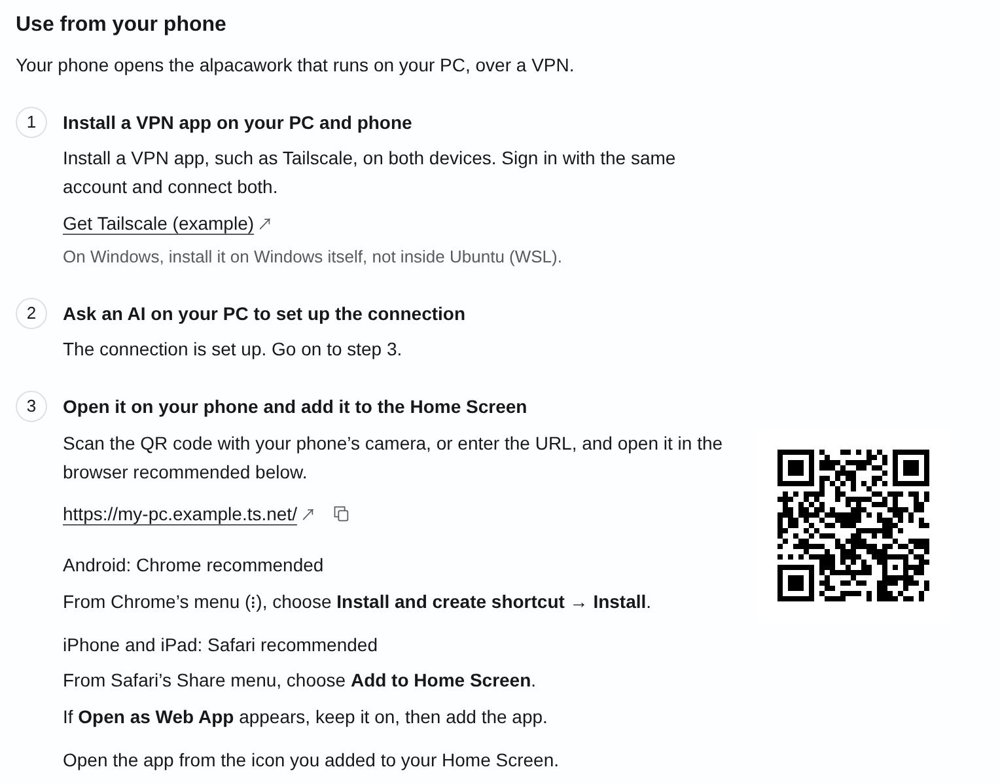
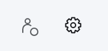

# 手机与通知

## 在手机上使用

在手机上，打开的是电脑上运行的 alpacawork 的界面。AI 在电脑上运行，所以使用期间不要让电脑休眠。

电脑和手机通过 VPN 连接。这里使用 [Tailscale](https://tailscale.com/)（个人使用免费）。

1. 在电脑和手机上安装 Tailscale，并用同一个账号登录。在 Windows 上，装在 Windows 一侧。
2. 在电脑的终端里启动 Claude Code 或 Codex，委托它“让 alpacawork 可以在手机上使用”。
3. 在电脑的界面上打开“设置（齿轮）→ 应用和手机”，用手机扫描显示的二维码。
4. 按界面上的步骤添加到主屏幕（iPhone 用 Safari，Android 用 Chrome）。

界面没有登录验证。只让你自己的设备连入 VPN，不要使用公开到互联网的设置（如 Tailscale Funnel）。设备丢失时，把它从 VPN 中移除。

想指出要改的地方时，在截图上标注后贴到输入框里，再用语音输入补充说明，能更快地传达。

## 接收通知

轮到你时（有提问、有报告、AI 停住时）会收到通知。每台要接收的设备都需要分别注册。

1. 打开“设置（齿轮）→ 个人”。
2. 在“推送通知”中按“在此设备上接收”，浏览器请求许可时，请允许。

在 iPhone 上，请从添加到主屏幕的图标打开后再操作。

正在操作 alpacawork 时不会收到通知。切换到其他应用 30 秒后，或界面开着但停止操作 5 分钟后，才开始收到。

## 停止通知

- 暂时停止：在界面右上角的人形按钮（齿轮左边）中选择“暂停 1 小时”等。

  

- 每晚停止：打开“设置（齿轮）→ 个人”中的“每日免打扰时段”。时段结束后，仍在等待的通知会合并成 1 条送达。
- 选择种类：在同一处的“通知”中，可以按通知的种类分别开关。“任务完成时”起初是关闭的。

## 无法正常使用时

- 不显示二维码：第 2 步还没做。请委托电脑上的 AI。
- 在手机上打不开：确认两边都连上了 VPN，电脑没有休眠。请使用以 `https://` 开头的 URL。
- 显示“请通过 HTTPS 打开界面”：用 `https://` 的 URL 重新打开。iPhone 请从主屏幕的图标打开。
- 收不到通知：确认没有暂停通知，那个种类也没有关闭。

## 在平时的 Claude Code 或 Codex 中使用

在平时的对话中调用 alpacawork 技能（Claude Code 用 `/alpacawork`，Codex 用 `$alpacawork`），那个对话就会成为对接窗口，可以像在界面的输入框里一样委托。
